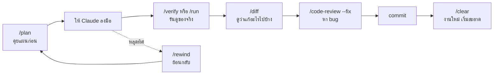

---
tags:
  - claude
  - claude-code
  - cheatsheet
type: reference
created: 2026-10-16
---

# ⌨️ Claude Code Slash Commands — มีอะไรบ้าง อะไรควรใช้ตอน vibe code

พิมพ์ `/` ในช่อง prompt เพื่อดูคำสั่ง ใช้ควบคุม Claude Code จากข้างใน session: เปลี่ยนโมเดล ล้าง context รีวิวโค้ด ย้อนกลับ ฯลฯ

**สถานะการตรวจ** 🔎 รายการคำสั่งและคำอธิบายอ่านจาก [เอกสาร Commands ทางการ](https://code.claude.com/docs/en/commands) เมื่อ 2026-10-16 (เอกสารอ้างถึงเวอร์ชันถึง v2.1.287) · 🧠 "ควรใช้ตัวไหนตอน vibe code" เป็นการจัดลำดับของผมเองจากหน้าที่ของคำสั่ง · 🌐 "ชุมชนใช้อะไร" มาจากบล็อกบุคคลที่สาม ไม่ใช่เอกสารทางการ ผมไม่ได้ตรวจซ้ำ ตัวเลขดาว GitHub เป็นค่าประมาณจากบทความรอง

> ⚠️ คำสั่งแต่ละคนเห็นไม่เหมือนกัน ขึ้นกับ platform, แผนที่สมัคร และ provider (เช่น `/desktop`, `/schedule`, `/design` ไม่โผล่ทุกเครื่อง) พิมพ์ `/help` หรือ `/` ดูของจริงในเครื่องคุณเสมอ

---

## 1. เริ่มจากภาพรวม: คำสั่งแยกตามช่วงงาน

| ช่วงงาน | ใช้ | ทำอะไร |
|---|---|---|
| เริ่มรีโปใหม่ | `/init` → `/memory` | สร้าง `CLAUDE.md` เริ่มต้น แล้วแก้ต่อ |
| เริ่มรีโปใหม่ | `/mcp`, `/permissions` | ต่อ MCP server, ตั้งกฎอนุมัติ |
| ระหว่างทำงาน | `/plan [งาน]` | เข้า plan mode ให้คิดก่อนแก้ (สลับด้วย Shift+Tab ก็ได้) |
| ระหว่างทำงาน | `/model`, `/effort` | เลือกโมเดล / ระดับการใช้เหตุผล |
| ระหว่างทำงาน | `/context`, `/compact` | ดูว่าอะไรกิน context / สรุปบทสนทนาให้โล่ง |
| ระหว่างทำงาน | `/btw [คำถาม]` | ถามข้างทางโดยไม่เพิ่มเข้าประวัติบทสนทนา |
| ก่อนส่งงาน | `/diff` | ดูสิ่งที่เปลี่ยนในโฟลเดอร์ทำงาน |
| ก่อนส่งงาน | `/code-review`, `/simplify`, `/security-review` | หา bug / ทำความสะอาดโค้ด / หาช่องโหว่ |
| ระหว่าง session | `/clear`, `/resume`, `/branch` | เริ่มใหม่ / กลับไปบทสนทนาเก่า / แตกทางลอง |
| พังแล้ว | `/rewind`, `/doctor`, `/debug` | ย้อนโค้ดและบทสนทนา / ตรวจ setup / ตรวจปัญหาตอนรัน |
| งานคู่ขนาน | `/tasks`, `/background`, `/batch` | ดูงานเบื้องหลัง / ปล่อย session รันต่อ / แตกงานใหญ่เป็นหลายหน่วย |

---

## 2. รายการเต็มตามหมวด 🔎

อาร์กิวเมนต์ `<x>` = จำเป็น, `[x]` = ไม่บังคับ ตัวที่มี alias ใส่ไว้ในวงเล็บ

### 2.1 Context และบทสนทนา

| คำสั่ง | ทำอะไร |
|---|---|
| `/clear [ชื่อ]` (`/reset`, `/new`) | เริ่มบทสนทนาใหม่ context ว่าง เก็บเก่าไว้เรียกกลับด้วย `/resume` |
| `/compact [คำสั่งโฟกัส]` | สรุปบทสนทนาให้ context โล่ง ระบุได้ว่าให้จำอะไรเป็นพิเศษ |
| `/context [all]` | แสดงตารางสีว่า context ถูกใช้ไปกับอะไร พร้อมคำแนะนำ |
| `/autocompact [auto\|ขนาด]` | ตั้งว่า context เต็มแค่ไหนถึงให้สรุปอัตโนมัติ |
| `/resume [session]` (`/continue`) | กลับไปบทสนทนาเดิม หรือเปิดตัวเลือก |
| `/branch [ชื่อ]` | แตกบทสนทนา ณ จุดนี้เพื่อลองอีกทาง เก็บของเดิมไว้ |
| `/fork [prompt]` | คัดลอกบทสนทนาไปเป็น background session แล้วทำต่อที่นี่ |
| `/subtask <งาน>` | ส่งงานข้างทางให้ subagent ที่รู้บริบททั้งหมด ผลกลับมาที่บทสนทนานี้ |
| `/rewind` (`/undo`, `/checkpoint`) | ย้อนโค้ดและ/หรือบทสนทนาไปจุดก่อนหน้า หรือสรุปจากข้อความที่เลือก |
| `/btw [คำถาม]` | ถามข้างทางโดยไม่กระทบประวัติ |
| `/recap` | สรุป session เป็นบรรทัดเดียว |
| `/rename [ชื่อ]`, `/export [ไฟล์]`, `/copy [N]` | ตั้งชื่อ session / ส่งออกเป็นข้อความ / คัดลอกคำตอบล่าสุด |

### 2.2 โหมดการทำงานและโมเดล

| คำสั่ง | ทำอะไร |
|---|---|
| `/plan [งาน]` | เข้า plan mode (อ่านอย่างเดียวจนกว่าจะอนุมัติแผน) |
| `/goal [เงื่อนไข]` | ตั้งเป้าหมาย ให้ Claude ทำต่อข้ามหลายรอบจนเข้าเงื่อนไข |
| `/model [รุ่น]` | สลับโมเดล (บันทึกเป็นค่าเริ่มต้น) |
| `/effort [ระดับ]` | `low` ถึง `xhigh`, `max` หรือ `auto` |
| `/fast [on\|off]` | เปิด/ปิด fast mode |
| `/advisor [รุ่น\|off]` | ให้โมเดลที่สองให้คำปรึกษาในจุดสำคัญ |
| `/sandbox` | เปิด/ปิด sandbox (บาง platform) |
| `/output-style [สไตล์]` | เปลี่ยนสไตล์การตอบ |

### 2.3 โค้ดและ git

| คำสั่ง | ทำอะไร |
|---|---|
| `/diff` | ดู working tree รวมสิ่งที่ Claude แก้ |
| `/code-review [ระดับ] [--fix] [--comment] [PR/branch/path]` (`/review`) | รีวิวหา bug ระดับ `low`..`max`, `--fix` ให้แก้เลย, `--comment` โพสต์ลง PR, `ultra` = รีวิวหลาย agent บน cloud |
| `/simplify [เป้าหมาย]` | ให้ 4 agent ช่วยดูโค้ดที่เปลี่ยนเรื่องใช้ซ้ำ/ทำให้เรียบง่าย/ประสิทธิภาพ **ไม่หา bug** (ใช้ `/code-review` หา bug) |
| `/security-review` | หาช่องโหว่ในการเปลี่ยนแปลงของ branch (ต้องมี `origin`) |
| `/verify` | พิสูจน์ว่าการแก้ทำงานจริงโดยรันแอป ไม่ใช่แค่ผ่านเทสต์ |
| `/run` | เปิดและขับแอปของโปรเจกต์เพื่อดูการเปลี่ยนแปลงทำงานจริง |
| `/autofix-pr [prompt]` | เปิด cloud session คอยแก้เมื่อ CI พังหรือมี review comment |
| `/batch <คำสั่ง>` | แตกงานทั้งโค้ดเบสเป็น 5–30 หน่วย ให้ subagent ทำแยก worktree |

### 2.4 งานเบื้องหลังและอัตโนมัติ

| คำสั่ง | ทำอะไร |
|---|---|
| `/tasks` (`/bashes`) | ดู/จัดการงานเบื้องหลัง |
| `/background [prompt]` (`/bg`) | ปล่อย session ไปรันเบื้องหลัง ปลดเทอร์มินัล |
| `/loop [ช่วงเวลา] [prompt]` | รัน prompt วนซ้ำขณะ session เปิด เช่น `/loop 5m check if the deploy finished` |
| `/schedule [คำอธิบาย]` (`/routines`) | สร้างงานที่รันบน cloud ตามเวลา |
| `/workflows`, `/deep-research <คำถาม>` | ดูความคืบหน้า workflow / ค้นเว็บหลายแหล่งแล้วสรุปรายงานมีอ้างอิง |
| `/remote-control` (`/rc`), `/teleport` (`/tp`), `/desktop` | ทำ session ต่อจากเครื่องอื่น / ดึง cloud session มาที่เทอร์มินัล / ไปแอป Desktop |

### 2.5 ตั้งค่า ส่วนขยาย ความจำ

| คำสั่ง | ทำอะไร |
|---|---|
| `/init` | สร้าง `CLAUDE.md` เริ่มต้น (ตั้ง `CLAUDE_CODE_NEW_INIT=1` ได้แบบ interactive ที่พาตั้ง skills/hooks ด้วย) |
| `/memory` | แก้ `CLAUDE.md` และ auto memory |
| `/permissions` (`/allowed-tools`) | จัดการกฎ allow/ask/deny |
| `/fewer-permission-prompts` | สแกนประวัติแล้วเสนอรายการ allow ที่ปลอดภัยลดการถามซ้ำ |
| `/config [key=value]` (`/settings`) | เปิดหน้าตั้งค่า หรือตั้งค่าตรง ๆ |
| `/update-config [คำขอ]` | บอกว่าอยากเปลี่ยนอะไร (เช่น เพิ่ม hook) แล้วให้ Claude แก้ `settings.json` |
| `/hooks`, `/mcp`, `/plugin`, `/skills` | ดู hooks / จัดการ MCP / จัดการ plugin / ดูรายการ skills |
| `/reload-plugins`, `/reload-skills` | โหลดของใหม่โดยไม่ต้องเริ่มใหม่ |
| `/skill-doctor` | ดูว่า skill แต่ละตัวกิน context เท่าไรและถูกใช้บ่อยแค่ไหน |
| `/add-dir <path>`, `/cd <path>` | เพิ่มโฟลเดอร์ให้เข้าถึง / ย้าย session ไปโฟลเดอร์อื่น |
| `/import [codex\|gemini\|cursor]` | ดึงคอนฟิกจากเครื่องมือเหล่านั้นมาใช้ |
| `/ide`, `/chrome`, `/statusline`, `/theme`, `/keybindings`, `/terminal-setup`, `/tui` | ตั้งค่า IDE, Chrome, status line, หน้าตา, ปุ่มลัด, เทอร์มินัล |

### 2.6 ตรวจสถานะ แก้ปัญหา บัญชี

| คำสั่ง | ทำอะไร |
|---|---|
| `/usage` (`/cost`, `/stats`) | ต้นทุน session, โควตาแผน, สถิติ |
| `/status` | เวอร์ชัน โมเดล บัญชี การเชื่อมต่อ |
| `/doctor [prompt-audit]` (`/checkup`) | ตรวจ setup แล้วเสนอแก้ (หลังยืนยัน) |
| `/debug [อาการ]` | เปิด debug log แล้วช่วยวิเคราะห์ |
| `/insights` | รายงาน HTML วิเคราะห์การใช้งานช่วงหลัง |
| `/powerup` | บทเรียนโต้ตอบสั้น ๆ สอนฟีเจอร์ |
| `/help`, `/release-notes`, `/feedback`, `/bug` (`/share`) | ช่วยเหลือ / ดู changelog / ส่ง feedback |
| `/login`, `/logout`, `/upgrade`, `/usage-credits`, `/rate-limit-options` | บัญชีและโควตา |
| `/exit` (`/quit`) | ออก |

### 2.7 งานออกแบบและ artifact (มีเฉพาะบางบัญชี/provider)

`/design`, `/design-sync`, `/slides`, `/artifacts`, `/dataviz` — สร้าง UI mockup / สไลด์ / ชาร์ต เป็น artifact (ต้องบัญชีที่รองรับ ไม่มีบน Bedrock, Vertex ฯลฯ)

### 2.8 คำสั่งที่ถูกถอดแล้ว (ระวังบทความเก่า)

`/pr-comments` (ถอด v2.1.91, ให้ถาม Claude ตรง ๆ), `/vim` (ถอด v2.1.92, ใช้ `/config` → Editor mode), `/ultraplan` (ถอด, ใช้ plan mode แทน) · `/review` เคยเป็นคำสั่งแยก ตอนนี้เป็น alias ของ `/code-review`

---

## 3. ควรใช้ตัวไหนตอน vibe code 🧠

หลักคิด: vibe code = สั่งด้วยภาษาธรรมชาติ แล้วอยู่กับผลลัพธ์ จุดเสี่ยงคือ **Claude หลุดทิศ**, **context เน่า**, **ไม่รู้ว่าโค้ดทำงานจริงไหม** — คำสั่งที่ควรจำคือตัวที่แก้สามเรื่องนี้



### ใช้ทุกวัน (เรียนก่อน)

| คำสั่ง | ทำไมสำคัญกับสาย vibe |
|---|---|
| `/plan` | งานที่คลุมเครือหรือแตะหลายไฟล์ ให้ตกลงแผนก่อนแก้ ถูกกว่าแก้ทิ้งทีหลัง |
| `/rewind` | ปุ่ม undo ของทั้งโค้ดและบทสนทนา ทำให้กล้าลองโดยไม่กลัวพัง |
| `/diff` | ตรวจว่า Claude แตะอะไรบ้างก่อน commit |
| `/clear` | เปลี่ยนงานแล้วเริ่มใหม่ ไม่ลาก context เก่าไปปนกัน |
| `/compact [โฟกัส]` | งานเดิมที่ยาว ย่อก่อนเต็ม บอกให้จำสิ่งสำคัญ |
| `/context` | ดูว่า context เต็มเพราะอะไร ก่อนตัดสินใจ `/compact` หรือ `/clear` |
| `/init` + `/memory` | ทำครั้งเดียวต่อรีโป ให้ Claude รู้กฎโปรเจกต์ |
| `/resume` | กลับไปบทสนทนาเมื่อวาน |
| `/model`, `/effort`, `/usage` | คุมคุณภาพ/ความเร็ว/ค่าใช้จ่าย |

### ใช้เป็นช่วง ๆ

| คำสั่ง | ใช้เมื่อ |
|---|---|
| `/verify`, `/run` | อยากเห็นว่าแอปทำงานจริง ไม่ใช่แค่เทสต์ผ่าน (ถ้าเทสต์ไม่ครอบคลุม ตัวนี้ช่วยมาก) |
| `/code-review [ระดับ] --fix` | ก่อน commit ก้อนใหญ่ |
| `/simplify` | หลังได้ฟีเจอร์ทำงานแล้ว อยากเก็บกวาด (ไม่หา bug) |
| `/security-review` | แตะ auth, input จากผู้ใช้, ไฟล์/คำสั่ง |
| `/goal <เงื่อนไข>` | งานยาวที่รู้ชัดว่าเสร็จเมื่อไร เช่น "เทสต์ผ่านทั้งหมด" |
| `/btw` | สงสัยข้างทางโดยไม่อยากรก context |
| `/branch` | อยากลองอีกแนวโดยเก็บของเดิมไว้ |
| `/fewer-permission-prompts` | ถูกถามขออนุญาตบ่อยจนรำคาญ |

### งานใหญ่/ขั้นสูง (รู้ไว้ก่อน)

`/batch` (ย้ายโค้ดเบสทั้งหมด), `/loop` และ `/schedule` (งานเป็นรอบ), `/background`, `/fork`, `/subtask` (ขนาน), `/autofix-pr` (ให้ cloud คอยแก้ CI), `/deep-research` (ค้นคว้าพร้อมอ้างอิง), `/import` (ย้ายมาจาก Cursor/Codex/Gemini)

---

## 4. ชุมชนแนะนำอะไร 🌐

บล็อกที่อ่านเห็นตรงกัน (ไม่ใช่เอกสารทางการ):

- **แกนหลักเหมือนกันทุกที่:** `/compact` กลางงาน, `/clear` ตอนเปลี่ยนงาน, `/rewind` เวลาพลาด, `/init` ครั้งเดียวต่อรีโป, `/plan` ก่อนแก้ ตามด้วย `/diff` และ `/review` ก่อน commit และดู `/cost` เป็นระยะ ([สรุปจากผลค้นหา](https://aifordevelopers.substack.com/p/claude-code-slash-commands-guide))
- **DataCamp** ([บทความ](https://www.datacamp.com/tutorial/claude-code-slash-commands), 2026-06): ให้เรียน `/compact`, `/plan`, `/cost` ก่อน แล้วเพิ่ม `/diff` และ `/goal` · แนะนำ compact ก่อน context เกิน ~80% พร้อมบอกว่าให้จำอะไร · `/plan` เหมาะกับโค้ดที่ไม่คุ้น แก้หลายไฟล์ หรือคำสั่งคลุมเครือ
- **สร้างคำสั่งของตัวเอง:** เมื่อพิมพ์ prompt เดิมซ้ำ ๆ ให้เก็บเป็นไฟล์ — แบบเก่าคือ `.claude/commands/ชื่อ.md` (`$ARGUMENTS` รับข้อความท้ายคำสั่ง) แต่ DataCamp ระบุว่าแบบแนะนำตอนนี้คือ skill ที่ `.claude/skills/<ชื่อ>/SKILL.md` ดู [[Claude Agent Skills]]
- **Skill pack ที่คนพูดถึงมาก:** *Superpowers* (obra/superpowers) ชูการบังคับ TDD และมีคำสั่งอย่าง `/superpowers:brainstorm`, `/superpowers:write-plan`, `/superpowers:execute-plan` (ประมาณ 29k ดาว ม.ค. 2026 ตามบทความรอง) · มีตัวห่อ GitHub *Spec-Kit* เป็น workflow 7 ขั้นแบบ spec-driven · รายการรวม skill เช่น *awesome-claude-skills* ติดตั้ง plugin ผ่าน `/plugin`
- **ข้อควรระวัง:** pack ของชุมชนเป็นโค้ดที่สั่ง Claude ให้ทำงาน อ่าน README และเนื้อ skill ก่อนติดตั้ง และผมยังไม่ได้ลองตัวใดเลย

---

## 5. แนวทางการเริ่มศึกษา

1. **เริ่มต้น:** เข้าใจว่า context คือกระดาษทดจำกัด แล้วจำ 4 ตัว `/clear` `/compact` `/context` `/rewind`
2. **ลงมือทำจริง:** ทำโปรเจกต์เล็กหนึ่งตัวตามวงจรในหัวข้อ 3: `/init` → `/plan` → ลงมือ → `/verify` → `/diff` → `/code-review --fix` → commit ลองพังตั้งใจแล้วใช้ `/rewind` กู้
3. **ใช้งานได้คล่อง:** ทำ prompt ที่ซ้ำเป็น skill ของตัวเอง, ลด permission prompt ด้วย `/fewer-permission-prompts`, ตั้ง hook ([[Claude Code Hooks]]), ใช้ `/usage` และ `/skill-doctor` คุมต้นทุน, ลอง `/goal` และ `/batch` กับงานที่ผลตรวจสอบได้ชัด

---

## กับดัก

- **ใช้ `/clear` ทั้งที่ยังทำงานเดิม** — Claude ลืมบริบทหมด ถ้าอยากโล่งแต่ทำต่อให้ใช้ `/compact` (เรียกบทสนทนาเก่ากลับด้วย `/resume`)
- **เชื่อบทความเก่า** — `/pr-comments`, `/vim`, `/ultraplan` ถูกถอดแล้ว และ `/review` เปลี่ยนความหมาย
- **ใช้ `/simplify` หวังจับ bug** — มันไม่หา bug ให้ใช้ `/code-review`
- **คิดว่าเทสต์ผ่าน = ใช้งานได้** — `/verify` มีไว้เพราะเทสต์ผ่านแต่แอปพังเกิดบ่อย
- **ติดตั้ง skill pack โดยไม่อ่าน** — มันคือคำสั่งที่ Claude จะทำตาม
- **พิมพ์คำสั่งกลางข้อความ** — รู้จักเฉพาะตอนอยู่ต้นข้อความ ข้อความที่ตามมากลายเป็นอาร์กิวเมนต์

## Cheat sheet

```
เริ่มรีโป   /init  /memory  /mcp  /permissions
ระหว่างงาน  /plan  /model  /effort  /context  /compact  /btw
ตรวจงาน     /verify  /diff  /code-review --fix  /simplify  /security-review
ย้อน/ต่อ    /rewind  /resume  /branch  /clear
คุมต้นทุน   /usage  /skill-doctor
ขนาน/ใหญ่   /batch  /loop  /background  /goal
```

## 🔗 เกี่ยวข้อง

- [[Claude Code Best Practices]] — verification loop, plan mode, จัดการ session
- [[Claude Code Hooks]] — สั่งงานอัตโนมัติที่จุดต่าง ๆ
- [[Claude Agent Skills]] — skill คืออะไร สร้างคำสั่งของตัวเอง
- [[Claude Code Auto Mode]] — ลด permission prompt อีกทาง
- [[Claude Agent Lifecycle]] — context window และ agentic loop
- [[Claude]]

## 📖 แหล่งอ้างอิง

- [Claude Code — Commands](https://code.claude.com/docs/en/commands) (ทางการ)
- [DataCamp — Claude Code slash commands](https://www.datacamp.com/tutorial/claude-code-slash-commands)
- [AI for Developers — Slash Commands Guide](https://aifordevelopers.substack.com/p/claude-code-slash-commands-guide)
- [heyuan110 — Claude Code Skills Top 20](https://www.heyuan110.com/posts/ai/2026-01-20-claude-code-skills-top20/)
