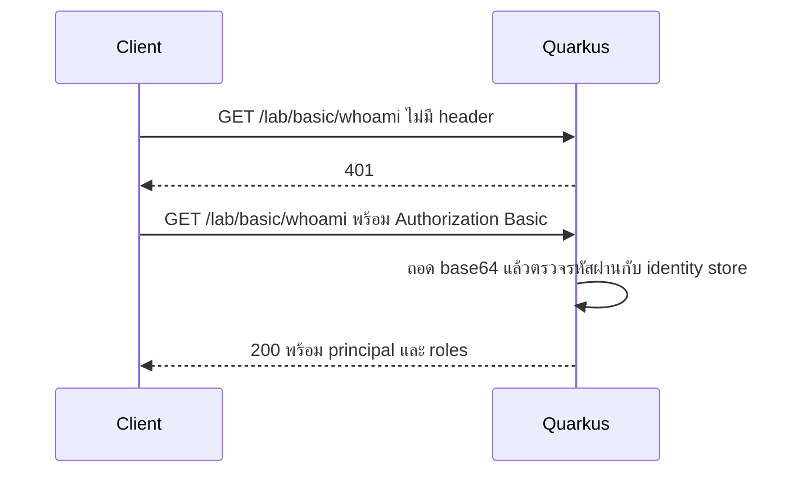
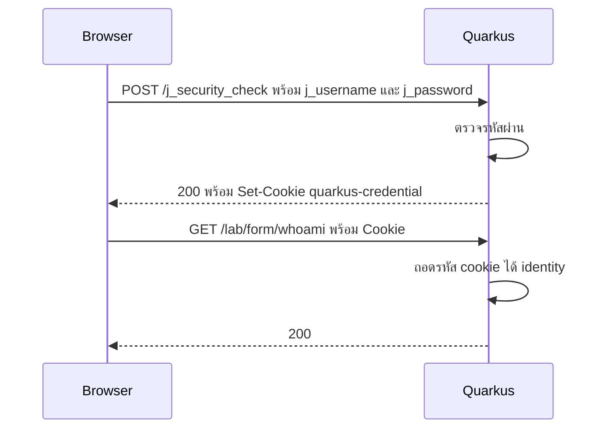
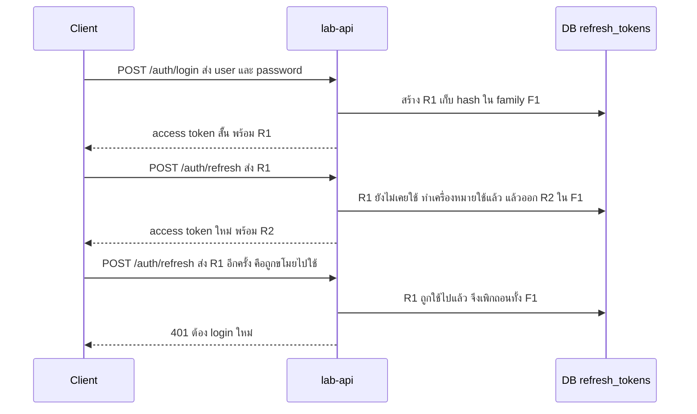
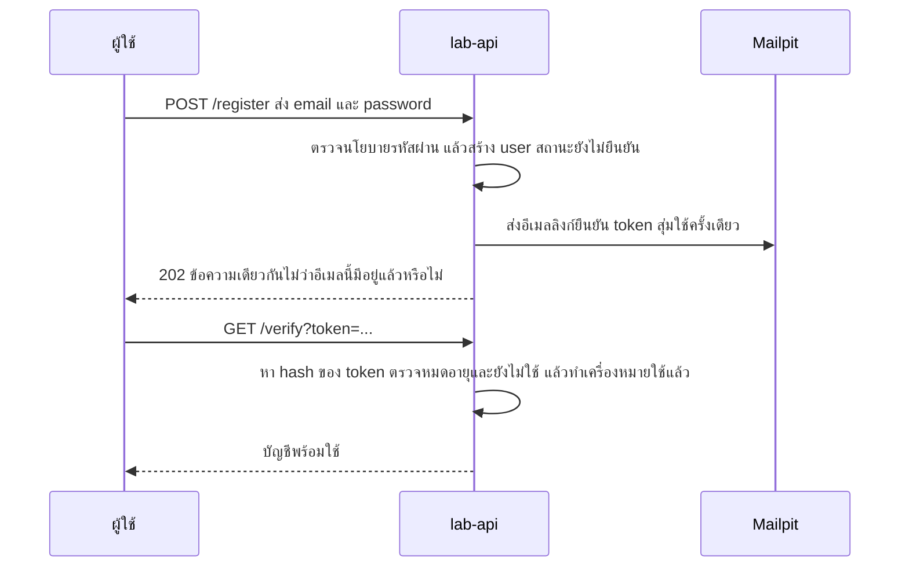
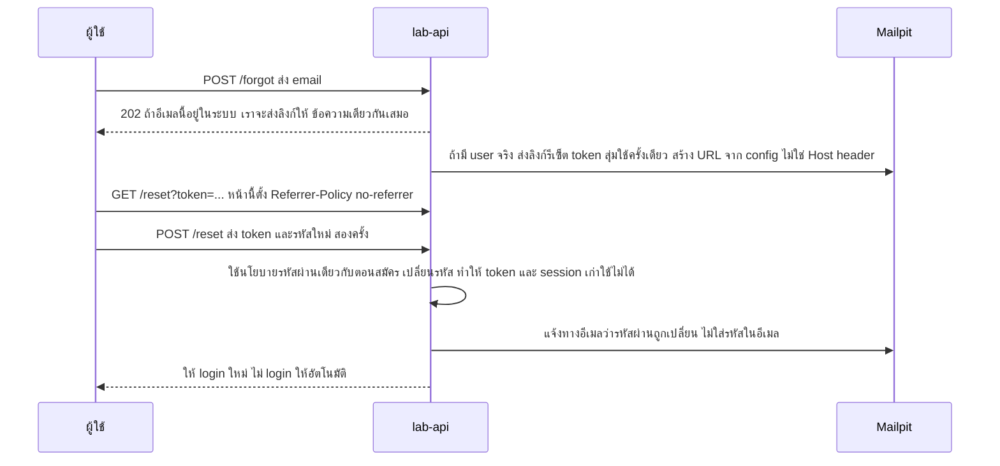

---
tags:
  - spec
  - security
  - auth
  - quarkus
type: spec
status: draft
parent: "[[Auth Flows Lab]]"
created: 2026-10-15
updated: 2026-10-16
---

# 🔑 Auth Flow Spec 1 — Own Accounts (ทำ auth เอง)

ส่วนที่ 1 ของ [[Auth Flow Spec]] — ตระกูลที่ **บัญชีผู้ใช้อยู่ในระบบเรา และเราตรวจ credential เอง** ง่ายที่สุดที่จะเริ่ม แต่เป็นตระกูลที่พลาดแล้วเจ็บที่สุด (ต้องเก็บรหัสผ่าน ทำ reset ทำ rate limit เองทั้งหมด) ถ้าไม่มีเหตุผลต้องทำเอง ให้ไปตระกูล [[Auth Flow Spec 2 — OAuth OIDC]] ที่ให้ IdP ทำแทน — ส่วนนี้มีไว้เพื่อ **เข้าใจว่า IdP ทำอะไรแทนเราบ้าง**

> **ผลรันจริงในส่วนนี้ (▶️)** ได้จาก Quarkus 3.33.4 (LTS) + JDK 21 (ยกเว้นเวลา hash ใน A7.5 กับเวกเตอร์ของ RFC ที่รันด้วย Java 21 + BouncyCastle ล้วนๆ) มี 4 extension: `quarkus-rest-jackson`, `quarkus-smallrye-jwt`, `quarkus-smallrye-jwt-build`, `quarkus-elytron-security-properties-file` — startup log ยืนยัน features: `cdi, rest, rest-jackson, security, security-properties-file, smallrye-context-propagation, smallrye-jwt, vertx` ทุก flow อยู่ในแอปเดียว คนละ path ตามที่ตั้งใน [[Auth Flow Spec]] ข้อ 5.1

---

## A1 — HTTP Basic

**คืออะไร** client ส่ง `Authorization: Basic <base64(user:password)>` ทุก request ไม่มี session ฝั่ง server ถ้าไม่มี/ผิด server ตอบ `401` + `WWW-Authenticate: Basic realm="..."` (RFC 7617 🧠) — base64 เป็นแค่การแปลงตัวอักษร ไม่ใช่การเข้ารหัสลับ ▶️ `printf 'alice:alice' | base64` ได้ `YWxpY2U6YWxpY2U=` ถอดกลับได้ทันที จึงต้องวิ่งบน HTTPS เสมอ

**ใช้เมื่อ** เครื่องมือภายใน, bootstrap ตอนตั้งระบบ, service ภายในที่มี TLS **ไม่ใช้เมื่อ** แอปผู้ใช้ทั่วไป — ส่งรหัสผ่านจริงทุก request, ไม่มี logout, ไม่มี MFA, เปิดทางให้ brute force



**ต้องสร้าง** ฝั่ง server: identity store (user + hash ของรหัสผ่าน), เปิด mechanism, policy ต่อ path · ฝั่ง client: ส่ง header, ห้าม log header นี้

**ใช้อะไร (Quarkus)**

- `quarkus.http.auth.basic=true` — ▶️ **ต้องตั้งเองเมื่อมี mechanism อื่นเปิดอยู่** ไม่งั้น Basic ไม่ทำงานเงียบๆ (ดูผลรันด้านล่าง)
- identity store เลือกอย่างใดอย่างหนึ่ง 🔎:
  - `quarkus-elytron-security-properties-file` — user ใน config (`quarkus.security.users.embedded.enabled=true`, `...plain-text=true`) เอกสารเตือนว่า **เหมาะกับทดสอบเท่านั้น**
  - `quarkus-security-jpa` (และ `-jpa-reactive`) — entity ติด `@UserDefinition` / `@Username` / `@Password` / `@Roles` ค่า default เก็บรหัสผ่านเป็น **bcrypt แบบ MCF** (algorithm, cost, salt อยู่ในสตริงเดียว) ตอนสมัครเรียก `BcryptUtil.bcryptHash(password)` (cost default 10, salt สุ่ม)
  - `quarkus-security-jdbc`, `quarkus-elytron-security-ldap` (มีคู่มือแยก — LDAP ดู C4)
- เลือก mechanism ต่อ path: `quarkus.http.auth.permission.basic.auth-mechanism=basic` 🔎 ▶️ · priority default ของ Basic คือ 2000 สูงกว่า mechanism ในตัวอื่น 🔎

**ต้องกัน** TLS เท่านั้น · rate limit ต่อบัญชี · ไม่ log `Authorization` (ใน [[Quarkus REST Client]] ต้องตั้ง `masked-headers`) · ห้ามใช้ plain-text store นอกการทดสอบ

**ผลรันจริง ▶️**

| ส่งอะไร | ผล |
|---|---|
| ไม่ส่ง credential | 401 **ไม่มี** `WWW-Authenticate` ในชุด config นี้ที่เปิดหลาย mechanism พร้อมกัน (ไม่ได้สืบสาเหตุ — ผลคือ browser จะไม่เด้งกล่องถามรหัส) |
| `alice:wrong` | 401 + `www-authenticate: basic` |
| `alice:alice` | 200 `{"mechanism":"basic","principal":"alice","roles":["user"]}` |
| `bob:bob` | 200 roles `admin`, `user` |
| ส่ง Basic ที่ถูกต้องไปที่ path ของ JWT | 401 + `www-authenticate: Bearer` |
| **ก่อนใส่ `quarkus.http.auth.basic=true`**: `alice:alice` | **401 ทั้งที่รหัสถูก** (มี form + JWT + mechanism ที่เขียนเองเปิดอยู่) |

**สถานะการตรวจ** 🔎 Quarkus authentication mechanisms, security-jpa · ▶️ ตารางด้านบน · 🧠 รูปแบบ header ของ RFC 7617

---

## A2 — HTTP Digest

**คืออะไร** (RFC 7616 🧠) ปรับปรุง Basic ให้ไม่ส่งรหัสผ่านตรงๆ: server ส่ง `nonce` มา client ส่ง hash ของ (user, realm, password, nonce, ...) กลับไป ทำให้ดักได้แค่ hash ที่ใช้ได้กับ nonce นั้น — แต่ server ต้องเก็บ password หรือค่าที่เทียบเท่า (HA1) แบบที่คำนวณกลับเป็นสิ่งที่ใช้ตรวจได้ ซึ่งขัดกับหลัก "เก็บเฉพาะ hash ช้าๆ ของรหัสผ่าน" และเมื่อทุกอย่างวิ่งบน TLS หมดแล้วข้อดีก็หายไป

**ข้อสรุป** อ่านให้รู้จักไว้ ไม่ต้องสร้าง — Bruno มี Digest เป็น auth mode ไว้ยิงทดสอบ API เก่า 🔎 ส่วน Quarkus ไม่อยู่ในรายการ mechanism ในตัว (overview ระบุ Basic, form, mTLS เป็นตัวในตัว) 🔎

---

## A3 — Form login + session cookie

**คืออะไร** ผู้ใช้กรอกรหัสผ่านครั้งเดียว server ตรวจแล้วออก **cookie** ให้ browser แนบมาเองทุก request ผู้ใช้ไม่ต้องส่งรหัสผ่านซ้ำ



### ออกแบบได้สองแบบ

| | cookie เข้ารหัส (Quarkus form auth) | session id + ตารางฝั่ง server |
|---|---|---|
| state อยู่ที่ | ใน cookie เอง (เอกสาร: เข้ารหัสและเก็บฝั่ง client ไม่ใช่ HTTP session 🔎) | แถวในตาราง `sessions` (หรือ Redis) |
| เพิกถอนก่อนหมดอายุ | ทำไม่ได้ เพราะไม่มี state ให้ลบ (อนุมานจากข้อบนยังไม่ได้ทดสอบ) | ลบแถวเดียวจบ |
| แสดงรายการ session / บังคับ logout ทุกเครื่อง | ทำไม่ได้ | ทำได้ |
| scale | ง่ายมาก ไม่ต้องมี store กลาง | ต้องมี store กลางที่เร็ว |
| งานที่ต้องเขียน | แทบไม่มี | `HttpAuthenticationMechanism` + `IdentityProvider` เอง (แพทเทิร์นเดียวกับ A4) |

### ใช้ form auth ของ Quarkus 🔎 ▶️

```properties
quarkus.http.auth.form.enabled=true
quarkus.http.auth.session.encryption-key=<16 ตัวอักษรขึ้นไป>   # key ถูก hash ด้วย SHA-256 แล้วใช้ AES-256 เข้ารหัส cookie
quarkus.http.auth.form.login-page=      # ตั้งว่างเมื่อเป็น SPA จะได้ 401 แทนที่จะ redirect
quarkus.http.auth.form.error-page=
quarkus.http.auth.form.landing-page=
quarkus.http.auth.form.http-only-cookie=true   # default คือ false (ดูผลรัน)
```

ค่า default ที่เอกสารระบุ 🔎: POST ไปที่ `/j_security_check` ด้วยฟิลด์ `j_username`, `j_password` · cookie ชื่อ `quarkus-credential` · idle timeout `30M` · ต่ออายุ cookie ทุก `1M` · `cookie-same-site` = `strict` · `cookie-max-age` ไม่ตั้ง (หายเมื่อปิด browser) · `http-only-cookie` = `false`

**ผลรันจริง ▶️**

| ส่งอะไร | ผล |
|---|---|
| รหัสผิด | 401 |
| รหัสถูก | 200 + `set-cookie: quarkus-credential=<ประมาณ 64 ตัวอักษร>; Path=/; SameSite=Strict` — **ไม่มี `HttpOnly`** (JS อ่านได้ ถ้ามี XSS ก็ขโมยได้) และไม่มี `Secure` (รันบน HTTP — ยังไม่ได้ลองบน HTTPS ว่า Quarkus เติมให้เองไหม ต้องตรวจก่อนขึ้นจริง) |
| ส่ง cookie ไป `/lab/form/whoami` | 200 `{"mechanism":"form","principal":"alice","roles":["user"]}` |
| ไม่มี cookie (ตั้ง login-page ว่าง) | 401 ไม่ redirect |
| ส่ง cookie ของ form ไปที่ path ของ JWT | 401 |

### ทำ session ฝั่ง server เอง (เมื่ออยากเพิกถอนได้) — ข้อกำหนดจาก OWASP 🔎

- **session id**: สุ่มด้วย CSPRNG ≥ 128 bit (OWASP ขั้นต่ำ 64 bit ของ entropy, แนะนำ 128 ถ้าสร้างเอง) ไม่มีความหมายในตัว ไม่ใส่ข้อมูลส่วนตัว ตั้งชื่อ cookie ให้ไม่บอก framework
- **เก็บ hash ของ id** ไม่เก็บตัวจริง (กันกรณีอ่าน DB ได้อย่างเดียว) เทียบแบบ constant-time
- **cookie**: `Secure; HttpOnly; SameSite=Strict` (หรือ `Lax`) + prefix `__Host-` (บังคับ `Secure`, `Path=/`, ห้ามมี `Domain`) ตัวอย่าง `Set-Cookie: __Host-SessionID=<ค่า>; Secure; HttpOnly; SameSite=Strict; Path=/`
- **สร้าง id ใหม่** ทุกครั้งหลัง login และเมื่อสิทธิ์เปลี่ยน (กัน session fixation) แล้วทำลายตัวเก่า
- **timeout ฝั่ง server**: idle 2–5 นาที (มูลค่าสูง) / 15–30 นาที (เสี่ยงต่ำ), absolute ตัวอย่าง 4–8 ชม.
- **logout** = ลบ session ฝั่ง server + ล้าง cookie (ลบแค่ cookie ไม่ทำให้ id ที่ถูกขโมยไปใช้ไม่ได้)
- ให้ผู้ใช้ **ดูและเพิกถอน session** ของตัวเองได้ และแจ้งเตือนเมื่อมี login ซ้อน
- ห้ามใส่ session id ใน URL; ตอบ `Cache-Control: no-store` สำหรับหน้าที่มีข้อมูล session

### CSRF — ตามมากับ cookie เสมอ

cookie ถูก browser แนบให้เองแม้คำขอมาจากเว็บอื่น → ต้องมีตัวกัน `SameSite` เป็นแค่ชั้นเสริมไม่ใช่ตัวแทน (OWASP 🔎) Quarkus มี `quarkus-rest-csrf` แบบ double-submit cookie 🔎:

| ค่า | default |
|---|---|
| `quarkus.rest-csrf.cookie-name` / `form-field-name` | `csrf-token` |
| `quarkus.rest-csrf.token-header-name` | `X-CSRF-TOKEN` |
| `quarkus.rest-csrf.cookie-http-only` | `true` (ถ้า JS ต้องอ่าน cookie เพื่อคัดลอกไป header ต้องตั้ง `false`) |
| `quarkus.rest-csrf.require-form-url-encoded` | `true` (ตั้ง `false` เพื่อให้ตรวจ request แบบ JSON) |
| `quarkus.rest-csrf.token-signature-key` | ไม่ตั้ง (ตั้งแล้วต้อง ≥ 32 ตัวอักษร จะเซ็น token ด้วย HMAC) |

ทางเลือกที่ไม่ต้องมี cookie เพิ่ม: ให้ CORS filter ตรวจ `Origin` (เอกสาร Quarkus พูดถึง) 🔎 · เรื่อง CORS ของ Angular + Quarkus ดู [[Quarkus Keycloak]] ข้อ 4

**ใช้เมื่อ** เว็บ server-rendered, SPA ที่ same-site, ต้องเพิกถอนทันที **ไม่ใช้เมื่อ** client เป็นบุคคลที่สามหรือ API ล้วน (ไม่มี cookie jar)

**สถานะการตรวจ** 🔎 Quarkus authentication mechanisms (ค่า default ของ form), OWASP Session Management, Quarkus CSRF prevention · ▶️ ตารางผลรัน · 🧠 ข้อเปรียบเทียบ "เพิกถอนไม่ได้" ของ cookie เข้ารหัส

---

## A4 — API key

**คืออะไร** secret ที่ระบุ **แอป/ลูกค้า** (ไม่ใช่ตัวคน) ส่งใน header เช่น `X-API-Key` เหมาะกับ developer API และ service ที่ยังไม่มี IdP

**ออกแบบ key**

| เรื่อง | ข้อเสนอ |
|---|---|
| รูปแบบ | `prefix_random` เช่น `lab_live_<32 ไบต์สุ่ม base64url>` — prefix บอกสภาพแวดล้อม/ชนิด และช่วยให้ support หา key เจอโดยไม่ต้องเก็บตัวจริง |
| แสดงตอนสร้าง | ครั้งเดียว หลังจากนั้นเห็นแค่ prefix |
| เก็บ | **เก็บ hash** (SHA-256 พอ เพราะ key สุ่ม entropy สูง ต่างจากรหัสผ่านที่คนตั้งเองซึ่งต้อง Argon2id) |
| ส่ง | header เท่านั้น ห้าม query string (รั่วผ่าน log, history, Referer) |
| ขอบเขต | ผูก scope ต่อ key, อายุ/วันหมดอายุ, `last_used_at` |
| หมุนเวียน | ให้มี key active ได้ 2 ตัวช่วงเปลี่ยน แล้วเพิกถอนตัวเก่า |
| จำกัด | rate limit / quota ต่อ key |

**โค้ดที่รันจริง ▶️ (Quarkus 3.33.4)** — เขียนเอง 4 ชิ้น จัดให้ส่วนที่ต้องแตะ `Uni` เหลือน้อยที่สุด ส่วนตรรกะจริงเป็น Java ธรรมดา อ่านได้แม้ยังไม่เคยเขียน reactive (รันซ้ำใน lab เล็กที่มีแค่ `quarkus-rest` + `quarkus-security` เมื่อ 2026-10-16)

**อ่าน `Uni` ใน 1 นาที (ถ้ายังไม่เคยเขียน reactive)**

Quarkus ตรวจ auth บน *event loop* — thread I/O ของ Vert.x ที่มีน้อยและแบ่งกันใช้หลาย request (ใน log ชื่อ `vert.x-eventloop-thread-N`) ถ้า thread นี้ค้างรอ DB หรือ HTTP งานอื่นบน thread เดียวกันก็ขยับไม่ได้ 🔎 เพราะอย่างนี้ interface ของ mechanism กับ `IdentityProvider` จึงให้คืน `Uni<T>` แทน `T` — นึกภาพเป็น "กล่องที่ใส่ผลลัพธ์ T ซึ่งจะมาทีหลัง" (คล้าย `CompletableFuture<T>` แบบหลวม ๆ) Quarkus เป็นคนรอรับกล่องให้เอง งานของเราคือ **ส่งกล่องกลับไป ไม่ต้องเปิดกล่อง** ท่าที่ใช้ในโค้ดนี้มีแค่ 4 ท่า:

| ท่า | แปลว่า | อยู่ที่ไหน |
|---|---|---|
| `Uni.createFrom().item(x)` | "มีคำตอบแล้ว คือ x" — ห่อค่าธรรมดาเป็น `Uni` | `getChallenge`, `getCredentialTransport` |
| `Uni.createFrom().nullItem()` | "ไม่มีคำตอบ ไม่ใช่เรื่องของฉัน" | `authenticate` ของ mechanism ตอนไม่มี key |
| `return idp.authenticate(...)` | "ส่งต่อให้ IdentityProvider" แล้ว return ผลของมันกลับไปตรง ๆ | `authenticate` ของ mechanism |
| `return context.runBlocking(() -> { ... })` | "รันโค้ด blocking ธรรมดาใน `{ }` บน worker thread" — `return` ในนั้น = ผ่าน, `throw` = ปฏิเสธ | `authenticate` ของ IdentityProvider |

กฎมี 3 ข้อ: **(1)** คืน `Uni` กลับไปเลย อย่าแกะค่าออกมา **(2)** งานที่ต้องรอ — query DB, เรียก API ข้างนอก, hash ช้าอย่าง bcrypt/Argon2 (ตาราง A7.5: 70–355 ms ต่อครั้ง) — ต้องอยู่ใน `runBlocking` **(3)** ห้ามเรียก `.await()` ในสองคลาสนี้ ผลลองจริงของข้อ 2 และ 3 อยู่ในตาราง "กับดักของคนที่ยังไม่เคยเขียน reactive" ถัดจากผลรัน

**① `ApiKeyMechanism` — ด่านหน้า อ่าน header แล้วส่งต่อ**

```java
import io.quarkus.security.identity.IdentityProviderManager;
import io.quarkus.security.identity.SecurityIdentity;
import io.quarkus.security.identity.request.AuthenticationRequest;
import io.quarkus.vertx.http.runtime.security.ChallengeData;
import io.quarkus.vertx.http.runtime.security.HttpAuthenticationMechanism;
import io.quarkus.vertx.http.runtime.security.HttpCredentialTransport;
import io.smallrye.mutiny.Uni;
import io.vertx.ext.web.RoutingContext;
import jakarta.enterprise.context.ApplicationScoped;
import java.util.Set;

@ApplicationScoped
public class ApiKeyMechanism implements HttpAuthenticationMechanism {
    static final String HEADER = "X-API-Key";

    // รันบน event loop — อ่าน header แล้วส่งต่ออย่างเดียว ห้ามตรวจ key หรือเรียก DB ที่นี่
    @Override
    public Uni<SecurityIdentity> authenticate(RoutingContext context, IdentityProviderManager idp) {
        String key = context.request().getHeader(HEADER);
        if (key == null || key.isBlank()) {
            return Uni.createFrom().nullItem();
            // ไม่มี key → ไม่ใช่เรื่องของ mechanism นี้ (path ที่ต้อง login จะได้ 401)
        }
        return idp.authenticate(new ApiKeyRequest(key));
        // ส่งต่อให้ ApiKeyIdentityProvider แล้ว return ผลกลับไปตรง ๆ
    }

    // หน้าตาของ 401 ที่ตอบกลับ
    @Override
    public Uni<ChallengeData> getChallenge(RoutingContext context) {
        return Uni.createFrom().item(new ChallengeData(401, "WWW-Authenticate", "ApiKey header=\"" + HEADER + "\""));
    }

    // สองเมธอดล่างนี้ประกาศว่า mechanism นี้สร้าง request ชนิดไหน และ credential มาทาง header ไหน — เขียนครั้งเดียว
    @Override
    public Set<Class<? extends AuthenticationRequest>> getCredentialTypes() {
        return Set.of(ApiKeyRequest.class);
    }

    @Override
    public Uni<HttpCredentialTransport> getCredentialTransport(RoutingContext context) {
        return Uni.createFrom().item(new HttpCredentialTransport(HttpCredentialTransport.Type.OTHER_HEADER, HEADER));
    }
}
```

**② `ApiKeyRequest` — ซองใส่ key ที่ส่งจาก mechanism ไปให้ provider (Java ธรรมดา)**

```java
import io.quarkus.security.identity.request.BaseAuthenticationRequest;

public class ApiKeyRequest extends BaseAuthenticationRequest {
    private final String key;
    public ApiKeyRequest(String key) { this.key = key; }
    public String key() { return key; }
}
```

**③ `ApiKeyIdentityProvider` — ตัวตัดสิน ตรวจ key แล้วสร้างตัวตน (งานที่ block ได้ใส่ใน `runBlocking`)**

```java
import io.quarkus.security.AuthenticationFailedException;
import io.quarkus.security.identity.AuthenticationRequestContext;
import io.quarkus.security.identity.IdentityProvider;
import io.quarkus.security.identity.SecurityIdentity;
import io.quarkus.security.runtime.QuarkusPrincipal;
import io.quarkus.security.runtime.QuarkusSecurityIdentity;
import io.smallrye.mutiny.Uni;
import jakarta.enterprise.context.ApplicationScoped;
import jakarta.inject.Inject;

@ApplicationScoped
public class ApiKeyIdentityProvider implements IdentityProvider<ApiKeyRequest> {

    @Inject
    ApiKeyStore store;   // ที่เก็บ key เป็น Java ธรรมดา (ชิ้น ④)

    @Override
    public Class<ApiKeyRequest> getRequestType() {
        return ApiKeyRequest.class;
    }

    @Override
    public Uni<SecurityIdentity> authenticate(ApiKeyRequest request, AuthenticationRequestContext context) {
        return context.runBlocking(() -> {   // ← ใน { } นี้เขียน Java แบบ blocking ได้ตามปกติ (รันบน worker thread)
            String client = store.findClientByKeyHash(ApiKeyStore.sha256Hex(request.key()));
            if (client == null) {
                throw new AuthenticationFailedException();   // ← throw ธรรมดา = ปฏิเสธ (ผลคือ 401)
            }
            return QuarkusSecurityIdentity.builder()         // ← return ธรรมดา = ผ่าน
                    .setPrincipal(new QuarkusPrincipal(client))
                    .addRole("service")
                    .build();
        });
    }
}
```

**④ `ApiKeyStore` — ที่เก็บ key (Java ธรรมดา ไม่มี `Uni` เลย)**

```java
import jakarta.enterprise.context.ApplicationScoped;
import java.nio.charset.StandardCharsets;
import java.security.MessageDigest;
import java.security.NoSuchAlgorithmException;
import java.util.HexFormat;
import java.util.Map;

@ApplicationScoped
public class ApiKeyStore {
    // เก็บเฉพาะ hash ของ key — lab ใช้ Map ในหน่วยความจำ โปรเจกต์จริงเปลี่ยนเป็น query ตาราง api_keys (A7.7) ที่ method เดียวนี้
    private final Map<String, String> hashToClient =
            Map.of(sha256Hex("lab_live_abc123"), "billing-service");

    // คืนชื่อ client ถ้าเจอ, null ถ้าไม่เจอ — query DB แบบ blocking ที่นี่ได้ เพราะถูกเรียกจากใน runBlocking
    public String findClientByKeyHash(String keyHash) {
        return hashToClient.get(keyHash);
    }

    public static String sha256Hex(String s) {
        try {
            byte[] digest = MessageDigest.getInstance("SHA-256").digest(s.getBytes(StandardCharsets.UTF_8));
            return HexFormat.of().formatHex(digest);
        } catch (NoSuchAlgorithmException e) {
            throw new IllegalStateException(e);   // SHA-256 มีใน JDK ทุกตัว ไม่เกิดขึ้นจริง
        }
    }
}
```

แบ่งหน้าที่เป็นสามชั้น: **mechanism** ดึง credential จาก request + กำหนดหน้าตา 401 (ชิ้นเดียวที่เต็มไปด้วย `Uni` เขียนครั้งเดียวแล้วไม่ต้องแก้อีก) · **IdentityProvider** ตรวจ credential แล้วสร้าง `SecurityIdentity` โดยครอบงาน blocking ด้วย `runBlocking` (รูปแบบนี้ใช้ซ้ำได้กับ session id ใน A3, HMAC ใน D6) · **Store** คือ Java ธรรมดาที่ไม่รู้จัก Quarkus Security เปลี่ยนจาก `Map` เป็น DB ได้โดยไม่แตะสองชั้นบน · ถ้าต้องเติมข้อมูลหลังตรวจ ให้เพิ่ม `SecurityIdentityAugmentor` ([[Quarkus Security]] ข้อ 1)

ถ้า store ใช้ Hibernate ORM/Panache แล้วเจอ error เรื่อง request context: 🔎 เอกสาร security-customization บอกว่า request context ไม่ถูกเปิดให้เองตอน augment identity และแก้ด้วย `@ActivateRequestContext` ที่เมธอดซึ่งถูกเรียกจากใน `runBlocking` (ตัวอย่างในเอกสารเป็น `SecurityIdentityAugmentor` กรณี `IdentityProvider` ยังไม่ได้ลองรอบนี้ 🧠)

**ผลรันจริง ▶️** — config `quarkus.http.auth.permission.apikey.auth-mechanism=x-api-key` (ชื่อที่ใช้ได้ในการรัน คือชื่อ header ตัวเล็ก ไม่ได้ทดสอบชื่ออื่น) สามแถวแรกได้ผลเดียวกับรอบแรกที่ยังไม่ใช้ `runBlocking`

| ส่งอะไร | ผล |
|---|---|
| `X-API-Key: lab_live_abc123` | 200 `{"mechanism":"apikey","principal":"billing-service","roles":["service"]}` |
| `X-API-Key: nope` | 401 + `WWW-Authenticate: ApiKey header="X-API-Key"` |
| ไม่ส่ง | 401 + header เดียวกัน |
| ส่ง header แต่ค่าว่าง | 401 + header เดียวกัน (`isBlank()` → `nullItem()`) |
| ชื่อ header ตัวเล็ก `x-api-key: lab_live_abc123` | 200 (HTTP header ไม่แยกตัวพิมพ์) |
| path ที่ไม่ต้อง login (`@PermitAll`) โดยไม่ส่ง key | 200 |

**โค้ดแต่ละส่วนรันบน thread ไหน ▶️** (จาก log ที่เติมไว้ชั่วคราวใน lab บรรทัดละจุด ไม่ได้ใส่ในโค้ดด้านบน)

| ตำแหน่ง | thread ที่เห็นใน log | แปลว่า |
|---|---|---|
| `ApiKeyMechanism.authenticate` | `vert.x-eventloop-thread-N` | event loop — ห้ามรอ ห้าม block |
| ข้างใน `runBlocking { }` (`ApiKeyStore.findClientByKeyHash`) | `executor-thread-1` | worker thread — block ได้ |

**กับดักของคนที่ยังไม่เคยเขียน reactive ▶️** (ทดสอบด้วย mechanism ที่แก้ชั่วคราวเฉพาะทดสอบ ไม่ใช่โค้ดด้านบน)

| ทำอะไรใน `authenticate` ของ mechanism | ผล |
|---|---|
| แกะ `Uni` ด้วย `idp.authenticate(...).await().indefinitely()` (อยากได้ค่าธรรมดา) | **500** — log `IllegalStateException: The current thread cannot be blocked: vert.x-eventloop-thread-7` |
| block ตรง ๆ ไม่ผ่าน `runBlocking` (จำลองด้วย `Thread.sleep(3500)` แทน DB/HTTP ที่ช้า) | **ไม่พังและไม่มี error** — ยังได้ 200 (ช้า ~3.8 วินาที) ทดสอบแบบยิงทีละ request ผ่านหมด แต่ log ขึ้น WARN `Thread[vert.x-eventloop-thread-15,5,main] has been blocked for 2151 ms, time limit is 2000 ms` ระหว่างนั้น event loop ตัวนั้นรับงานอื่นไม่ได้ (ตามเอกสาร 🔎 ไม่ได้วัดเอง) |

**ข้อจำกัดที่ต้องรู้** ระบุแอปไม่ระบุผู้ใช้ · ไม่หมดอายุเองถ้าไม่ตั้ง · รั่วแล้วใช้ได้เต็มสิทธิ์จนกว่าจะเพิกถอน · ทำ consent ของผู้ใช้ไม่ได้ → ถ้าต้อง "ในนามผู้ใช้" หรืออายุสั้น ไปที่ B6 (client credentials) หรือ D5 (mTLS)

**สถานะการตรวจ** 🔎 Quarkus custom `HttpAuthenticationMechanism` (ชื่อ interface และเมธอด), เหตุผลที่ต้องเป็น `Uni` (reactive architecture guide), `runBlocking` และ `@ActivateRequestContext` (security-customization ซึ่งแสดงตัวอย่างกับ `SecurityIdentityAugmentor`) · ▶️ โค้ดและผลทั้งหมดด้านบน (คอมไพล์และรันซ้ำ 2026-10-16 หลังปรับเป็น `runBlocking`), thread ที่เห็นใน log, ผลของกับดัก 2 ข้อ · 🧠 ข้อเสนอการออกแบบ key, การใช้ `@ActivateRequestContext` กับ `IdentityProvider`

---

## A5 — Opaque bearer token + introspection

**คืออะไร** token เป็นสตริงสุ่มที่ **ไม่มีความหมายในตัว** resource server ต้องถาม auth server (RFC 7662 🧠: `POST /introspect` ส่ง `token` ได้ JSON ที่มี `active` true/false พร้อม `sub`, `scope`, `exp` ฯลฯ) หรือค้นตารางของตัวเอง

**ได้อะไร** เพิกถอนทันที (ลบ/ทำเครื่องหมายแล้วจบ), ไม่เปิดเผย claim, ขนาดเล็ก **เสียอะไร** ทุก request ต้องเรียก introspection (ลดด้วย cache สั้นๆ) auth server กลายเป็นคอขวด

**ใช้เมื่อ** ต้องคุมสิทธิ์ละเอียดและเพิกถอนทันที (เช่น backoffice) · เทียบกับ JWT ที่ A6 และตารางข้อ 4.2 ใน [[Auth Flow Spec]]

**ใช้อะไร** `quarkus-oidc` รองรับ opaque token ผ่าน introspection endpoint ของ provider — ชื่อ property ยังไม่ได้ตรวจ ดูที่ guide ของ bearer token ก่อน 🧠 · ถ้าสร้างเองใช้แพทเทิร์นเดียวกับ A4 (token = สตริงสุ่ม, เก็บ hash, `expires_at`, `revoked_at`)

---

## A6 — JWT bearer (ออก token เอง)

**คืออะไร** token รูปแบบ `header.payload.signature` (base64url 3 ส่วน) ที่ **เซ็นลายเซ็น** ผู้ตรวจ verify ได้เองโดยไม่ต้องถามผู้ออก ▶️ ตรวจเทียบกับตัวอย่าง HS256 ใน RFC 7515 ภาคผนวก A.1 ได้ signature ตรงทุกตัวอักษร (`dBjftJeZ4CVP-mB92K27uhbUJU1p1r_wW1gFWFOEjXk`)

| claim | ความหมาย | ต้องตรวจ |
|---|---|---|
| `iss` | ใครออก | ตรงกับผู้ออกที่เราเชื่อ |
| `sub` | เป็นของใคร | — (ใช้เป็นตัวระบุผู้ใช้) |
| `aud` | ออกให้ใครใช้ | ตรงกับตัวเรา (กัน confused deputy) |
| `exp` / `nbf` / `iat` | หมดอายุ / ยังไม่เริ่มใช้ / ออกเมื่อ | เวลาปัจจุบัน + clock skew |
| `jti` | รหัส token | ใช้ทำ denylist / กัน replay |
| `groups` หรือ `scope` | สิทธิ์ | map เป็น role |

**payload อ่านได้ทุกคน** (แค่ base64 ไม่ใช่การเข้ารหัส) ห้ามใส่ข้อมูลลับ

### ออกและตรวจใน Quarkus 🔎 ▶️

```properties
# ตรวจ
mp.jwt.verify.publickey.location=publicKey.pem
mp.jwt.verify.issuer=https://lab.example/issuer
# ออก
smallrye.jwt.sign.key.location=privateKey.pem
```

```java
String token = Jwt.issuer("https://lab.example/issuer")
        .subject("alice")
        .upn("alice")
        .groups(Set.of("user"))
        .expiresIn(Duration.ofSeconds(300))
        .sign();            // RS256 เมื่อคีย์เป็น RSA (default ของ SmallRye) — เติม iat, exp, jti ให้เองถ้าไม่ตั้ง
```

ค่า default ที่เอกสารระบุ 🔎: อายุ token ใหม่ `smallrye.jwt.new-token.lifespan` = 300 วินาที · `mp.jwt.verify.clock.skew` = 60 วินาที · claim `groups` คือ role ที่ `@RolesAllowed` ใช้ · ถ้าไม่ตั้งกุญแจตรวจ ใน dev/test Quarkus สร้างคู่กุญแจ RSA ให้เอง (ห้ามพึ่งใน prod)

### ชุดโจมตี — ผลรันจริง ▶️ (ส่งไป `/lab/jwt/whoami`)

ชุดแรกรันโดยไม่ตั้ง `mp.jwt.verify.audiences`:

| # | token ที่ส่ง | ผล |
|---|---|---|
| A | token ที่ออกจาก `/lab/jwt/login` | 200 principal `alice` |
| B | แก้ payload เป็น `upn=bob, groups=admin` แต่ไม่เซ็นใหม่ | 401 |
| C | หมดอายุไปแล้ว 30 วินาที (iat ก็อยู่ในอดีต) | **200** — อยู่ในช่วง clock skew 60 วินาที |
| D | หมดอายุไปแล้ว 120 วินาที | 401 |
| E | `alg: none` ไม่มี signature | 401 |
| F | alg confusion: `alg: HS256` เซ็นด้วย **public key PEM เป็น secret** | 401 |
| G | เซ็นด้วย RSA key ของผู้โจมตี (claim ถูกต้องทุกตัว) | 401 |
| H | `iss` ผิด (เซ็นด้วย key จริง) | 401 |
| I | `aud: another-api` (เซ็นด้วย key จริง) | **200** — **ไม่ตรวจ `aud` ถ้าไม่ตั้ง** |
| J | ไม่มี `exp` | 401 |
| K | `nbf` อีก 1 ชั่วโมงข้างหน้า | 401 |
| L | ส่ง token ใน query string `?access_token=` | 401 (ไม่รับ) |
| M | scheme เป็นตัวเล็ก `bearer` | 200 (scheme ไม่แยกตัวพิมพ์) |
| N | scheme `Token` | 401 |

รันซ้ำโดยตั้ง `-Dmp.jwt.verify.audiences=lab-api`: token จาก `/lab/jwt/login` (ไม่มี `aud`) → **401** และ A ที่มี `aud: another-api` → **401** (ไม่ได้ลองส่ง `aud: lab-api` เพื่อยืนยันว่าผ่าน)

**สิ่งที่ต้องจำ** (1) ตั้ง `mp.jwt.verify.audiences` เสมอ — ไม่งั้น token ที่ออกให้ API อื่นจาก issuer เดียวกันใช้กับเราได้ (2) clock skew 60 วินาทีทำให้ "หมดอายุ" จริงช้าไป 1 นาที (3) library ปฏิเสธ `none` และ alg confusion ให้ **เมื่อกุญแจกับ algorithm ถูกกำหนดจาก config** อย่าเขียนตัวตรวจเองโดยอ่าน `alg` จาก header (RFC 8725 🧠)

### Refresh token (เมื่อออก token เอง)

access token สั้น (เช่น 5–15 นาที — ข้อเสนอ) + refresh token ที่เป็น **opaque เก็บ hash ฝั่ง server** หมุนทุกครั้งที่ใช้ และตรวจ **reuse** เพราะ RFC 9700 กำหนดว่า refresh token ของ public client ต้องถูก sender-constrain หรือหมุน (rotation) 🔎



- logout = เพิกถอน family ของ refresh token · access token ที่ออกไปแล้ว **ยังใช้ได้จนหมดอายุ** (ข้อแลกของ stateless) → อายุสั้น หรือ denylist `jti` (แต่ถ้าเช็กทุก request แปลว่ากลับไป stateful แล้ว)
- ส่ง refresh token ทาง cookie `HttpOnly` ที่จำกัด `Path=/auth/refresh` ดีกว่าให้ JS ถือ

### กุญแจและ JWKS

เปิด `/.well-known/jwks.json` ให้ผู้ตรวจดึงกุญแจสาธารณะ ใส่ `kid` ทุกกุญแจ (`smallrye.jwt.sign.key.id` 🔎) หมุนกุญแจตามข้อ 4.5 ของ [[Auth Flow Spec]] · `mp.jwt.verify.publickey.location` ชี้ไปที่ URL ของ JWKS ได้ 🧠

### session กับ JWT — เลือกตามสิ่งที่กลัว

| | session cookie (A3) | JWT (A6) |
|---|---|---|
| state | server จำ | ไม่มี |
| เพิกถอนทันที | ได้ | ไม่ได้จนหมดอายุ |
| XSS | HttpOnly กันการอ่านได้ | ถ้าเก็บใน JS ถูกขโมยได้ |
| CSRF | เสี่ยง ต้องกัน | ไม่เสี่ยงถ้าส่งใน header เอง |
| หลาย service | ต้องแชร์ store | ตรวจเองได้ |
| ใช้กับ third-party / mobile | อึดอัด | เหมาะ |

**สถานะการตรวจ** 🔎 Quarkus SmallRye JWT และ JWT build (property, default), RFC 9700 (refresh token) · ▶️ ตารางโจมตี, vector ของ RFC 7515 · 🧠 RFC 8725, JWKS URL ใน `mp.jwt.verify.publickey.location`

---

## A7 — วงจรชีวิตบัญชี (เมื่อเก็บ user เอง)

ทุกอย่างในข้อนี้คือสิ่งที่ **IdP ทำแทนเรา** — ถ้าเลือกตระกูล B/C ข้อนี้หายไปจากงานของเราเกือบหมด

### A7.1 สมัครและยืนยันอีเมล



- ตอบ **ข้อความเดียวกัน** ทั้งกรณีมี/ไม่มีอีเมลนี้ เช่น "ส่งลิงก์ยืนยันไปที่อีเมลแล้ว" (กัน user enumeration) และเวลาตอบควรใกล้เคียงกัน 🔎
- token: CSPRNG, ผูกกับ user เดียว, ใช้ครั้งเดียว, มีวันหมดอายุ (OWASP ไม่ระบุตัวเลข — ข้อเสนอ: ยืนยันอีเมล 24 ชม., รีเซ็ตรหัส 15–60 นาที) เก็บ **hash** ในตาราง (ข้อเสนอ)

### A7.2 Login

- ข้อความผิดพลาดเดียวสำหรับ "ไม่มีบัญชี / รหัสผิด / ถูกล็อก" เช่น `Login failed; Invalid user ID or password.` และ **ทำงานเท่ากันทุกกรณี** (ถ้าไม่พบ user ให้ hash รหัสผ่านหลอกหนึ่งครั้ง) 🔎 — status code ก็ต้องไม่ต่างกัน
- **นับความล้มเหลวต่อบัญชี** ไม่ใช่ต่อ IP (OWASP) กำหนด threshold/window/duration, ล็อกแบบ exponential ได้ แต่ระวังให้ผู้โจมตีใช้ล็อกเป็น DoS ได้ → ให้ผู้ใช้ยังเข้า flow ลืมรหัสผ่านได้เสมอ · CAPTCHA เป็นชั้นเสริม แสดงหลังล้มเหลวหลายครั้ง 🔎
- หลัง login สำเร็จ: สร้าง session/ชุด token ใหม่ (A3/A6), แจ้งเตือน login จากอุปกรณ์ใหม่ (ข้อเสนอ), ถ้ามี MFA ให้เข้าขั้น D1/D4

### A7.3 ลืมรหัสผ่านและรีเซ็ต



ข้อกำหนดจาก OWASP Forgot Password 🔎: ข้อความและเวลาตอบเท่ากัน · token CSPRNG, ผูก user เดียว, ใช้ครั้งเดียว, มีอายุ · **อย่าประกอบ URL จาก Host header** (host header injection) ให้ใช้ค่า config หรือรายการโดเมนที่เชื่อ · หน้ารีเซ็ตตั้ง `Referrer-Policy: no-referrer` · rate limit การส่ง (กันถล่มอีเมลผู้ใช้) · หลังรีเซ็ต: แจ้งอีเมล, **ไม่ login อัตโนมัติ**, ถามหรือเพิกถอน session อื่น · **อย่าล็อกบัญชีเพราะ forgot-password ถูกยิงเยอะ** (ผู้โจมตีใช้เป็น DoS ได้)

### A7.4 เปลี่ยนรหัสผ่าน/อีเมล และงานอ่อนไหว

ต้อง **ยืนยันตัวตนซ้ำ** ด้วยรหัสปัจจุบัน/passkey/MFA ก่อนแก้ข้อมูลอ่อนไหว (เปลี่ยนรหัส, อีเมล, ช่องทางชำระเงิน, เพิ่มอุปกรณ์เชื่อถือ) และหลังเปลี่ยนให้เพิกถอน session/rotate token 🔎 — เปลี่ยนอีเมลควรยืนยันทั้งที่อยู่เก่าและใหม่ (ข้อเสนอ) · ลิงก์ไป step-up ที่ B11

### A7.5 เก็บรหัสผ่าน

ลำดับที่ OWASP แนะนำ 🔎 และเวลาที่วัดได้จริงบนเครื่องนี้ ▶️ (BouncyCastle 1.86 เป็น pure Java, JDK 21, ค่ากลางของ 5 รอบ):

| อัลกอริทึม | ค่าขั้นต่ำของ OWASP | เวลาต่อ 1 hash บนเครื่องนี้ |
|---|---|---|
| **Argon2id** (ตัวเลือกแรก) | m = 19 MiB, t = 2, p = 1 (หรือชุดเทียบเท่า เช่น m = 46 MiB, t = 1) | 77 ms (19 MiB/t2) · 104 ms (46 MiB/t1) · 308 ms (64 MiB/t3/p4 ซึ่งเข้มกว่า min) |
| scrypt (ถ้าไม่มี Argon2id) | N = 2^17, r = 8, p = 1 | ไม่ได้วัด |
| bcrypt (legacy) | work factor ≥ 10 และ **จำกัดรหัสยาวไม่เกิน 72 ไบต์** | 70 ms (cost 10) · 355 ms (cost 12) |
| PBKDF2 (ถ้าต้อง FIPS-140) | HMAC-SHA256, 600,000 รอบ | 150 ms |

- ปรับ work factor ให้แต่ละ hash ช้าไม่เกิน ~1 วินาทีบน **เครื่องจริงของเรา** ตัวเลขข้างบนเป็นของเครื่องนี้เท่านั้น
- salt สุ่มต่อรหัสผ่าน (ไลบรารีส่วนใหญ่จัดให้) · pepper เป็นความลับร่วมที่เก็บนอก DB (เสริม ไม่ใช่ตัวหลัก)
- เก็บพารามิเตอร์ไว้กับ hash (รูปแบบ PHC string `$argon2id$v=19$m=19456,t=2,p=1$...`) แล้ว **rehash ตอน login** เมื่อเพิ่มค่าให้เข้มขึ้น
- Quarkus: `@Password` ของ `quarkus-security-jpa` เก็บ bcrypt แบบ MCF ให้ 🔎 · **Argon2id ไม่มีในตัว** ต้องใช้ไลบรารี (ในการวัดใช้ BouncyCastle)

### A7.6 นโยบายรหัสผ่าน

| เรื่อง | NIST SP 800-63B-4 🔎 | OWASP Authentication 🔎 |
|---|---|---|
| ความยาวขั้นต่ำ | 15 ตัวถ้ารหัสผ่านอย่างเดียว · 8 ตัวถ้าใช้ภายใน MFA | < 8 อ่อนแม้มี MFA · < 15 อ่อนถ้าไม่มี MFA |
| ความยาวสูงสุด | ควรรับได้ ≥ 64 ตัว | รับได้ ≥ 64 ตัว |
| กฎผสมตัวอักษร | ห้ามบังคับ | ห้ามบังคับ รับทุกตัวอักษรรวม unicode และช่องว่าง |
| บังคับเปลี่ยนตามรอบ | ห้าม (เปลี่ยนเมื่อรั่วเท่านั้น) | หลีกเลี่ยง |
| blocklist | ต้องตรวจตอนตั้ง/เปลี่ยน (รหัสที่ใช้กันทั่วไป, หลุดจาก breach, คำในบริบท) | ตรวจรหัสที่หลุด/ฮิต (เช่น Pwned Passwords) |
| paste / password manager | ต้องอนุญาต | ต้องอนุญาตวางในช่อง username/password/MFA |
| ห้ามตัดรหัสเงียบๆ | — | ห้าม truncate |

### A7.7 โครงสร้างข้อมูลเริ่มต้นของ lab (ร่าง ยังไม่ได้รัน)

```sql
create table users (
  id uuid primary key,
  email text not null,
  email_verified_at timestamptz,
  status text not null default 'active',            -- active | locked | disabled
  created_at timestamptz not null default now()
);
create unique index users_email_lower on users (lower(email));

create table password_credentials (
  user_id uuid primary key references users(id),
  hash text not null,                               -- PHC string
  updated_at timestamptz not null default now()
);

create table one_time_tokens (                      -- verify email / reset / magic link
  token_hash bytea primary key,
  user_id uuid not null references users(id),
  purpose text not null,                            -- verify_email | reset_password | magic_link
  expires_at timestamptz not null,
  used_at timestamptz
);

create table sessions (
  id_hash bytea primary key,
  user_id uuid not null references users(id),
  created_at timestamptz not null default now(),
  last_seen_at timestamptz not null default now(),
  expires_at timestamptz not null,                  -- absolute timeout
  revoked_at timestamptz
);

create table refresh_tokens (
  token_hash bytea primary key,
  family_id uuid not null,
  user_id uuid not null references users(id),
  used_at timestamptz,
  revoked_at timestamptz,
  expires_at timestamptz not null
);

create table api_keys (
  id uuid primary key,
  client_name text not null,   -- key นี้เป็นของ client ไหน (ApiKeyStore คืนค่านี้เป็นชื่อ principal)
  prefix text not null,
  key_hash bytea not null,
  scopes text[] not null default '{}',
  last_used_at timestamptz,
  revoked_at timestamptz,
  expires_at timestamptz
);
-- + login_attempts (นับต่อบัญชี), audit_log (login ล้มเหลว, lockout, เปลี่ยน factor)
```

### A7.8 บันทึกเหตุการณ์

log ทุก login ล้มเหลว, lockout, เปลี่ยนรหัส/อีเมล/factor, รีเซ็ต — **ห้าม log รหัสผ่านและ token** 🔎 และแจ้งผู้ใช้เมื่อมีกิจกรรมน่าสงสัย

**สถานะการตรวจ** 🔎 OWASP Authentication / Forgot Password / Password Storage / Session Management, NIST SP 800-63B-4 · ▶️ เวลา hash (BouncyCastle 1.86, JDK 21) · 🧠 อายุ token ที่เสนอ, SQL

---

## กับดัก

- **เปิด mechanism อื่นแล้ว Basic หาย** — รหัสถูกก็ 401 จนกว่าจะตั้ง `quarkus.http.auth.basic=true` ▶️
- **ใช้ form auth ของ Quarkus แล้วเชื่อว่า cookie ปลอดภัยแล้ว** — default ไม่มี `HttpOnly` ▶️ และเพิกถอนไม่ได้ (ไม่มี state)
- **ลืมตั้ง `mp.jwt.verify.audiences`** — token ที่ออกให้ API อื่นใช้กับเราได้ ▶️
- **ลืม clock skew 60 วินาที** — token "หมดอายุแล้ว" ยังผ่านอีก 1 นาที ▶️
- **ตัวตรวจ JWT เลือก algorithm จาก header ของ token** — เปิดทาง `none` / HS256-ด้วย-public-key
- **เก็บ API key เป็น plain text หรือส่งใน URL**
- **แกะ `Uni` ด้วย `.await().indefinitely()` ใน mechanism/IdentityProvider** — ได้ 500 `The current thread cannot be blocked` เพราะรันบน event loop ▶️ คืน `Uni` กลับไปตรง ๆ แทน
- **เรียก DB/HTTP ตรง ๆ ใน `authenticate` โดยไม่ผ่าน `runBlocking`** — ไม่พังและทดสอบทีละ request ผ่านหมด แต่ event loop ค้าง (log WARN `has been blocked for … ms`) ▶️
- **เก็บ token รีเซ็ตเป็น plain text, ประกอบลิงก์จาก Host header, login ให้อัตโนมัติหลังรีเซ็ต**
- **ตอบ "ไม่มีอีเมลนี้ในระบบ"** — เปิดทาง user enumeration
- **ใช้ bcrypt กับรหัสยาวเกิน 72 ไบต์** — ส่วนเกินถูกตัดทิ้ง (OWASP) 🔎
- **นับ rate limit ตาม IP อย่างเดียว** — credential stuffing กระจาย IP ได้

## Cheat sheet

```properties
quarkus.http.auth.basic=true
quarkus.http.auth.form.enabled=true
quarkus.http.auth.form.http-only-cookie=true
quarkus.http.auth.session.encryption-key=<16+ ตัวอักษร>
quarkus.http.auth.permission.<ชื่อ>.paths=/x/*
quarkus.http.auth.permission.<ชื่อ>.policy=authenticated
quarkus.http.auth.permission.<ชื่อ>.auth-mechanism=basic|form|bearer|<ชื่อ mechanism ของเรา>
mp.jwt.verify.publickey.location=publicKey.pem
mp.jwt.verify.issuer=https://...
mp.jwt.verify.audiences=<aud ของเรา>
smallrye.jwt.sign.key.location=privateKey.pem
quarkus.rest-csrf.token-signature-key=<32+ ตัวอักษร>
```

| อยากได้ | ใช้ |
|---|---|
| user/pass ง่ายสุด ภายใน | A1 + TLS |
| เว็บ + เพิกถอนได้ | A3 แบบ session ฝั่ง server |
| client เป็นแอปของลูกค้า ไม่มีผู้ใช้ | A4 API key (หรือ B6) |
| หลาย service ตรวจเอง | A6 JWT + `aud` + JWKS |
| ต้องเพิกถอนทันที + ไม่ใช่ cookie | A5 opaque token |

## 🔗 เกี่ยวข้อง

- [[Auth Flow Spec]] — หน้ารวม · [[Auth Flow Spec 2 — OAuth OIDC]] (ให้ IdP ทำแทน) · [[Auth Flow Spec 4 — MFA Passkeys Machine]] (MFA, recovery, HMAC)
- [[Quarkus Security]] — `SecurityIdentityAugmentor`, permission checker
- [[Quarkus Keycloak]] — CORS และ `@RolesAllowed`
- [[Quarkus Hibernate]] — entity ของ `quarkus-security-jpa`
- [[Idempotency]] — ลิงก์/token ใช้ครั้งเดียว

## 📖 แหล่งอ้างอิง

- [Quarkus — Authentication mechanisms](https://quarkus.io/guides/security-authentication-mechanisms)
- [Quarkus — Security with Jakarta Persistence](https://quarkus.io/guides/security-jpa)
- [Quarkus — Security customization (custom HttpAuthenticationMechanism, `runBlocking`, `@ActivateRequestContext`)](https://quarkus.io/guides/security-customization)
- [Quarkus — Reactive architecture](https://quarkus.io/guides/quarkus-reactive-architecture) (ทำไม I/O thread ห้าม block จึงต้องมี `Uni`)
- [Quarkus — Using JWT RBAC](https://quarkus.io/guides/security-jwt) · [JWT build](https://quarkus.io/guides/security-jwt-build)
- [Quarkus — CSRF prevention](https://quarkus.io/guides/security-csrf-prevention)
- [OWASP — Session Management](https://cheatsheetseries.owasp.org/cheatsheets/Session_Management_Cheat_Sheet.html) · [Forgot Password](https://cheatsheetseries.owasp.org/cheatsheets/Forgot_Password_Cheat_Sheet.html) · [Password Storage](https://cheatsheetseries.owasp.org/cheatsheets/Password_Storage_Cheat_Sheet.html) · [Authentication](https://cheatsheetseries.owasp.org/cheatsheets/Authentication_Cheat_Sheet.html)
- [NIST SP 800-63B-4](https://pages.nist.gov/800-63-4/sp800-63b.html)
- [RFC 9700 — OAuth 2.0 Security BCP](https://www.rfc-editor.org/rfc/rfc9700.html)
- [RFC 7515 — JSON Web Signature](https://www.rfc-editor.org/rfc/rfc7515) (vector ภาคผนวก A.1)
