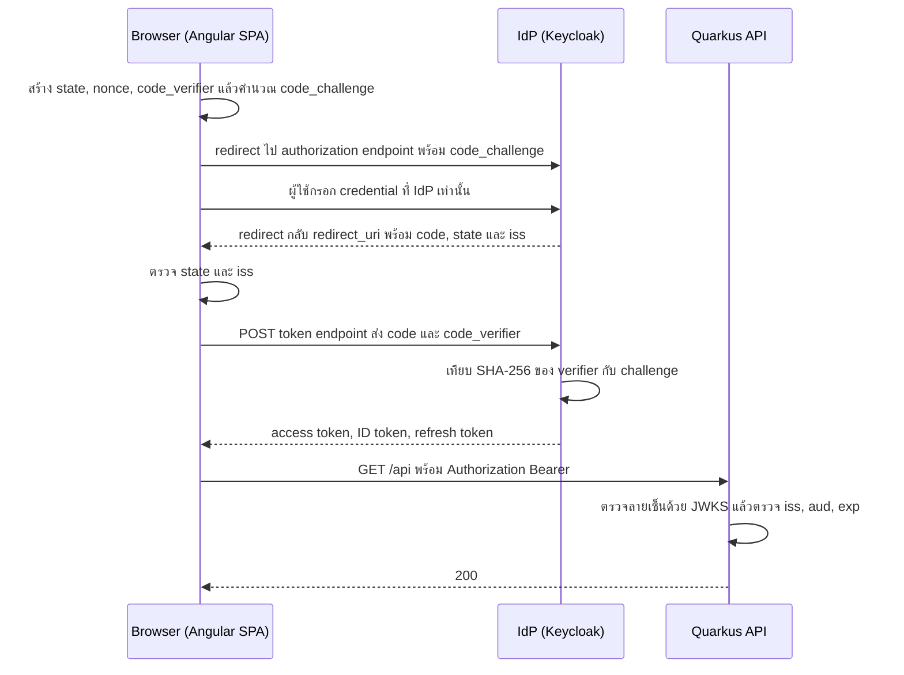
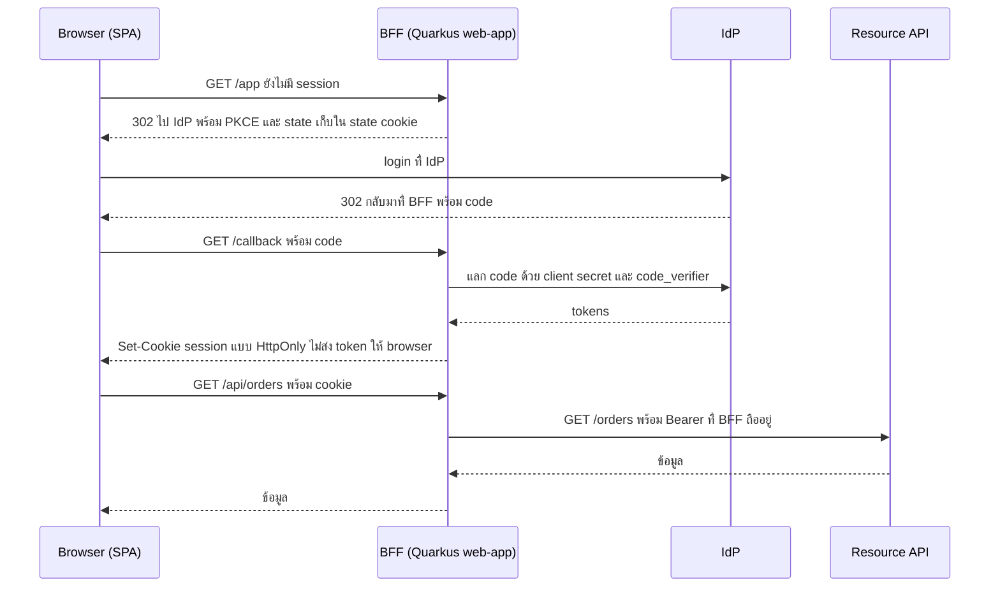
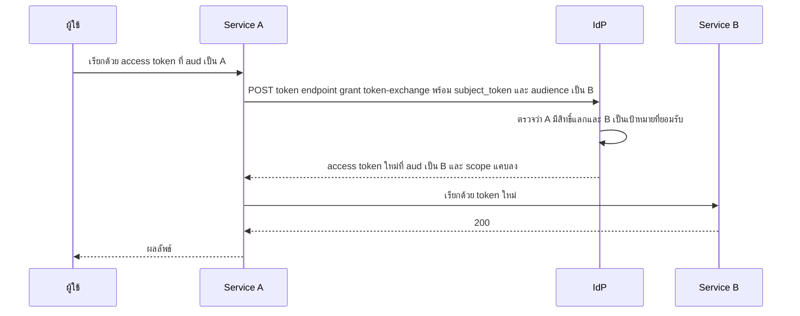

---
tags:
  - spec
  - security
  - auth
  - oauth2
  - oidc
  - quarkus
  - angular
type: spec
status: draft
parent: "[[Auth Flows Lab]]"
created: 2026-10-15
updated: 2026-10-15
---

# 🛂 Auth Flow Spec 2 — OAuth 2.0 และ OIDC

ส่วนที่ 2 ของ [[Auth Flow Spec]] — มาตรฐานที่คนใช้กันมากที่สุด แนวคิด, 4 ตัวละคร, grant type เบื้องต้น และตาราง provider อยู่ที่ [[OAuth 2.0]] กับ [[Keycloak]] แล้ว **ไม่พูดซ้ำ** ส่วนนี้เพิ่มระดับ HTTP จริง สิ่งที่ต้องตรวจ สิ่งที่ต้องสร้าง และเครื่องมือใน Quarkus/Angular

> **สถานะการตรวจของส่วนนี้** ทั้งส่วนมาจากการอ่านต้นทาง (🔎) ไม่ได้รันกับ Keycloak/IdP จริง เพราะ Docker ไม่ได้เปิดตอนตรวจ ยกเว้นที่ระบุ ▶️ (PKCE, ค่า S256) · ป้าย 🧠 = ความรู้มาตรฐานทั่วไปที่ยังไม่ได้เปิดตรวจรอบนี้

---

## B0 — แผนที่ endpoint และ discovery

| endpoint | ใช้ทำอะไร | ช่องทาง | มาตรฐาน |
|---|---|---|---|
| `authorization_endpoint` | ส่งผู้ใช้ไป login/ยินยอม ได้ `code` กลับมา | ผ่าน browser (front channel) | RFC 6749 |
| `token_endpoint` | แลก code / refresh / client credentials เป็น token | client ยิงตรง (back channel) | RFC 6749 |
| `userinfo_endpoint` | ขอ claim ผู้ใช้ด้วย access token | ยิงตรง | OIDC Core |
| `jwks_uri` | กุญแจสาธารณะไว้ตรวจลายเซ็น | ยิงตรง | RFC 7517 |
| `introspection_endpoint` | ถามว่า token ยัง active ไหม | ยิงตรง | RFC 7662 |
| `revocation_endpoint` | เพิกถอน token | ยิงตรง | RFC 7009 |
| `end_session_endpoint` | logout ที่ IdP | ผ่าน browser | OIDC RP-Initiated Logout |
| `device_authorization_endpoint` | เริ่ม device flow | ยิงตรง | RFC 8628 |
| `pushed_authorization_request_endpoint` | ส่ง authorization request ทางหลังบ้าน | ยิงตรง | RFC 9126 |
| `registration_endpoint` | ลงทะเบียน client อัตโนมัติ | ยิงตรง | RFC 7591 |

**เหตุผลที่แยกสองช่องทาง:** ทุกอย่างที่ผ่าน browser (URL, history, log, Referer) ถือว่าเปิดเผยได้ จึงส่งได้แค่ `code` ที่ใช้ครั้งเดียวและแลกต่อไม่ได้ถ้าไม่มี `code_verifier` — ตัว token จริงมาทาง back channel เท่านั้น

**Discovery** — ผู้ให้บริการบอก endpoint ทั้งหมดที่ `/.well-known/openid-configuration` (OIDC Discovery) หรือ `/.well-known/oauth-authorization-server` (RFC 8414) 🔎 ของ Keycloak คือ `http://localhost:8180/realms/<realm>/.well-known/openid-configuration` (ไม่มี `/auth` — ดู [[Quarkus Keycloak]] ข้อ 2) ฝั่ง resource server ประกาศตัวเองที่ `/.well-known/oauth-protected-resource` (RFC 9728) 🔎

## ประเภท client และการยืนยันตัว client

| ประเภท | ตัวอย่าง | เก็บ secret ได้ไหม | ยืนยันตัวกับ token endpoint |
|---|---|---|---|
| confidential | Quarkus web-app, BFF, backend | ได้ | secret, `private_key_jwt`, mTLS |
| public | SPA, mobile, CLI | ไม่ได้ | ไม่มี → ต้องพึ่ง PKCE |

วิธียืนยันตัว client ที่ `quarkus-oidc-client` รองรับ 🔎: `client_secret_basic` (`credentials.secret`), `client_secret_post` (`credentials.client-secret.method=post`), `client_secret_jwt` (`credentials.jwt.secret`, HS256), `private_key_jwt` (`credentials.jwt.key-file` ฯลฯ, RS256 default), mTLS (`quarkus.tls.oidc-client.*` + `tls.tls-configuration-name`), JWT bearer assertion (`credentials.jwt.source=bearer`), SPIFFE JWT-SVID (`credentials.jwt.source=spiffe-jwt`) · RFC 9700: AS ควรบังคับยืนยันตัว client เท่าที่ทำได้ และ **แนะนำแบบ asymmetric** (mTLS / private key JWT) 🔎

---

## B1 — Authorization Code + PKCE (SPA เป็น public client)



**request ที่ browser ไปหา IdP**

```
GET /realms/lab/protocol/openid-connect/auth
  ?response_type=code
  &client_id=lab-web
  &redirect_uri=http%3A%2F%2Flocalhost%3A4200%2Fcallback
  &scope=openid%20profile
  &state=<สุ่ม>
  &nonce=<สุ่ม>
  &code_challenge=<BASE64URL(SHA256(code_verifier))>
  &code_challenge_method=S256
```

**แลก code** — `POST /realms/lab/protocol/openid-connect/token` แบบ `application/x-www-form-urlencoded`

```
grant_type=authorization_code&code=<code>&redirect_uri=<ตัวเดิม>&client_id=lab-web&code_verifier=<verifier>
```

ตอบ `{ access_token, expires_in, refresh_token, id_token, token_type: "Bearer", scope }`

| พารามิเตอร์ | ค่า | ทำไม |
|---|---|---|
| `redirect_uri` | ต้องตรงกับที่ลงทะเบียน **ตรงตัวทุกตัวอักษร** | AS ต้องเทียบ string ตรงตัว (ยกเว้นพอร์ตของ localhost ใน native app) กันการหลอก redirect — RFC 9700 MUST 🔎 |
| `state` | สุ่มต่อ request เก็บฝั่ง client แล้วเทียบตอนกลับ | กัน CSRF |
| `nonce` | สุ่ม ไปอยู่ใน ID token | กัน ID token ถูกเล่นซ้ำ |
| `code_challenge` + `S256` | `BASE64URL(SHA256(verifier))` | กันดัก code — RFC 9700: public client MUST ใช้ PKCE, ควรใช้วิธีที่ไม่เปิดเผย verifier (คือ `S256`) 🔎 |

**PKCE ▶️** verifier ยาว 43–128 ตัวอักษร 🔎 · สุ่ม 32 ไบต์แล้ว base64url ได้ 43 ตัวพอดี · ตัวอย่างใน RFC 7636 ภาคผนวก B: verifier `dBjftJeZ4CVP-mB92K27uhbUJU1p1r_wW1gFWFOEjXk` → challenge `E9Melhoa2OwvFrEMTJguCHaoeK1t8URWbuGJSstw-cM` คำนวณเองแล้วตรงทุกตัวอักษร

**ฝั่ง client ต้องตรวจก่อนส่ง code ไปแลก:** `state` ตรง · ถ้ามี `iss` ใน response ต้องเท่ากับ issuer ที่บันทึกไว้ก่อน redirect (RFC 9207) · code ใช้ได้ครั้งเดียว

**ต้องสร้าง** IdP: realm + client `lab-web` เป็น public (ปิด "Client authentication"), เปิด Standard flow, redirect URI ตรงตัว, Web origins · Angular: ไลบรารี OIDC · Quarkus: `quarkus-oidc` โหมด `service`

**ใช้อะไร** ฝั่ง Angular (เวอร์ชันจาก npm ณ 15 ต.ค. 2026 🔎): `keycloak-angular` 22.0.0 (peer Angular ^22, keycloak-js ^18–^26 — ตัวที่ [[Quarkus Keycloak]] ใช้) · `angular-oauth2-oidc` 22.0.2 (Angular ≥ 22, อธิบายตัวเองว่า OAuth 2(.1) และ OIDC) · `angular-auth-oidc-client` 22.0.1 (Angular ≥ 20) · `oidc-client-ts` 3.5.0 (ไม่ผูก framework, Node ≥ 18) · ฝั่ง Quarkus: ดู B14

**ข้อจำกัด** SPA แบบนี้คือ pattern "browser-based client" ของ RFC 10017 ซึ่งเอกสารระบุว่า **โดนทุกการโจมตีที่ไล่ไว้** มากที่สุดในสามแบบ 🔎 → ถ้าข้อมูลอ่อนไหวไปที่ B2

---

## B2 — Code flow ฝั่ง server / BFF

**คืออะไร** server ที่เป็น confidential client ทำ code flow เอง ถือ token ไว้เอง แล้วให้ browser ถือแค่ **session cookie** RFC 10017 (BCP 212, ส.ค. 2026) แบ่ง SPA เป็น 3 แบบ เรียงจากปลอดภัยมากไปน้อย 🔎

| แบบ | ใครถือ token | เอกสารว่า |
|---|---|---|
| Backend For Frontend (BFF) | server ถือทั้งหมด browser ได้แค่ cookie, server proxy คำขอไป API | "strongly recommended" สำหรับงานธุรกิจ งานอ่อนไหว และงานที่ถือข้อมูลส่วนบุคคล |
| Token-mediating backend | server ได้ token แล้วส่ง access token ให้ browser เรียก API เอง (refresh token อยู่ที่ server) | ใช้เมื่อ proxy แบบ BFF ไม่เหมาะ ให้ลอง BFF ก่อน |
| Browser-based client (B1) | browser ถือและเก็บทุกอย่าง ต้องใช้ PKCE | โดนทุกการโจมตีที่ไล่ไว้ |



### Quarkus ทำได้ยังไง 🔎

- `quarkus.oidc.application-type=web-app` = code flow สำหรับแอปที่เสิร์ฟ HTML · `hybrid` = เสิร์ฟทั้ง HTML และ REST (ใช้ code flow เฉพาะเมื่อไม่มี Bearer ใน `Authorization`) · `service` = รับ Bearer อย่างเดียว (default สำหรับ API)
- `quarkus.oidc.authentication.pkce-required=true` + `quarkus.oidc.authentication.state-secret` (32 ตัวอักษร ใช้เข้ารหัส verifier ที่เก็บใน state cookie ถ้าไม่ตั้งจะสุ่มให้) · state cookie แยกชื่อต่อ flow รองรับหลายแท็บ อายุ default 5 นาที (`state-cookie-age`)
- token ถูกเก็บใน **session cookie ที่เข้ารหัส** โดย `TokenStateManager` default (`quarkus.oidc.token-state-manager.strategy=id-refresh-tokens` หรือ `id-token`) · `split-tokens=true` เมื่อ cookie ใหญ่เกินขีดจำกัดของ browser · `encryption-secret` ≥ 32 ตัวอักษร (ต้องตั้งเองเมื่อใช้ mTLS หรือ `private_key_jwt`) · เอกสารมีหัวข้อ Redis TokenStateManager สำหรับเก็บ token ฝั่ง server จริงๆ (ชื่อ extension ดูที่เอกสาร)
- ต่ออายุ: `quarkus.oidc.token.refresh-expired=true` เมื่อ ID token หมดอายุจะใช้ refresh token ต่อ session · `refresh-token-time-skew` ต่อล่วงหน้า · `refresh-token-cache-time-to-live` กรณีเรียกต่อพร้อมกันและ provider จำกัดการใช้ refresh token ซ้ำ
- SPA เรียก endpoint ของ web-app ด้วย Fetch/XHR: ตั้ง `quarkus.oidc.authentication.java-script-auto-redirect=false` แล้ว Quarkus จะตอบ **499** พร้อม `WWW-Authenticate: OIDC` แทนการ redirect (ที่ provider อาจไม่รองรับ CORS) สคริปต์ต้องส่ง `X-Requested-With: JavaScript` และ reload หน้าเมื่อเจอ 499 · ถ้า framework ตั้ง header เอง (ตัวอย่างคือ `HX-Request: true`) ลงทะเบียน bean `quarkus.oidc.JavaScriptRequestChecker`
- เรียก API ปลายทางด้วย token ที่ BFF ถือ: inject `JsonWebToken` / `AccessTokenCredential` แล้วแนบเอง หรือใช้ `quarkus-rest-client-oidc-token-propagation` กับ `@AccessToken` (ฝั่ง RESTEasy Classic คือ `quarkus-resteasy-client-oidc-token-propagation`)

**หมายเหตุการแมป** เอกสาร Quarkus ที่ตรวจไม่ได้เรียกสิ่งนี้ว่า BFF ตรงๆ — การแมป `web-app` + cookie เข้ากับ BFF ของ RFC 10017 เป็นของผู้บันทึก (BFF เต็มรูปแบบคือ BFF ที่ proxy คำขอ API ให้ด้วย ซึ่งใน Quarkus ต้องต่อ token propagation เอง)

**ข้อควรทำเพิ่ม** cookie session ต้องกัน CSRF (ดู A3, `quarkus-rest-csrf`) · ตั้งชื่อและ flag ตามข้อกำหนด cookie ของ OWASP ใน A3

---

## B3 — OIDC: ชั้น identity

OIDC เติมสิ่งที่ OAuth ไม่มี: **ID token** (JWT เล่าเรื่องการ authenticate ครั้งนั้น), scope `openid`, userinfo endpoint, discovery, claim มาตรฐาน — ความต่าง OAuth กับ OIDC และ 3 token ดู [[Keycloak]] ข้อ 2

| claim ใน ID token | ความหมาย |
|---|---|
| `iss` | ผู้ออก |
| `sub` | ตัวระบุผู้ใช้ที่ **คงที่** ในผู้ออกรายนี้ |
| `aud` | client ที่ token นี้ออกให้ |
| `exp`, `iat` | หมดอายุ / ออกเมื่อ |
| `auth_time` | เวลาที่ผู้ใช้ authenticate จริง (ใช้กับ `max_age`) |
| `nonce` | ค่าที่ client ส่งไปตอนขอ |
| `acr`, `amr` | ระดับ/วิธีที่ใช้ยืนยันตัว (ใช้กับ step-up B11) |
| `azp` | client ที่ขอ (มีเมื่อ `aud` มีหลายค่า) |

**ตรวจ ID token ก่อนเชื่อ** 🧠 (ตาม OIDC Core ส่วน ID Token Validation): ลายเซ็นกับ JWKS ของ issuer ด้วย alg ที่ลงทะเบียนไว้ (ห้าม `none`) · `iss` ตรง · `aud` มี client_id ของเรา (ถ้ามีหลายค่าต้องมี `azp` = client_id) · `exp` ยังไม่ผ่าน · `nonce` ตรงกับที่ส่ง · ถ้าขอ `max_age` ตรวจ `auth_time` · ถ้าขอ `acr_values` ตรวจ `acr`

**ใช้ `(iss, sub)` เป็นตัวระบุผู้ใช้ ไม่ใช่ email** (email เปลี่ยนได้และบาง provider ไม่ยืนยัน — ดู C2) · **ห้ามส่ง ID token ให้ API เป็น access token** ([[Keycloak]] ข้อ 2)

พารามิเตอร์เสริมของ authentication request 🧠: `prompt` (`none`, `login`, `consent`, `select_account`), `max_age`, `login_hint`, `id_token_hint`, `acr_values`, `response_mode` (`query`, `fragment`, `form_post`) · OIDC นิยามสามวิธีขอ token: code (ใช้), implicit (`id_token`, `id_token token` — ❌), hybrid (`code id_token` ฯลฯ — พบน้อย)

Quarkus มี `quarkus.oidc.provider=<ชื่อ>` สำเร็จรูป 🔎: `apple`, `discord`, `facebook`, `github`, `google`, `linkedin`, `mastodon`, `microsoft`, `slack`, `spotify`, `strava`, `twitch`, `x` — ข้อควรรู้ของแต่ละเจ้าอยู่ที่ C2

---

## B4 — Native / mobile app (RFC 8252)

ใช้ code flow + PKCE เหมือน B1 แต่ client เป็นแอปบนเครื่องผู้ใช้ (public client) แนวปฏิบัติ 🧠: เปิด **system browser** ไม่ใช้ WebView ที่แอปควบคุมได้ (แอปจะเห็นรหัสผ่านได้และ SSO cookie ไม่แชร์) · รับ redirect ผ่าน claimed HTTPS link (ดีที่สุด) หรือ loopback `http://127.0.0.1:<port>` หรือ custom scheme (เสี่ยงชนกับแอปอื่น) · RFC 9700 ผ่อนผันเฉพาะพอร์ตของ localhost redirect 🔎 · เก็บ refresh token ใน Keychain/Keystore ของ OS

---

## B5 — Device Authorization Grant (RFC 8628)

สำหรับอุปกรณ์ที่ไม่มี browser หรือพิมพ์ลำบาก (TV, CLI, IoT) — แผนภาพดู [[OAuth 2.0]] ข้อ 2.3 ที่นี่ลงรายละเอียดระดับ HTTP 🔎

1. client `POST device_authorization_endpoint` ด้วย `client_id` (+ `scope`)
2. ได้ `device_code`, `user_code`, `verification_uri`, `verification_uri_complete` (optional, ใส่ใน QR), `expires_in`, `interval` (optional — **ถ้าไม่มีให้ใช้ 5 วินาที**)
3. อุปกรณ์แสดง `user_code` + URL ผู้ใช้เปิดบนเครื่องอื่นแล้ว login และอนุมัติ
4. อุปกรณ์ `POST token_endpoint` ด้วย `grant_type=urn:ietf:params:oauth:grant-type:device_code&device_code=...&client_id=...` ทุก `interval` วินาที
5. ผลระหว่างรอ:

| error | ต้องทำอะไร |
|---|---|
| `authorization_pending` | รอแล้วถามใหม่ตาม interval |
| `slow_down` | เพิ่ม interval อีก 5 วินาที **สำหรับทุกครั้งถัดไป** |
| `access_denied` | หยุด (ผู้ใช้ปฏิเสธ) |
| `expired_token` | `device_code` หมดอายุ — เริ่มใหม่ (ควรรอให้ผู้ใช้สั่งก่อน) |
| อื่นๆ | หยุด poll |

`user_code` ควรสั้นและอ่านง่าย: ชุดอักษร 20 ตัว `BCDFGHJKLMNPQRSTVWXZ` (ไม่มีสระและตัวเลข เลี่ยงตัวที่สับสน) เทียบแบบไม่แยกตัวพิมพ์ ตัวอย่าง `WDJB-MJHT` มี entropy ราว 34.5 bit จึง **ต้อง rate-limit การลองรหัสฝั่ง server** (RFC ยกตัวอย่างว่าเปิดให้ลองแค่ ~5 ครั้งก็ได้ความน่าจะเป็นสำเร็จ 2^-32)

**ต้องสร้าง** IdP เปิด device grant ให้ client (Keycloak รองรับ RFC 8628 ตั้งแต่ 13.0.0 🔎) · CLI: loop poll + แสดงผล + (ถ้าต้องการ) QR จาก `verification_uri_complete`

**ใช้อะไร** เอกสาร `quarkus-oidc-client` ที่ตรวจ **ไม่มี grant แบบ device** (ที่มี: `client`, `password`, `refresh`, `code`, `ciba`, `exchange`, `jwt`) 🔎 → CLI ใช้ HTTP client ธรรมดาเขียน loop เอง · ตัวอย่างใช้จริง: `gh auth login`, `docker login`

**ข้อควรระวัง** ผู้โจมตีให้เหยื่อกรอก `user_code` ของผู้โจมตีได้ (device-code phishing 🧠) → หน้าอนุมัติต้องแสดงชื่อ client, อุปกรณ์, สิทธิ์ที่ขอ ให้ชัด

---

## B6 — Client Credentials

service ยืนยันตัวเอง ไม่มีผู้ใช้ `POST token_endpoint` ด้วย `grant_type=client_credentials` + การยืนยันตัว client + `scope` (หรือ `audience`) → ได้ `access_token` (ปกติไม่มี refresh token 🧠)

```properties
quarkus.oidc-client.auth-server-url=http://localhost:8180/realms/lab
quarkus.oidc-client.client-id=lab-worker
quarkus.oidc-client.credentials.secret=${OIDC_SECRET}
quarkus.oidc-client.grant.type=client        # default — ย่อมาจาก client_credentials
quarkus.oidc-client.grant-options.client.audience=lab-api
```

- extension: `quarkus-oidc-client` + ตัวแนบ token ให้ REST client: `quarkus-rest-client-oidc-filter` (ใช้ `@OidcClientFilter`) หรือ `quarkus-resteasy-client-oidc-filter` สำหรับ RESTEasy Classic — ตัว filter ขอและต่ออายุ token ให้เอง 🔎 · ตัวอย่างเต็มอยู่ที่ [[Quarkus Keycloak]] ข้อ 7
- Keycloak: เปิด "Service accounts roles" ที่ client
- **ยกระดับ** จาก secret เป็น `private_key_jwt` หรือ mTLS (RFC 9700 แนะนำ asymmetric) 🔎
- **ฝั่งรับ** ตรวจว่า token มาจาก client ที่อนุญาต (`azp`/`client_id` หรือ role ของ service account) · **อย่าใช้ token นี้ทำแทนผู้ใช้** — service ที่ทำ action ในนามผู้ใช้ด้วยสิทธิ์ของตัวเองคือ confused deputy → ใช้ B8

---

## B7 — Refresh token

`POST token_endpoint` ด้วย `grant_type=refresh_token&refresh_token=...&client_id=...` (+ client auth) → ได้ access token ใหม่ (และ refresh token ใหม่ถ้าเปิด rotation)

- RFC 9700: refresh token ของ public client **ต้อง** sender-constrained หรือใช้ rotation 🔎 — รายละเอียด rotation + reuse detection ดู A6
- scope `offline_access` ขอ refresh token แบบอายุยาว 🧠 · ตั้งทั้ง idle และ absolute lifetime
- Quarkus web-app: `quarkus.oidc.token.refresh-expired=true` + `refresh-token-time-skew` 🔎 · Angular: ไลบรารีทำ silent refresh ให้ (ตรวจแต่ละไลบรารี 🧠)

---

## B8 — Token Exchange (RFC 8693)

service A ถือ token ของผู้ใช้ และต้องเรียก service B ในนามผู้ใช้ → ขอ token ใหม่ที่ `aud` เป็น B และ scope แคบลง **แทนการส่ง token เดิมต่อ** (เอกสาร Quarkus เตือนเรื่องส่งต่อ token ตรงๆ ข้ามหลาย service แล้วแนะนำ token exchange 🔎)



| ส่วน | พารามิเตอร์ (RFC 8693) 🔎 |
|---|---|
| request | `grant_type=urn:ietf:params:oauth:grant-type:token-exchange`, `subject_token` + `subject_token_type` (บังคับ), `audience` / `resource`, `scope`, `requested_token_type`, `actor_token` + `actor_token_type` (ถ้ามี actor ต้องมีทั้งคู่) |
| response | `access_token`, `issued_token_type`, `token_type` (บังคับ), `expires_in`, `scope` (ถ้าต่างจากที่ขอ), `refresh_token` (ปกติไม่มี) |
| ชนิด token | `urn:ietf:params:oauth:token-type:` + `access_token` / `refresh_token` / `id_token` / `jwt` / `saml1` / `saml2` |

**Impersonation กับ delegation** 🔎: impersonation = A ได้สิทธิ์ทุกอย่างของ B แยกไม่ออกว่าใคร · delegation = A ยังมีตัวตนของตัวเอง กระทำในนาม B — claim `act` บอกผู้กระทำ (ซ้อนกันได้เพื่อบอกลำดับ แต่ **ผู้กระทำก่อนหน้าเป็น informational ห้ามใช้ตัดสินสิทธิ์**) และ `may_act` บอกว่าใครได้รับอนุญาตให้เป็นผู้กระทำ

**ใช้อะไร** Quarkus: `quarkus.oidc-client.grant.type=exchange` + `quarkus.oidc-client.grant-options.exchange.audience=<aud>` · ตอน propagate ใส่ `exchange-token=true` ให้แลกก่อนส่ง 🔎 · Keycloak: **standard token exchange** (RFC 8693) supported ตั้งแต่ 26.2.0 🔎

---

## B9 — JWT bearer: client assertion และ grant (RFC 7523)

ใช้ได้สองทาง:

1. **ยืนยันตัว client ด้วยลายเซ็น (`private_key_jwt`)** — ส่ง `client_assertion_type=urn:ietf:params:oauth:client-assertion-type:jwt-bearer` + `client_assertion=<JWT ที่เซ็นด้วยกุญแจส่วนตัวของ client>` โดยทั่วไป `iss` = `sub` = client_id, `aud` = token endpoint, มี `exp` และ `jti` 🧠 → ไม่มี shared secret ให้รั่ว · Quarkus: `credentials.jwt.key-file` / `key-store-file` 🔎
2. **ใช้ assertion เป็น grant** — `grant_type=urn:ietf:params:oauth:grant-type:jwt-bearer&assertion=<JWT>` แลก assertion จากระบบอื่นเป็น access token · Quarkus: `grant.type=jwt` (เอกสารยกตัวอย่าง Azure on-behalf-of: `grant-options.jwt.requested_token_use=on_behalf_of`) 🔎

Keycloak: JWT Authorization Grant (RFC 7523) preview ใน 26.5.0 และ supported ตั้งแต่ 26.6.0 🔎 · แบบ SAML assertion คือ RFC 7522 🧠

---

## B10 — CIBA (Client-Initiated Backchannel Authentication)

client รู้ตัวผู้ใช้อยู่แล้ว (ผ่าน `login_hint` ฯลฯ) → ยิงคำขอไปที่ IdP → IdP ให้ผู้ใช้ **อนุมัติบนอุปกรณ์อื่น** (เช่น push) → client ได้ token (โหมด poll / ping / push 🧠) · OIDF ระบุเป็น Final 🔎 · Quarkus `oidc-client` มี `grant.type=ciba` (ส่ง `auth_req_id`, grant `urn:openid:params:grant-type:ciba`) 🔎 · Keycloak มี CIBA ตั้งแต่ 13.0.0 🔎

ใช้กับงานที่ผู้ใช้ไม่ได้นั่งหน้าจอ client (call center, ยืนยันที่เคาน์เตอร์) — **ไม่ใช่เส้นทางหลักของ lab อ่านอย่างเดียวพอ**

---

## B11 — Step-up authentication (RFC 9470)

token ที่ได้จากรหัสผ่านอย่างเดียวเอาไปทำ action อ่อนไหวไม่ได้ 🔎

1. client เรียก API ด้วย token เดิม
2. resource server ปฏิเสธ: `401` + `WWW-Authenticate: Bearer error="insufficient_user_authentication", error_description="...", acr_values="myACR"` (หรือ `max_age="5"` เมื่อต้องการการยืนยันที่สดใหม่)
3. client เริ่ม authorization request ใหม่ ใส่ `acr_values` / `max_age`
4. ผู้ใช้ยืนยันระดับที่ต้อง (เช่น TOTP หรือ passkey) AS ออก token ใหม่ที่มี `acr` และ `auth_time`
5. client เรียกซ้ำ
6. resource server ตรวจ `acr` + `auth_time` ผ่านจึงตอบ

Keycloak: step-up แบบ SAML supported ตั้งแต่ 26.7.0 🔎 ส่วนฝั่ง OIDC ให้ตรวจคู่มือ Keycloak (authentication flow / LoA) ก่อนใช้ 🧠 · คู่กับ MFA ที่ D1/D4 · สเปค MCP ใช้แนวคิดคล้ายกันกับ scope (`insufficient_scope`) ที่ C7

---

## B12 — ตัวเสริมความปลอดภัย

| ตัวเสริม | RFC | แก้ปัญหา | ใจความ |
|---|---|---|---|
| **DPoP** | 9449 | token ถูกขโมยแล้วเอาไปใช้ซ้ำ | client มีคู่กุญแจ ส่ง header `DPoP: <proof JWT>` (header `typ: dpop+jwt` + `jwk`, claim `jti`, `htm` (method), `htu` (URL), `iat`, และ `ath` เมื่อส่งพร้อม access token, `nonce` เมื่อ server บังคับ) · AS ผูก token กับกุญแจผ่าน `cnf.jkt` และตอบ `token_type: DPoP` · ถ้าต้องใช้ nonce ตอบ 400 `use_dpop_nonce` + header `DPoP-Nonce` · RS ใช้ `WWW-Authenticate: DPoP` 🔎 |
| mTLS-bound token | 8705 | เหมือน DPoP แต่ผูกกับ certificate | `cnf` ชี้ thumbprint ของ cert 🧠 |
| PAR | 9126 | authorization request ใน URL ถูกแก้/ยาวเกิน | client POST พารามิเตอร์ตรงไป PAR endpoint ได้ `request_uri` แล้วใช้ค่านั้นเป็นตัว redirect 🧠 |
| JAR | 9101 | ปกป้องความถูกต้องของ request | ส่งพารามิเตอร์เป็น JWT ที่เซ็น (`request`) 🧠 |
| RAR | 9396 | scope ละเอียดไม่พอ | `authorization_details` เป็น JSON เช่น "โอนเงิน X ให้บัญชี Y" 🧠 |
| `iss` ใน response | 9207 | mix-up attack | AS ใส่ `iss` ตอน redirect กลับ client เทียบกับ issuer ที่บันทึกไว้ก่อน redirect · สเปค MCP ระบุละเอียด: เทียบ string ตรงตัว ห้าม normalize และถ้า AS ประกาศ `authorization_response_iss_parameter_supported: true` แต่ response ไม่มี `iss` ให้ reject 🔎 |
| Resource indicators | 8707 | token ถูกใช้ผิด resource | พารามิเตอร์ `resource` ใน authorization/token request ให้ `aud` ตรงเป้าหมาย (MCP บังคับ) 🔎 |
| FAPI 2.0 | OIDF | profile สำหรับงานการเงิน | Security Profile และ Message Signing เป็น Final 🔎 |

Keycloak: DPoP supported ตั้งแต่ 26.4.0, FAPI 2 (Final) supported ตั้งแต่ 26.4.0 🔎 · **Quarkus ไม่พบ DPoP ในเอกสารที่ตรวจ** — ยังไม่รู้ว่าฝั่ง resource server รองรับแค่ไหน (อยู่ในรายการ 📚 ของ [[Auth Flows Lab]])

---

## B13 — Logout และ revocation

logout มี 3 ชั้น: (1) session ของแอป (cookie/token ที่ client) (2) **session ที่ IdP** — ถ้าไม่ล้าง กด login ที่แอปอื่นแล้วเข้าได้เลย (3) token ที่ออกไปแล้ว — access token แบบ JWT ใช้ได้จนหมดอายุ

| spec (OIDF Final 🔎) | ทำงานยังไง |
|---|---|
| RP-Initiated Logout 1.0 | แอปส่งผู้ใช้ไป `end_session_endpoint` (พารามิเตอร์ `id_token_hint`, `post_logout_redirect_uri`, `state` 🧠) |
| Front-Channel Logout 1.0 | IdP ให้ browser โหลด URL ออกจากระบบของแต่ละแอป (พึ่ง browser ใช้น้อย) |
| Back-Channel Logout 1.0 | IdP ยิง HTTP ตรงหาแต่ละแอปพร้อม logout token ไม่พึ่ง browser |
| Session Management 1.0 | ตรวจสถานะ session ที่ IdP จากฝั่ง browser |

logout token ของ back-channel 🧠: JWT ที่มี `iss`, `aud`, `iat`, `jti`, `events` (`http://schemas.openid.net/event/backchannel-logout`), `sub` และ/หรือ `sid` และ **ห้ามมี `nonce`**

Quarkus 🔎: `quarkus.oidc.end-session-path` (เมื่อ discovery ไม่มี) · `quarkus.oidc.logout.backchannel.path=/back-channel-logout` (ต้องลงทะเบียน URL เต็มที่ IdP ถ้า logout token ไม่มี `exp` ให้ตั้ง `quarkus.oidc.token.age=10S`) · `quarkus.oidc.logout.frontchannel.path=/front-channel-logout` · เอกสารสะกด property ของ back-channel ไม่ตรงกันสองที่ — ตรวจ config reference ก่อนใช้

**Revocation (RFC 7009 🧠)** `POST revocation_endpoint` ด้วย `token=...&token_type_hint=refresh_token` — เพิกถอน refresh token ได้ทันที แต่ JWT access token ที่ออกไปแล้วยังใช้ได้ถ้า resource server ไม่เช็กสถานะ (ดู B14)

---

## B14 — ฝั่ง resource server: ตรวจ token

สองวิธี: ตรวจ JWT เอง (โปรไฟล์ JWT access token, RFC 9068 🔎 ชื่อ: claim ปกติ `iss`, `exp`, `aud`, `sub`, `client_id`, `iat`, `jti` และ `typ: at+jwt` 🧠) หรือถาม introspection (RFC 7662, ดู A5)

**checklist ที่ API ต้องผ่านทุก request**

1. ลายเซ็น — กุญแจจาก JWKS (cache, ดึงใหม่เมื่อเจอ `kid` ที่ไม่รู้จัก) algorithm มาจาก config
2. `iss` ตรง
3. **`aud` มีเรา** — RFC 9700: RS ต้องปฏิเสธ token ที่ไม่ได้ออกให้ตัวเอง 🔎 · ▶️ SmallRye ไม่ตรวจถ้าไม่ตั้ง `mp.jwt.verify.audiences` (ดู A6) ส่วน `quarkus-oidc` มี property ตรวจ audience ในชุด `quarkus.oidc.token.*` — ตรวจชื่อจริงใน config reference 🧠
4. `exp` / `nbf` (+ clock skew)
5. สิทธิ์: แมป scope/role → `@RolesAllowed` · `quarkus.oidc.roles.source=realm` ถ้า role อยู่ระดับ realm ([[Quarkus Keycloak]] ข้อ 9)
6. ตอบถูกชนิด: 401 `invalid_token` / 403 `insufficient_scope` + `WWW-Authenticate` (RFC 6750 🔎)
7. CORS: preflight `OPTIONS` ต้องไม่โดน auth บล็อก ([[Quarkus Keycloak]] ข้อ 4) · RFC 9700: token / metadata / JWKS / registration endpoint รองรับ CORS ได้ แต่ **authorization endpoint ต้องไม่รองรับ CORS** 🔎
8. ไม่รับ token ทาง query string — ▶️ SmallRye ปฏิเสธ (A6 แถว L)

Quarkus: `quarkus.oidc.application-type=service` (default) · ไม่ตั้ง `auth-server-url` ใน dev/test แล้ว **Dev Services สร้าง Keycloak ให้** (realm `quarkus`, client `quarkus-app`, user `alice` = admin+user, `bob` = user, รหัสผ่านเท่าชื่อ) และ Dev UI (`/q/dev`) ให้ login ขอ token ถอดดู และยิง endpoint ด้วย token ได้ · `quarkus.oidc.devui.grant.type` เลือก `code` (default), `implicit`, `password`, `client` (ใช้ใน dev เท่านั้น) 🔎 · หลาย tenant ดู [[Quarkus Security]]

---

## B15 — เลิกใช้แล้ว และอนาคต

- **Implicit grant** ❌ — RFC 9700: ไม่ควรใช้ response type ที่ออก access token ใน authorization response (`response_type=token`) เว้นแต่กันการ inject และจำกัดการรั่วได้ 🔎
- **ROPC (`grant_type=password`)** ❌ — RFC 9700: **ต้องไม่ใช้** 🔎 เหตุผลและตัวอย่างในคู่มือเก่าดู [[OAuth 2.0]] ข้อ 2.5–2.6 · `quarkus.oidc-client.grant.type=password` ยังมีในเอกสาร แต่มีไว้ migration/ทดสอบ
- **OAuth 2.1** — ณ 15 ต.ค. 2026 ยังเป็น **draft** (`draft-ietf-oauth-v2-1` v16, 3 ก.ย. 2026, สถานะ "I-D Exists", milestone ส่ง IESG ธ.ค. 2026) รวม RFC 6749/6750 + 8252 + 9700 + แนวทาง browser-based apps · บังคับ PKCE (`S256`, verifier 43–128 ตัว), ไม่มี implicit/ROPC, redirect URI ตรงตัว (ยกเว้นพอร์ต loopback), แนะนำ sender-constrained token 🔎 → **ทำตาม RFC 9700 วันนี้ = ทำตาม OAuth 2.1 เกือบหมดแล้ว**
- **Authorization Server** ไม่ควรเขียนเอง → provider และข้อควรคิดก่อนเลือกอยู่ที่ [[OAuth 2.0]] ข้อ 3 · ลงทะเบียน client อัตโนมัติด้วย Dynamic Client Registration (RFC 7591) · สเปค MCP นิยม "Client ID Metadata Documents" (draft) แทน (ดู C7)

---

## ตารางสรุป: grant → พารามิเตอร์

| grant | `grant_type` | พารามิเตอร์หลัก | client auth |
|---|---|---|---|
| authorization code | `authorization_code` | `code`, `redirect_uri`, `code_verifier` | public: ไม่มี · confidential: มี |
| client credentials | `client_credentials` | `scope` | ต้องมี |
| refresh | `refresh_token` | `refresh_token` | ตามชนิด client |
| device | `urn:ietf:params:oauth:grant-type:device_code` | `device_code` | public ได้ |
| token exchange | `urn:ietf:params:oauth:grant-type:token-exchange` | `subject_token`, `subject_token_type` | ต้องมี |
| JWT bearer | `urn:ietf:params:oauth:grant-type:jwt-bearer` | `assertion` | ตามกรณี |
| CIBA | `urn:openid:params:grant-type:ciba` | `auth_req_id` | ต้องมี |

## กับดัก

- **SPA เก็บ token ใน `localStorage`** — XSS ขโมยได้ → BFF (B2)
- **ไม่เปิด PKCE เพราะเป็น confidential client** — RFC 9700 แนะนำทุกประเภท (ต้องสำหรับ public)
- **`redirect_uri` แบบ wildcard** — AS ต้องเทียบตรงตัว
- **ไม่ตรวจ `state` / `nonce` / `iss`** — เปิดทาง CSRF, replay, mix-up
- **ID token ไปเรียก API** — ผิดชนิด token
- **ใช้ email เป็นตัวระบุผู้ใช้** — ใช้ `(iss, sub)`
- **ไม่ตั้ง `aud` ฝั่ง API** ▶️ — token ของ API อื่นจาก issuer เดียวกันใช้ได้
- **ใช้ client credentials แทนผู้ใช้** — confused deputy → ใช้ token exchange (B8)
- **ส่ง token ผ่าน query string** — รั่วทาง log/history/Referer
- **logout แค่ล้าง cookie ฝั่งแอป** — session ที่ IdP ยังอยู่ และ JWT ยังใช้ได้จนหมดอายุ
- **refresh token ไม่หมุน** — ถูกขโมยแล้วใช้ได้ยาวและตรวจไม่ได้
- **คิดว่า OAuth 2.1 เป็น RFC แล้ว** — ยังเป็น draft (ตามตัว RFC 9700 และ 10017 ไปก่อน)

## Cheat sheet

| อยากได้ | ใช้ |
|---|---|
| SPA + ข้อมูลอ่อนไหว | B2 BFF (`quarkus.oidc.application-type=web-app`) |
| SPA + ยอมให้ browser ถือ token | B1 + PKCE `S256` |
| มือถือ/เดสก์ท็อป | B4 system browser + PKCE |
| TV / CLI | B5 device flow |
| service เรียก service | B6 (`grant.type=client`) |
| เรียกต่อในนามผู้ใช้ | B8 (`grant.type=exchange`) |
| client ไม่อยากถือ secret | B9 `private_key_jwt` หรือ mTLS (D5) |
| ต้องยืนยันซ้ำก่อน action อ่อนไหว | B11 step-up |
| ห้ามเอา token ที่ขโมยไปเล่นซ้ำ | B12 DPoP (Keycloak 26.4+) |

```properties
quarkus.oidc.auth-server-url=http://localhost:8180/realms/lab
quarkus.oidc.client-id=lab-api
quarkus.oidc.application-type=service|web-app|hybrid
quarkus.oidc.authentication.pkce-required=true
quarkus.oidc.authentication.state-secret=<32 ตัวอักษร>
quarkus.oidc.token.refresh-expired=true
quarkus.oidc.authentication.java-script-auto-redirect=false
quarkus.oidc.logout.backchannel.path=/back-channel-logout
quarkus.oidc-client.grant.type=client|exchange|jwt|ciba|code|refresh|password
```

## 🔗 เกี่ยวข้อง

- [[Auth Flow Spec]] — หน้ารวม · [[Auth Flow Spec 1 — Own Accounts]] (A6 JWT, A7 บัญชี) · [[Auth Flow Spec 3 — Federation Enterprise]] (social login, broker, MCP) · [[Auth Flow Spec 4 — MFA Passkeys Machine]] (mTLS, workload identity)
- [[OAuth 2.0]] — grant type, provider · [[Keycloak]] — OIDC, 3 token · [[Quarkus Keycloak]] — โค้ดเต็ม Angular + Quarkus
- [[Quarkus REST Client]] — แนบ token ให้ service ปลายทาง · [[Quarkus Security]] — multi-tenant, permission
- [[Angular HttpClient]] — interceptor ที่แนบ token

## 📖 แหล่งอ้างอิง

- [RFC 9700 — OAuth 2.0 Security Best Current Practice](https://www.rfc-editor.org/rfc/rfc9700.html)
- [RFC 10017 — OAuth 2.0 for Browser-Based Applications](https://www.rfc-editor.org/info/rfc10017)
- [RFC 8628 — Device Authorization Grant](https://www.rfc-editor.org/rfc/rfc8628.html) · [RFC 8693 — Token Exchange](https://www.rfc-editor.org/rfc/rfc8693.html) · [RFC 9449 — DPoP](https://www.rfc-editor.org/rfc/rfc9449.html) · [RFC 9470 — Step Up Authentication](https://www.rfc-editor.org/rfc/rfc9470.html)
- [OAuth.net — รายการ spec](https://oauth.net/specs/) · [OpenID Foundation — specs](https://openid.net/developers/specs/)
- [draft-ietf-oauth-v2-1](https://datatracker.ietf.org/doc/draft-ietf-oauth-v2-1/)
- [Quarkus — OIDC authorization code flow](https://quarkus.io/guides/security-oidc-code-flow-authentication) · [OIDC client reference](https://quarkus.io/guides/security-openid-connect-client-reference) · [Dev Services for OIDC](https://quarkus.io/guides/security-openid-connect-dev-services)
- [Keycloak — Release notes](https://www.keycloak.org/docs/latest/release_notes/index.html)
- npm: [keycloak-angular](https://www.npmjs.com/package/keycloak-angular) · [angular-oauth2-oidc](https://www.npmjs.com/package/angular-oauth2-oidc) · [angular-auth-oidc-client](https://www.npmjs.com/package/angular-auth-oidc-client) · [oidc-client-ts](https://www.npmjs.com/package/oidc-client-ts)
