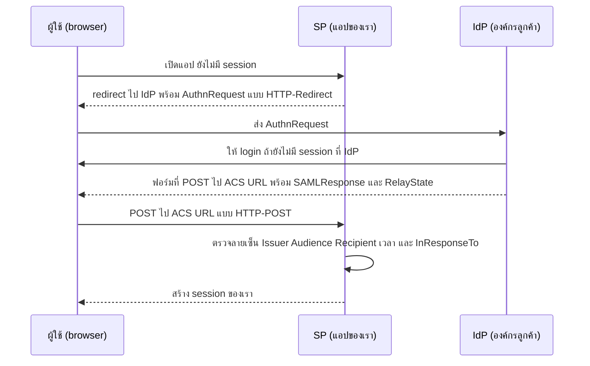
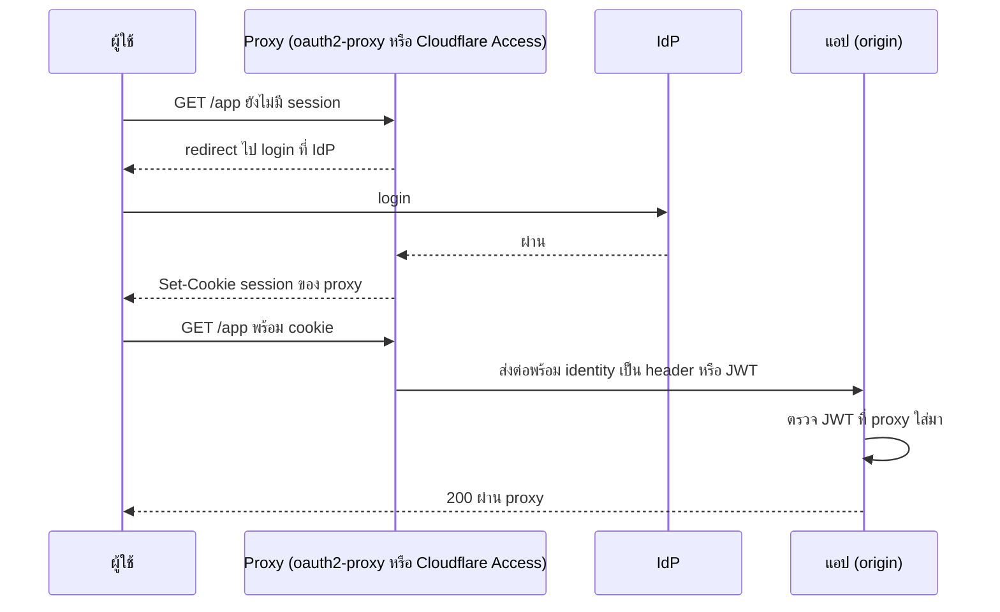
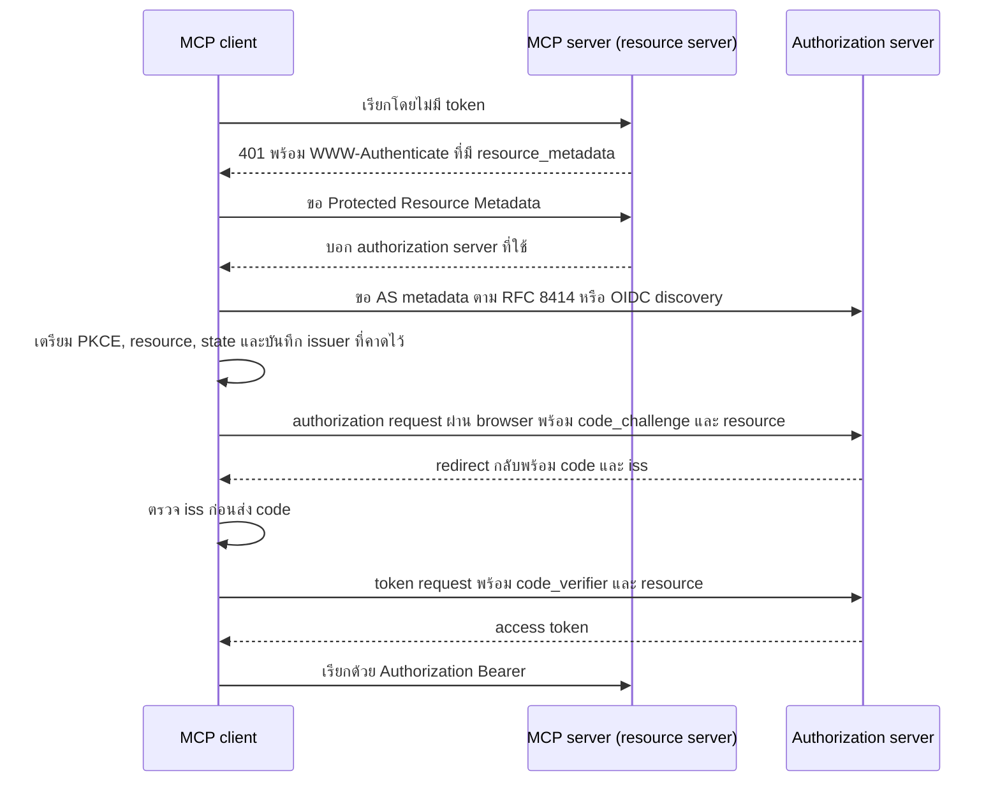

---
tags:
  - spec
  - security
  - auth
  - saml
  - oidc
  - quarkus
type: spec
status: draft
parent: "[[Auth Flows Lab]]"
created: 2026-10-15
updated: 2026-10-15
---

# 🏢 Auth Flow Spec 3 — Federation และ Enterprise

ส่วนที่ 3 ของ [[Auth Flow Spec]] — **ให้คนอื่นยืนยันตัวตนแทนเรา** (SSO, social login, SAML) และของฝั่งองค์กร (LDAP, Kerberos, gateway) ส่วนที่เป็น OIDC ล้วนอยู่ที่ [[Auth Flow Spec 2 — OAuth OIDC]]

> **สถานะการตรวจ** ส่วน Quarkus / LINE / Cloudflare / MCP / Keycloak ตรวจกับเอกสารแล้ว (🔎) ส่วน SAML / LDAP / Kerberos ส่วนใหญ่เขียนจากความรู้มาตรฐานทั่วไป (🧠) ยังไม่ได้เปิดตรวจรอบนี้ และไม่มีส่วนไหนในไฟล์นี้ที่รันจริง (ไม่มี IdP/Docker ตอนตรวจ)

---

## C1 — SAML 2.0 SSO

**คืออะไร** โปรโตคอล SSO แบบ XML ที่องค์กรขนาดใหญ่ใช้กันมานาน — IdP (องค์กรลูกค้า) ออก **Assertion** ที่เซ็นด้วย XML signature ให้ SP (แอปของเรา) โดยผู้ใช้เป็นคนถือข้อความข้ามไปมา (ผ่าน browser) 🧠

| ส่วนของ Assertion | บอกอะไร | SP ต้องตรวจอะไร |
|---|---|---|
| `Issuer` | IdP ที่ออก (entityID) | ตรงกับ IdP ที่เราตั้งไว้จาก metadata |
| `Signature` | XML signature บน Response หรือ Assertion | ตรวจด้วย cert จาก metadata ของ IdP |
| `Subject` / `NameID` | ตัวผู้ใช้ | ใช้เป็นตัวระบุ (ตกลงชนิด NameID กันก่อน) |
| `SubjectConfirmationData` | `Recipient`, `NotOnOrAfter`, `InResponseTo` | Recipient = ACS URL ของเรา · InResponseTo = ID ของ request ที่เราเพิ่งส่ง |
| `Conditions` | `NotBefore`, `NotOnOrAfter`, `AudienceRestriction` | อยู่ในช่วงเวลา · Audience = entityID ของเรา |
| `AuthnStatement` | `AuthnInstant`, `AuthnContextClassRef` | ระดับ/เวลาการยืนยัน |
| `AttributeStatement` | attribute เช่น email, groups | แมปเป็น role |

- **SP-initiated vs IdP-initiated** — แบบ IdP-initiated ไม่มี AuthnRequest จึงไม่มี `InResponseTo` ให้ผูกคำขอกับคำตอบ เปิดทาง login CSRF/replay หลายระบบจึงปิดแบบนี้ 🧠
- **Metadata** — XML ที่แลกกันตอนตั้งค่า (entityID, SSO URL, ACS URL, cert) · **SLO** (single logout) ซับซ้อนและเปราะ มักตกเป็นข้อที่ทำได้ไม่ครบ 🧠
- **จุดที่พลาดบ่อย** 🧠: XML signature wrapping (ตรวจลายเซ็นของ element หนึ่งแต่เอา element อีกตัวไปใช้), XXE/DTD, ไม่กัน replay ของ assertion ID, ไม่ตรวจ Audience/Recipient, clock skew → **ใช้ไลบรารีที่ผ่านการตรวจ ห้ามเขียนตัวตรวจ XML signature เอง**

**Quarkus: ไม่มี SAML adapter** 🔎 — `quarkus-oidc` ทำได้แต่ OIDC คู่มือแนะนำให้ **ใช้ OIDC provider เป็นสะพาน**: ให้ Keycloak (หรือ Okta, Auth0, ADFS) ทำ identity broker ไปหา SAML IdP แล้วแอปคุย OIDC กับ Keycloak ตามปกติ ตัวอย่างในคู่มือ: realm `quarkus`, broker alias `saml`, ฝั่ง SAML IdP ตั้งปลายทางกลับมาที่ `http://localhost:8081/realms/quarkus/broker/saml/endpoint`, ใน Keycloak เพิ่ม SAML identity provider ชี้ metadata URL ของ IdP, แอปตั้ง `quarkus.oidc.auth-server-url` ไป realm เดิม โค้ดแอป (`@Authenticated`, `SecurityIdentity`) **ไม่เปลี่ยน**

**ใน lab** ใช้ Keycloak สอง realm (ฝั่งหนึ่งทำตัวเป็น SAML IdP จำลอง อีกฝั่งเป็น broker) หรือ SAML IdP ทดสอบอื่น แล้วดู XML จริงของ AuthnRequest/Response ด้วย extension ดัก SAML ใน browser 🧠 · Keycloak 26.7.0: SAML step-up supported 🔎 · ตรวจเอกสาร Keycloak ก่อนว่าฟีเจอร์ SAML ที่ต้องการไม่อยู่ใน preview

**ใช้เมื่อ** ลูกค้าองค์กรบังคับ SAML · **ไม่ใช้เมื่อ** เลือกได้ — OIDC ง่ายกว่ามาก (JSON/JWT แทน XML)

---

## C2 — Social login

ผู้ใช้ล็อกอินด้วยบัญชี Google / GitHub / Apple / Facebook / LINE ฯลฯ → แอปไม่ต้องเก็บรหัสผ่านเอง · Quarkus มี `quarkus.oidc.provider=<ชื่อ>` สำเร็จรูป 🔎 ข้อควรรู้ของแต่ละเจ้า:

| provider | `quarkus.oidc.provider` | ข้อควรรู้ (ตามคู่มือ Quarkus) |
|---|---|---|
| Google | `google` | สร้าง OAuth client ใน GCP + consent screen · callback ตอน dev `http://localhost:8080/google` · scope default `openid email profile` · จะเพิ่ม scope ให้ใช้ `authentication.extra-params.scope` — ถ้าตั้ง `authentication.scopes` จะ **ทับ** ค่า default |
| GitHub | `github` | **OAuth2 เท่านั้น** ได้แค่ access token (ไม่ใช่ OIDC เต็มรูป) · callback `/github` · ถ้าได้ 401 หลัง login ลอง `credentials.client-secret.method=post` · scope `user:email` |
| Apple | `apple` | ต้องมี Apple developer (คู่มือบอก $99/ปี) · **ทดสอบบน localhost ไม่ได้** ต้อง HTTPS สาธารณะ (คู่มือแนะนำ ngrok) · client credential เป็น **JWT ที่เซ็นด้วย private key `.p8`** (`credentials.jwt.key-file`, `token-key-id`, `issuer`, `subject`) · scope `openid email name` · callback `<host>/apple` |
| Facebook | `facebook` | ต้อง HTTPS สาธารณะ · app แบบ Other + Consumer · scope `email`, `public_profile` · ต้องขอ Advanced Access สำหรับ `public_profile` |
| Microsoft | `microsoft` | ลงทะเบียนใน Entra ID · ถ้า access token ไม่ใช่ JWT ตั้ง `verify-access-token-with-user-info=true` · บางกรณีต้อง `token.customizer-name=azure-access-token-customizer` |
| X | `x` (`twitter` ยังใช้ได้ชั่วคราว) | บังคับ PKCE |
| อื่นๆ | `discord`, `linkedin`, `mastodon`, `slack`, `spotify`, `strava`, `twitch` | — |

### LINE Login (ไม่อยู่ในรายการสำเร็จรูปของ Quarkus 🔎)

LINE Login v2.1 รองรับ OpenID Connect และออก ID token ตามสเปค 🔎

| เรื่อง | ค่า |
|---|---|
| authorize | `https://access.line.me/oauth2/v2.1/authorize` |
| token | `https://api.line.me/oauth2/v2.1/token` (`grant_type=authorization_code`, `code`, `redirect_uri`, `client_id`, `client_secret`) |
| บังคับ | `response_type=code`, `client_id`, `redirect_uri` (ต้องตรงที่ลงทะเบียน), `state`, `scope` |
| ไม่บังคับ | `nonce`, `code_challenge` + `code_challenge_method` (**`S256` เท่านั้น**), `prompt`, `max_age`, `bot_prompt` ฯลฯ |
| scope | `profile`, `openid` (ต้องมีอย่างใดอย่างหนึ่ง), `email` (**ต้องขออนุมัติใน Developers Console ก่อน**) |
| อายุ | authorization code 10 นาที ใช้ครั้งเดียว · access token 30 วัน · refresh token สูงสุด 90 วัน |
| ข้อควรจัดการ | ผู้ใช้ปฏิเสธบาง scope ได้ → แอปต้องรับกรณีสิทธิ์ไม่ครบ |

Quarkus: ต้องตั้ง `quarkus.oidc.*` เองตาม endpoint ข้างบน (ตรวจ discovery URL ของ LINE ก่อน 🧠) · ผูกกับ [[LINE Slip Bot]] (login แอดมิน) · **ข้อสังเกต 🧠 ยังไม่ได้ตรวจ**: `userId` ของ LINE ออก **ต่อ provider** — ถ้า channel ของ LINE Login กับ Messaging API อยู่ provider เดียวกัน `userId` น่าจะเป็นค่าเดียวกัน ซึ่งจะจับคู่ "แอดมินที่ login" กับ "คนส่งสลิปในกลุ่ม" ได้ — ตรวจเอกสาร LINE ก่อนออกแบบ

### เชื่อมบัญชีให้ถูก (account linking)

- ผูกผู้ใช้ด้วย **`(iss, sub)`** เก็บในตาราง `federated_identities(user_id, issuer, subject, linked_at)` ไม่ใช้ email เป็นกุญแจ
- เชื่อ email เฉพาะที่ provider ระบุว่า verified (`email_verified`) · **อย่า merge อัตโนมัติ** กับบัญชีเดิมที่ email ตรงกันแต่ยังไม่ได้พิสูจน์ว่าเป็นเจ้าของ — ผู้โจมตีสมัครบัญชีรหัสผ่านด้วย email ของเหยื่อไว้ก่อน แล้วรอให้เหยื่อ login ผ่าน social (pre-hijacking 🧠)
- ขอ scope เท่าที่ใช้ · ถ้าต้องเรียก API ของ provider ต่อ ต้องเก็บ token ของ provider อย่างปลอดภัย — Keycloak 26.7 ให้ broker ดึง token จริงของ external IdP ได้แล้ว (ตาม [[Keycloak Updates]])

---

## C3 — Identity brokering และ SSO ผ่าน IdP กลาง

ให้แอปรู้จัก IdP ตัวเดียว (เช่น Keycloak) แล้วให้ IdP นั้นไป **ต่อกับ** Google, GitHub, SAML ขององค์กรอื่น, LDAP/AD ให้ ทำให้แอปไม่ต้องเขียน flow ซ้ำทีละ provider — ความสามารถของ Keycloak ในส่วนนี้ (SSO, Identity Brokering, User Federation, MFA, Account Console, multi-tenancy ผ่าน realm) อธิบายไว้ที่ [[Keycloak]] ข้อ 1

- เมื่อผู้ใช้เข้าผ่าน provider ภายนอกครั้งแรก IdP มี "first login flow" ตัดสินว่าจะสร้างผู้ใช้ใหม่ ผูกกับบัญชีเดิม หรือถามยืนยัน — ตั้งให้ตรงกับนโยบาย account linking ข้างบน 🧠
- SSO = login ครั้งเดียวใช้ได้หลายแอป เพราะ session อยู่ที่ IdP (ผลข้างเคียง: logout ต้องจัดการหลายชั้น — ดู B13)

---

## C4 — LDAP / Active Directory

**คืออะไร** ตรวจรหัสผ่านกับ directory ขององค์กรตรงๆ 🧠

1. bind ด้วย service account แล้วค้นหา DN ของผู้ใช้จาก username
2. bind ใหม่ด้วย DN นั้น + รหัสผ่านที่ผู้ใช้กรอก — สำเร็จ = รหัสถูก (**ห้ามดึง hash มาเทียบเอง**)
3. อ่านกลุ่มแล้วแมปเป็น role

**ต้องระวัง** ใช้ LDAPS/StartTLS เสมอ · escape ค่าที่ใส่ใน filter (LDAP injection) · ปิด anonymous bind · **bind ผิดซ้ำจะไปล็อกบัญชี AD จริงของผู้ใช้** (นโยบาย lockout ของ AD)

**Quarkus** มีคู่มือ "Using security with an LDAP realm" 🔎 (artifact น่าจะเป็น `quarkus-elytron-security-ldap` และ property ยังไม่ได้ตรวจ 🧠) — **แนะนำกว่า:** ไม่ให้แอป bind ตรง ใช้ **User Federation ของ Keycloak** ต่อ LDAP/AD แล้วแอปคุย OIDC ([[Keycloak]] ข้อ 1) ได้ MFA/SSO ฟรีและแอปไม่ต้องรู้จัก LDAP

---

## C5 — Kerberos / SPNEGO (และ NTLM)

**คืออะไร** SSO เงียบๆ ในเครือข่ายองค์กรที่เข้า domain แล้ว: server ตอบ `401` + `WWW-Authenticate: Negotiate` → browser บนเครื่อง domain-joined ส่ง `Authorization: Negotiate <base64 token>` (SPNEGO/GSSAPI ห่อ Kerberos v5 ticket) โดย **ผู้ใช้ไม่ต้องกรอกอะไร** 🔎 (เอกสาร Quarkiverse: Kerberos v5 กับ HTTP Negotiate)

- ต้องมี: SPN `HTTP/<host>` + keytab บนเซิร์ฟเวอร์, DNS และเวลาตรงกับ KDC, browser ตั้งให้เชื่อ intranet 🧠
- Quarkus: Quarkiverse `io.quarkiverse.kerberos:quarkus-kerberos` 🔎 คู่มือ dev ใช้ KDC ในเครื่อง ส่วน property (keytab, SPN) ยังไม่ได้ตรวจ · มีรายงานว่า `quarkus.kerberos.enabled` เป็น build-time ใน RHBQ 2.7.x (ปิดตอน runtime ไม่ได้) 🔎
- **NTLM** เป็น legacy ⚠️ อย่าสร้างใหม่ (Bruno ยิงทดสอบ NTLM ได้ 🔎 ไว้คุย API เก่า)
- ใช้เมื่อ intranet AD ที่อยากได้ SSO เงียบๆ · **lab: อ่านอย่างเดียว** (ต้องมี KDC)

---

## C6 — Gateway / forward-auth (ให้ proxy ทำ auth ให้)

ให้ proxy หน้าบ้านพาผู้ใช้ login แล้วส่งต่อให้แอปพร้อม identity — แอปไม่ต้องรู้จัก OIDC เลยก็ได้

| ตัวเลือก | จุดสำคัญ |
|---|---|
| **oauth2-proxy** | reverse proxy ที่ทำ auth ให้ เป็นโปรเจกต์ CNCF Sandbox 🔎 ใช้เป็น forward-auth กับ nginx ได้: `auth_request /oauth2/auth` — 202 = ผ่าน, 401 = ส่งไป `/oauth2/sign_in` · เปิด `--set-xauthrequest` ให้ส่ง `X-Auth-Request-User` / `-Email` กลับ แล้ว copy ด้วย `auth_request_set` · cookie เกิน 4 KB ต้องจัดการ `Set-Cookie` หลายตัวเอง (จากตัวอย่างชุมชน 🔎 ตรวจเอกสารตามเวอร์ชันก่อนใช้) |
| **Cloudflare Access** | ส่ง JWT มาใน header `Cf-Access-Jwt-Assertion` (ให้ตรวจตัวนี้ ไม่ใช่ cookie `CF_Authorization` เพราะ cookie ไม่รับประกันว่าถูกส่ง) · ดึงกุญแจจาก `https://<team>.cloudflareaccess.com/cdn-cgi/access/certs` เลือกด้วย `kid` · ตรวจ RS256, `iss` = `https://<team>.cloudflareaccess.com`, `aud` = AUD tag ของแอป · กุญแจหมุน ~ทุก 6 สัปดาห์ กุญแจเก่ายังใช้ได้อีก 7 วัน ห้าม hard-code 🔎 |
| API gateway ตรวจ JWT | gateway ตรวจแล้วแอปตรวจซ้ำ 🧠 |

**ฝั่ง Quarkus ที่ใช้ตรวจ JWT ของ Cloudflare** — `mp.jwt.token.header` ให้อ่าน token จาก header อื่นนอกจาก `Authorization` 🔎: `mp.jwt.token.header=Cf-Access-Jwt-Assertion`, `mp.jwt.verify.issuer=https://<team>.cloudflareaccess.com`, `mp.jwt.verify.audiences=<AUD tag>`, `mp.jwt.verify.publickey.location=<URL ของ certs>` (ชี้ URL ของ JWKS ได้ 🧠) — property มีจริงในเอกสาร SmallRye ส่วนการประกอบเข้ากับ Cloudflare **ยังไม่ได้ลอง**

**ข้อควรระวังที่ร้ายแรงที่สุดของ pattern นี้** 🧠: ถ้าเข้าถึง origin ได้โดยไม่ผ่าน proxy ใครก็ปลอม header identity ได้ = bypass ทั้งระบบ → (1) ล็อก origin ให้รับเฉพาะจาก proxy (firewall หรือ [[Cloudflare]] Tunnel) (2) ให้ proxy ลบ header identity ที่ client ส่งมาเอง (3) ตรวจ JWT ในแอปด้วยเสมอ (defense in depth)

---

## C7 — MCP / AI-agent authorization

สเปคฝั่ง MCP นิยามให้ MCP server เป็น **resource server** และ MCP client เป็น **OAuth client** บน OAuth 2.1 (อ้างอิง draft-13) 🔎 — ข้อมูลจากสเปคฉบับ draft ที่เปิดอ่าน 15 ต.ค. 2026 อาจเปลี่ยน

| ข้อกำหนดของสเปค 🔎 | ระดับ |
|---|---|
| MCP server ต้องมี OAuth 2.0 Protected Resource Metadata (RFC 9728) และ client ต้องใช้ค้นหา authorization server | MUST |
| authorization server ต้องมี discovery อย่างน้อยหนึ่งแบบ (RFC 8414 หรือ OIDC Discovery) และ client ต้องรองรับทั้งสอง | MUST |
| ลงทะเบียน client ได้สามทาง: **Client ID Metadata Documents** (draft), pre-registration, Dynamic Client Registration (ถูกระบุว่า deprecated เหลือไว้ backward compatibility) | ตัวแรก SHOULD |
| ใส่พารามิเตอร์ `resource` (RFC 8707) ทั้งใน authorization และ token request ชี้ URI ของ MCP server | MUST |
| ตรวจ `iss` (RFC 9207) ก่อนส่ง code ไปแลก โดยเทียบ string ตรงตัว | MUST (ฝั่ง client) |
| ส่ง token ใน header `Authorization: Bearer` ทุก request **ห้ามอยู่ใน query string** | MUST |
| MCP server ต้องตรวจว่า token ออกให้ตัวเองเป็น audience · **ห้ามรับหรือส่งต่อ token อื่น** | MUST |
| ตอบ 401 เมื่อ token ไม่ถูกต้อง · 403 + `error="insufficient_scope"`, `scope="..."`, `resource_metadata` เมื่อสิทธิ์ไม่พอ แล้ว client ทำ step-up ด้วย scope ที่รวมของเดิม | SHOULD |
| ใช้ PKCE · refresh token เก็บเป็นความลับ · `offline_access` เป็นทางเลือกของ client | — |
| transport แบบ STDIO ไม่ควรใช้สเปคนี้ ให้เอา credential จาก environment | SHOULD NOT |

Keycloak 26.5.0 (ม.ค. 2026) มีคู่มือใช้ Keycloak เป็น authorization server ให้ MCP server 🔎 · (ไม่มี MCP server ทางการสำหรับ **จัดการ** Keycloak — ดู [[OAuth 2.0]] ข้อ 3)

**ทำไมน่าเรียน** มันคือ OAuth 2.1 + RFC 9728/8707/9207/8414 ประกอบกัน — เท่ากับตัวอย่างของ "OAuth สมัยใหม่ที่ถูกต้อง" ที่ครบที่สุดชุดหนึ่ง

---

## C8 — Provisioning (SCIM) และ multi-tenant

- **SCIM** — มาตรฐานซิงก์ user/group ระหว่างระบบ (RFC 7643/7644 🧠) แทนการให้ admin สร้างบัญชีมือ · Keycloak: SCIM API preview ใน 26.7.0 และ supported ตั้งแต่ 26.8.0 🔎
- **multi-tenant** — Quarkus OIDC รองรับหลาย tenant แบบ static (`quarkus.oidc.<tenant>.*`) และ dynamic (`TenantConfigResolver`) → [[Quarkus Security]] ข้อ 3 (กับดักสำคัญ: resolver คืน tenant ผิดแล้ว token ของ tenant หนึ่งผ่านที่อีกที่แบบเงียบๆ) · Keycloak มี **Organizations** supported ตั้งแต่ 26.0.0 🔎 หรือใช้ realm ต่อ tenant ([[Keycloak]] ข้อ 1)

## กับดัก

- **เขียนตัวตรวจ SAML เอง** — signature wrapping / XXE
- **เปิด IdP-initiated SAML โดยไม่มีเหตุผล** — ไม่มี `InResponseTo`
- **ผูกบัญชีด้วย email** — ใช้ `(iss, sub)`; อย่า merge บัญชีที่ email ตรงแต่ยังไม่ยืนยันเจ้าของ
- **คิดว่า GitHub = OIDC** — เป็น OAuth2 ได้แค่ access token 🔎
- **ทดสอบ Apple/Facebook บน localhost** — ไม่ได้ ต้อง HTTPS สาธารณะ 🔎
- **ตั้ง `authentication.scopes` ของ Google แล้วเสีย scope default** 🔎
- **ให้แอป bind LDAP ตรง ถูกล็อกบัญชี AD** — ใช้ User Federation
- **เชื่อ identity header โดยเข้า origin ได้ตรงๆ** — gateway bypass
- **hard-code กุญแจของ Cloudflare Access** — หมุนทุก ~6 สัปดาห์ 🔎
- **ส่งต่อ token ให้ MCP server อื่น / รับ token ที่ไม่ได้ออกให้เรา** — สเปคห้าม 🔎

## Cheat sheet

| สถานการณ์ | ใช้ |
|---|---|
| ลูกค้าองค์กรขอ SAML | C1 ผ่าน Keycloak broker (Quarkus ไม่มี SAML adapter) |
| ผู้ใช้ทั่วไป ไม่อยากสมัครใหม่ | C2 social login — Google, Apple, LINE ตามกลุ่มผู้ใช้ |
| ต้องรองรับหลายที่มาของผู้ใช้ | C3 IdP กลาง |
| ใช้ผู้ใช้ใน AD/LDAP เดิม | Keycloak User Federation (C4) |
| intranet SSO เงียบๆ | C5 Kerberos |
| ซ่อนแอปภายในหลัง Cloudflare | C6 Access + ตรวจ JWT ที่ origin |
| เปิด MCP server ให้ AI agent | C7 OAuth 2.1 profile |

## 🔗 เกี่ยวข้อง

- [[Auth Flow Spec]] — หน้ารวม · [[Auth Flow Spec 2 — OAuth OIDC]] (B13 logout, B8 token exchange) · [[Auth Flow Spec 4 — MFA Passkeys Machine]]
- [[Keycloak]] · [[Keycloak Updates]] · [[Quarkus Keycloak]] · [[Quarkus Security]]
- [[LINE Slip Bot]] — LINE Login ฝั่งแอดมิน · [[Cloudflare]] — Access, Tunnel · [[OAuth 2.0]]

## 📖 แหล่งอ้างอิง

- [Quarkus — OIDC authorization code flow (มีหัวข้อ OIDC SAML identity broker)](https://quarkus.io/guides/security-oidc-code-flow-authentication)
- [Quarkus — OIDC providers (Apple, GitHub, Google, Facebook, Microsoft ฯลฯ)](https://quarkus.io/guides/security-openid-connect-providers)
- [Quarkus — Using JWT RBAC (`mp.jwt.token.header`)](https://quarkus.io/guides/security-jwt)
- [Quarkiverse — Kerberos](https://docs.quarkiverse.io/quarkus-kerberos/dev/index.html)
- [LINE Developers — Integrating LINE Login](https://developers.line.biz/en/docs/line-login/integrate-line-login/)
- [Cloudflare — Validate the Access JWT](https://developers.cloudflare.com/cloudflare-one/identity/authorization-cookie/validating-json/)
- [oauth2-proxy](https://oauth2-proxy.github.io/oauth2-proxy/)
- [MCP — Authorization (draft)](https://modelcontextprotocol.io/specification/draft/basic/authorization)
- [Keycloak — Release notes](https://www.keycloak.org/docs/latest/release_notes/index.html) · [Keycloak 26.5.0 released](https://www.keycloak.org/2026/01/keycloak-2650-released)
