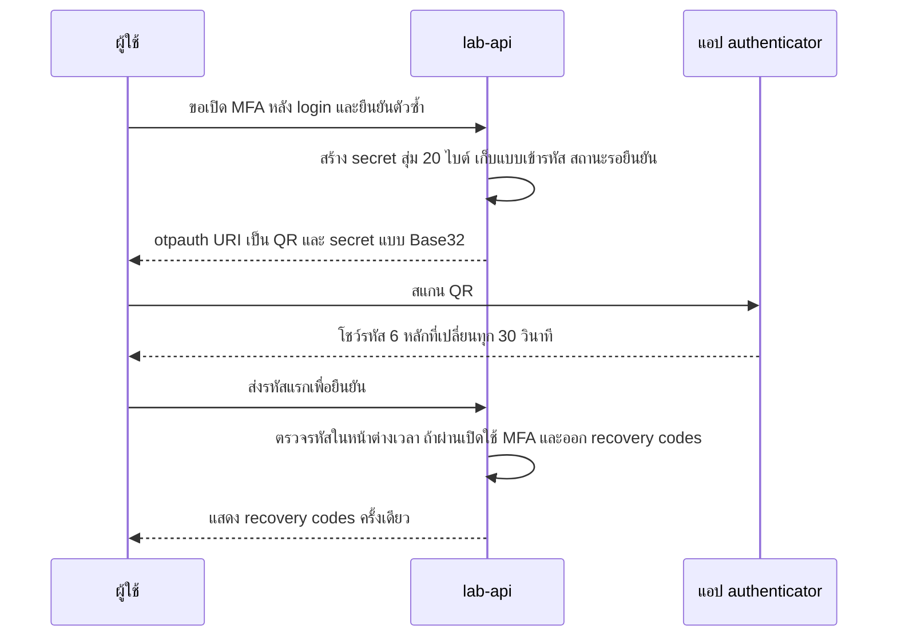
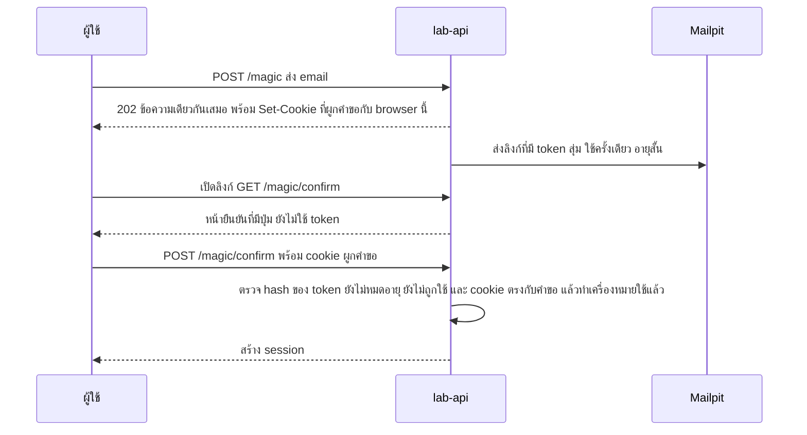
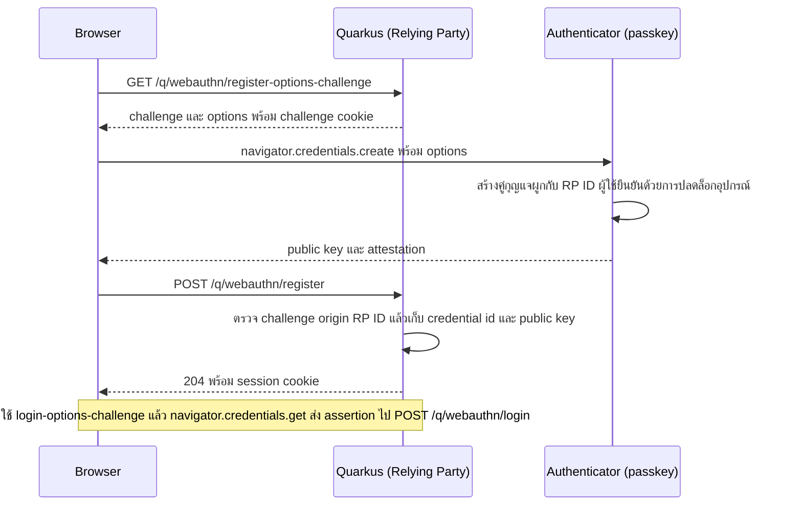

---
tags:
  - spec
  - security
  - auth
  - mfa
  - webauthn
  - quarkus
type: spec
status: draft
parent: "[[Auth Flows Lab]]"
created: 2026-10-15
updated: 2026-10-15
---

# 🛡️ Auth Flow Spec 4 — MFA, Passkeys และ Machine identity

ส่วนที่ 4 ของ [[Auth Flow Spec]] — **ปัจจัยที่สองและกุญแจที่กันฟิชชิ่งได้** (TOTP, OTP, passkey, certificate) กับ **เครื่องคุยกับเครื่อง** (HMAC, mTLS, workload identity) รวมกันเพราะแก่นเดียวกัน: พิสูจน์ด้วยสิ่งที่ "ถือ" หรือ "ลงลายเซ็น" ไม่ใช่สิ่งที่ "รู้"

> **สถานะการตรวจ** TOTP, HMAC, PKCE รันจริงเทียบเวกเตอร์ของ RFC (▶️) · Quarkus WebAuthn / mTLS / SPIFFE ตรวจกับเอกสาร (🔎) แต่ **ไม่ได้รัน** · NIST/W3C ตรวจกับต้นทาง (🔎) · ส่วนที่เป็นข้อเสนอการออกแบบไม่มีป้าย

---

## D0 — ปัจจัยและระดับความมั่นใจ

ปัจจัยมี 3 ชนิด: **รู้** (รหัสผ่าน, PIN) · **ถือ** (โทรศัพท์, security key, cert) · **เป็น** (ชีวมิติ ซึ่งในทางปฏิบัติใช้ปลดล็อกกุญแจในเครื่อง ไม่ได้ส่งไปให้ server) — MFA = อย่างน้อยสองชนิดต่างกัน

**NIST SP 800-63B-4** แบ่งระดับ AAL 🔎

| ระดับ | ต้องมีอะไร |
|---|---|
| AAL1 | ปัจจัยเดียวหรือหลายปัจจัยก็ได้ (รหัสผ่าน, OTP, out-of-band, cryptographic ฯลฯ) ควรเสนอ MFA |
| AAL2 | multi-factor (หรือ authenticator ฝั่ง "ถือ" คู่กับรหัสผ่าน/ชีวมิติ) · อย่างน้อยหนึ่งตัวต้อง **ต้านการเล่นซ้ำ (replay-resistant)** · ผู้ตรวจต้องเสนอตัวเลือกที่ **ต้านฟิชชิ่ง** อย่างน้อยหนึ่งแบบ |
| AAL3 | cryptographic เป็นหลัก กุญแจส่วนตัว **ส่งออกไม่ได้** + ต้านฟิชชิ่ง + ต้านเล่นซ้ำ + มีเจตนาของผู้ใช้ (authentication intent) |

**ต้านฟิชชิ่ง (phishing resistance)** = ป้องกันไม่ให้ความลับถูกเปิดเผยให้ verifier ปลอม **โดยไม่ต้องพึ่งความระมัดระวังของผู้ใช้** · ที่ไม่ผ่าน: รหัสผ่าน, look-up secret, OTP และ out-of-band ที่ผู้ใช้พิมพ์เอง · ที่ผ่าน: การผูกชื่อ verifier (เช่น WebAuthn), channel binding (เช่น client-authenticated TLS) 🔎

**กฎของ NIST ที่กระทบการเลือก** 🔎: SMS/เสียง (PSTN) เป็น **restricted** — ต้องมีทางเลือกอื่นให้ทุกคนและพิจารณาสัญญาณเสี่ยง (เปลี่ยน SIM, พอร์ตเบอร์) · **อีเมลห้ามใช้เป็น out-of-band authentication** (แต่โค้ดยืนยันอีเมลหรือ recovery code ไม่นับเป็น authentication) · syncable authenticator **ห้ามใช้ที่ AAL3** (ที่ AAL2 ข้อความที่อ่านไม่ได้ห้าม แต่เงื่อนไขอยู่ภาคผนวก B ที่ยังไม่ได้อ่าน)

---

## D1 — TOTP / HOTP

**คืออะไร** รหัสผ่านใช้ครั้งเดียวที่คำนวณจากความลับร่วม · **HOTP** (RFC 4226) = ตัดค่าจาก `HMAC(K, counter)` · **TOTP** (RFC 6238) = HOTP โดย `counter = floor(เวลา unix / 30)` (step 30 วินาที)

**▶️ ผลรันจริง** — โค้ดด้านล่างให้ผลตรงกับเวกเตอร์ใน RFC 6238 ภาคผนวก B ทั้ง 6 ตัว (HMAC-SHA-1, secret ASCII `12345678901234567890`, 8 หลัก):

| เวลา (วินาที) | counter | รหัสที่ได้ = ค่าใน RFC |
|---|---|---|
| 59 | 1 | 94287082 |
| 1111111109 | 37037036 | 07081804 |
| 1111111111 | 37037037 | 14050471 |
| 1234567890 | 41152263 | 89005924 |
| 2000000000 | 66666666 | 69279037 |
| 20000000000 | 666666666 | 65353130 |

รหัส 6 หลักของ counter 1 คือ `287082` (เลขท้าย 6 หลักของ 94287082) · Base32 ของ secret ตัวอย่าง = `GEZDGNBVGY3TQOJQGEZDGNBVGY3TQOJQ`

```java
static String hotp(byte[] key, long counter, int digits, String alg) throws Exception {
    Mac mac = Mac.getInstance(alg);  // "HmacSHA1" ตาม RFC 6238 ตัวอย่าง
    mac.init(new SecretKeySpec(key, "RAW"));
    byte[] h = mac.doFinal(ByteBuffer.allocate(8).putLong(counter).array());
    int off = h[h.length - 1] & 0xf;    // dynamic truncation
    int bin = ((h[off] & 0x7f) << 24) | ((h[off + 1] & 0xff) << 16)
            | ((h[off + 2] & 0xff) << 8) | (h[off + 3] & 0xff);
    return String.format("%0" + digits + "d", bin % (int) Math.pow(10, digits));
}
// TOTP = hotp(secret, unixTime / 30, 6, "HmacSHA1")
```



URI สำหรับ QR 🧠 (รูปแบบ key URI ที่ authenticator ส่วนใหญ่รองรับ): `otpauth://totp/<Issuer>:<account>?secret=<BASE32>&issuer=<Issuer>&algorithm=SHA1&digits=6&period=30`

**ข้อกำหนดตอนตรวจ** (ข้อเสนอ):

- ยอมรับหน้าต่าง ±1 step ชดเชยนาฬิกาเพี้ยน
- **จำ counter ล่าสุดที่ใช้ต่อผู้ใช้** แล้วปฏิเสธรหัสเดิมซ้ำ (กัน replay ในหน้าต่างเดียวกัน)
- rate limit ต่อบัญชี (ช่องว่างมีแค่ 10^6)
- เก็บ secret แบบ **เข้ารหัสที่อ่านกลับได้** (server ต้องใช้คำนวณ) ไม่ใช่ hash — ต่างจากรหัสผ่าน
- ต้องให้ผู้ใช้ยืนยันรหัสแรกก่อนถึงจะเปิดใช้ MFA จริง
- หลังรหัสผ่านถูก ออก session/token ระดับ "pre-MFA" ที่ใช้ได้แค่ endpoint ยืนยัน MFA ไม่ให้เรียก API อื่นก่อนผ่านปัจจัยที่สอง

**ข้อจำกัด** ไม่ต้านฟิชชิ่ง — ผู้ใช้พิมพ์รหัสให้เว็บปลอมได้ (NIST: OTP ที่พิมพ์เองไม่ใช่ phishing-resistant 🔎) · **Quarkus ไม่มี TOTP ในตัว** (ไม่อยู่ในรายการ mechanism ของ overview 🔎) → เขียนเองเพื่อเรียน ของจริงใช้ไลบรารีหรือ OTP policy ของ Keycloak ([[Keycloak]] ข้อ 1)

**สถานะการตรวจ** ▶️ เวกเตอร์ RFC 6238 · 🔎 NIST · 🧠 รูปแบบ URI

---

## D2 — OTP ทาง SMS/อีเมล และ magic link (passwordless ระดับเสี่ยงต่ำ)

ตามกฎ NIST ใน D0: SMS = restricted, อีเมล **ห้ามนับเป็น out-of-band authentication** — magic link/OTP ทางอีเมลจึงคือ "อีเมลเป็น authenticator" ใช้ได้กับงานเสี่ยงต่ำ แต่ **ไม่ถึงระดับ AAL** ตามนิยามของ NIST



- **ทำไมต้องมีหน้า POST ยืนยัน** — ตัวสแกนลิงก์ในอีเมลและ link preview มัก `GET` ลิงก์ล่วงหน้า ถ้า `GET` ใช้ token ทันที token ใช้ครั้งเดียวจะถูกกินก่อนผู้ใช้กด 🧠
- **ผูกคำขอกับ browser ที่ขอ** (cookie) กันการส่งลิงก์ต่อให้คนอื่นและ login CSRF 🧠
- token: CSPRNG, ใช้ครั้งเดียว, อายุสั้น (ข้อเสนอ 10–15 นาที), เก็บ hash, rate limit การส่ง (กันถล่มกล่องจดหมาย), ไม่ประกอบ URL จาก Host header — ข้อกำหนดแบบเดียวกับ reset password ใน A7.3 🔎
- OTP ตัวเลข: อายุสั้น (ข้อเสนอ 5–10 นาที), จำกัดจำนวนครั้งที่ลอง
- **SMS**: เสี่ยง SIM swap / ดักข้อความ / ฟิชชิ่ง และมีต้นทุน → เป็น fallback ไม่ใช่ปัจจัยหลัก
- ใน lab ใช้ Mailpit รับอีเมลทดสอบ 🧠

---

## D3 — Push approval / number matching

ผู้ใช้กดอนุมัติบนมือถือเมื่อมีคนพยายาม login 🧠 ความเสี่ยงคือ **MFA fatigue** (ผู้โจมตีส่ง push รัวๆ จนผู้ใช้กดอนุมัติเพื่อให้หยุด) ลดด้วย: number matching (ผู้ใช้พิมพ์เลขที่เห็นบนหน้า login ลงในแอป), จำกัดจำนวน push ต่อช่วงเวลา, แสดงบริบท (ที่ตั้ง, แอป, อุปกรณ์), แจ้งเตือนเมื่อถูกขอผิดปกติ · ไม่ต้านฟิชชิ่งถ้าไม่ผูกกับ origin · ต้องมีโครงสร้าง push หรือใช้ผลิตภัณฑ์ของ IdP → **lab: อ่านอย่างเดียว**

---

## D4 — WebAuthn / passkey

**มาตรฐาน** W3C Web Authentication Level 3 เป็น **Recommendation เมื่อ 25 ส.ค. 2026** 🔎 · มีสอง ceremony: **registration** (`navigator.credentials.create()`) และ **authentication** (`navigator.credentials.get()`) · กุญแจถูกสร้างบนอุปกรณ์ **ผูกกับ Relying Party ID (โดเมน)** — เว็บปลอมคนละโดเมน authenticator จะไม่เซ็นให้ → นี่คือที่มาของ "ต้านฟิชชิ่ง" 🔎

**discoverable credential** (เดิมเรียก resident key) = credential ที่ authenticator ใช้ได้โดย server ไม่ต้องบอก credential id (`allowCredentials` ว่าง) คือสิ่งที่เรียกกันว่า **passkey** — ทำให้ login ได้โดยไม่ต้องกรอก username · สเปคมี flag **backup eligibility (BE)** (ตั้งตอนสร้าง เปลี่ยนไม่ได้: กุญแจนี้ซิงก์ข้ามอุปกรณ์ได้ไหม) และ **backup state (BS)** (ตอนนี้ถูกสำรองอยู่ไหม) เก็บไว้ใช้ประเมินความเสี่ยง 🔎



### Quarkus `quarkus-security-webauthn` 🔎 (ไม่ได้รัน)

| เรื่อง | ค่าตามเอกสาร |
|---|---|
| artifact | `io.quarkus:quarkus-security-webauthn` (+ `quarkus-test-security-webauthn` สำหรับเทสต์) |
| endpoint ที่มีให้ | `GET /q/webauthn/register-options-challenge?username=&displayName=` · `POST /q/webauthn/register?username=` · `GET /q/webauthn/login-options-challenge?username=` (username ไม่บังคับเมื่อใช้ discoverable) · `POST /q/webauthn/login` · `GET /q/webauthn/logout` (302) · `GET /.well-known/webauthn` (related origins) |
| **ต้องเปิดเอง** | `quarkus.webauthn.enable-registration-endpoint=true` และ `quarkus.webauthn.enable-login-endpoint=true` — หรือเขียน endpoint เองด้วย `WebAuthnSecurity`, `WebAuthnLoginResponse`, `WebAuthnRegisterResponse` (แล้วต้องตั้ง session cookie เอง) |
| ที่เก็บ | implement `WebAuthnUserProvider`: `findByUsername`, `findByCredentialId`, `store(WebAuthnCredentialRecord)`, `update(credentialId, counter)`, `getRoles(userId)` · entity ตัวอย่าง `WebAuthnCredential` เก็บ `credentialId`, `publicKey`, `publicKeyAlgorithm`, `counter`, `aaguid` + `@OneToOne` ไป `User` |
| default สำคัญ | `relying-party.id` = host ของ origin แรก · `relying-party.name` = `Quarkus server` · `resident-key` = `REQUIRED` · `user-verification` = `REQUIRED` · `user-presence-required` = `true` · `attestation` = `NONE` · `public-key-credential-parameters` = `ES256`, `RS256` · `timeout` = `5m` · `challenge-length` = `64` · `authenticator-attachment` = ไม่จำกัด |
| session | cookie ชื่อ `quarkus-credential` (ใช้ร่วมกับ form auth) อายุ `30M`, ต่ออายุทุก `1M`, `SameSite=strict` · challenge cookie `_quarkus_webauthn_challenge` · key เข้ารหัสที่ `quarkus.http.auth.session.encryption-key` |
| HTTPS | สเปคบังคับ HTTPS แต่ `localhost` ถือเป็น secure context ใช้ HTTP ได้ |

> **คำเตือนจากเอกสาร Quarkus (ต้องทำตาม)** `store` ต้อง **ห้ามสร้าง credential ให้ username ที่มีอยู่แล้ว** — ไม่งั้นผู้โจมตีลงทะเบียน passkey ของตัวเองเข้าบัญชีคนอื่นได้ ให้ใส่ unique constraint หรือตรวจเทียบเท่า · การเพิ่ม passkey ให้บัญชีเดิมต้องผ่าน session ที่ login แล้ว + ยืนยันตัวซ้ำ ไม่ใช่ endpoint สมัคร

**สิ่งที่ควรรู้เพิ่ม**

- ค่า `counter` ใช้ตรวจ authenticator ที่ถูกโคลน แต่ passkey ที่ซิงก์ข้ามอุปกรณ์มักไม่เพิ่ม counter จึงอย่า reject เพียงเพราะ counter ไม่เพิ่ม 🧠
- **conditional UI** — ให้ passkey โผล่ใน autofill ของช่อง username ด้วย `mediation: 'conditional'` 🧠
- **recovery คือจุดอ่อนที่สุด** — ผู้ใช้ควรมี passkey ≥ 2 ตัว หรือมี recovery codes (D8) ไม่งั้นเสียเครื่อง = เสียบัญชี แล้วทางกู้คืนที่อ่อน (อีเมลอย่างเดียว) จะกลายเป็นทางโจมตี
- Keycloak: passkeys supported ตั้งแต่ 26.4.0 🔎 (ไม่พบข้อความเรื่อง conditional UI ในโน้ตรุ่น)
- **lab M9:** ทำบน `localhost` ลงทะเบียน + login + ลองลบ passkey แล้วดู recovery

---

## D5 — mTLS (client certificate)

**คืออะไร** ทั้งสองฝั่งแสดง certificate ใน TLS handshake — server ตรวจ chain กับ trust store แล้วแมป subject/SAN เป็นตัวตน ไม่มีรหัสผ่านหรือ token ส่งไปมา · ต้านฟิชชิ่งเพราะเป็น channel binding (client-authenticated TLS) 🔎

**Quarkus 🔎** (ตัวอย่างจากเอกสาร)

```properties
quarkus.http.ssl.certificate.key-store-file=server-keystore.jks
quarkus.http.ssl.certificate.key-store-password=...
quarkus.http.ssl.certificate.trust-store-file=server-truststore.jks
quarkus.http.ssl.certificate.trust-store-password=...
quarkus.http.ssl.client-auth=required              # หรือ request
quarkus.http.auth.permission.default.paths=/*
quarkus.http.auth.permission.default.policy=authenticated
quarkus.http.insecure-requests=disabled
quarkus.http.auth.certificate-role-attribute=CN    # default คือ CN
quarkus.http.auth.certificate-role-properties=roles.properties   # แมปค่าใน cert → role
```

- เลือก mechanism นี้ต่อ path ด้วย `auth-mechanism` หรือ annotation `@MTLSAuthentication` (ต้อง `quarkus.http.auth.proactive=false`) · priority 1000 (3000 เมื่อเปิด inclusive authentication)
- ใช้ `SecurityIdentityAugmentor` อ่าน `CertificateCredential` ของ identity เพื่อสร้าง role เองได้ (ตัวอย่างอยู่ในคู่มือ security customization)
- **OAuth + mTLS** (RFC 8705): ใช้ cert ยืนยันตัว client (`tls_client_auth`, `self_signed_tls_client_auth`) และผูก access token กับ cert (claim `cnf`) 🧠 · ฝั่ง `quarkus-oidc-client` ตั้ง mTLS ผ่าน `quarkus.tls.oidc-client.*` + `tls.tls-configuration-name` 🔎

**สร้าง cert ทดลอง** (🧠 คำสั่งมาตรฐานของ openssl ยังไม่ได้รัน)

```bash
openssl req -x509 -newkey rsa:2048 -nodes -keyout ca.key -out ca.crt -days 30 -subj "/CN=lab-ca"
openssl req -newkey rsa:2048 -nodes -keyout client.key -out client.csr -subj "/CN=billing-service"
openssl x509 -req -in client.csr -CA ca.crt -CAkey ca.key -CAcreateserial -out client.crt -days 7
# server cert ทำแบบเดียวกัน (ต้องมี SAN = localhost) แล้วแปลงเป็น PKCS12/JKS ให้ Quarkus
curl --cacert ca.crt --cert client.crt --key client.key https://localhost:8443/lab/mtls/whoami
```

**ยากตรงไหน** ไม่ใช่การตั้งค่า แต่คือ **วงจรชีวิตของ cert** — ออก, หมุน, เพิกถอน (CRL/OCSP) → ใช้ cert อายุสั้น + ระบบอัตโนมัติ (SPIFFE ใน D7, service mesh) · ใช้ใน B2B, service mesh, การเงิน (FAPI)

---

## D6 — HMAC / request signing (webhook, API ที่กันแก้ข้อความ)

ผู้ส่งเซ็นข้อความด้วยความลับร่วม ผู้รับคำนวณซ้ำแล้วเทียบ — พิสูจน์ว่า **ข้อความมาจากคนที่รู้ความลับและไม่ถูกแก้** ไม่มีผู้ใช้/session เกี่ยว

**ตัวอย่างจริง: LINE webhook** 🔎 header `x-line-signature` = **Base64 ของ HMAC-SHA256** โดยใช้ channel secret เป็นกุญแจ ทับ **request body ตามที่รับมา** · ห้าม parse / format / unescape ก่อนตรวจ (รักษา UTF-8) · proxy และ load balancer ต้องไม่แก้ header/body · ถ้าไม่ตรงหรือไม่มี header ห้ามประมวลผล event ให้ตอบ error · เอกสารไม่ได้พูดถึงการเทียบแบบ constant-time (**เป็นคำแนะนำของผู้บันทึก** — ใช้ `MessageDigest.isEqual`) และไม่มี timestamp ในลายเซ็น → กัน replay/ส่งซ้ำด้วย dedupe ที่ event id ตาม [[Idempotency]] (ดู `webhookEventId` ใน [[LINE Slip Bot]])

**▶️ ตัวอย่างคำนวณ** body `{"events":[{"type":"message"}]}` กับ secret `channel-secret-demo` ได้ `f1vz+9Ul4KNFlyp88WXFz36oMJvmG814i0kj4kup5BY=` และเมื่อแก้ `message` เป็น `messagE` ลายเซ็นเปลี่ยนไปเป็นค่าอื่นโดยสิ้นเชิง

```java
@POST @Path("/hmac/webhook") @Consumes(MediaType.APPLICATION_JSON)
public Response webhook(@HeaderParam("X-Signature") String signature, String rawBody) throws Exception {
    if (signature == null) return Response.status(401).entity(Map.of("error", "missing_signature")).build();
    Mac mac = Mac.getInstance("HmacSHA256");
    mac.init(new SecretKeySpec(SECRET.getBytes(UTF_8), "HmacSHA256"));
    byte[] expected = mac.doFinal(rawBody.getBytes(UTF_8));          // ทับ body ดิบ ไม่ใช่ object ที่ parse แล้ว
    byte[] given = Base64.getDecoder().decode(signature);
    if (!MessageDigest.isEqual(expected, given))                     // constant-time
        return Response.status(401).entity(Map.of("error", "signature_mismatch")).build();
    return Response.ok(Map.of("status", "accepted")).build();
}
```

**ผลรันจริง ▶️** (Quarkus 3.33.4 — รับ body เป็น `String` ใน endpoint ที่ `@Consumes(APPLICATION_JSON)` จึงได้ข้อความดิบ)

| ส่งอะไร | ผล |
|---|---|
| body ถูก + ลายเซ็นถูก | 200 |
| body ถูกแก้ 1 ตัวอักษร ใช้ลายเซ็นเดิม | 401 `signature_mismatch` |
| ไม่มี header ลายเซ็น | 401 `missing_signature` |
| body เดิมแต่เติมช่องว่างท้าย 1 ตัว | 401 `signature_mismatch` |

**กับดัก:** ตรวจกับ body ที่ถูก deserialize แล้ว serialize กลับ (ลำดับ key/ช่องว่างเปลี่ยน ลายเซ็นไม่ตรง) · เทียบด้วย `equals`/`==` (timing leak) · เก็บ secret ใน repo · ไม่มี timestamp/event id ให้กัน replay

**แบบอื่นของแนวเดียวกัน** AWS Signature V4 เซ็น "canonical request" ด้วยกุญแจที่ derive จากวัน/region/service 🧠 · RFC 9421 HTTP Message Signatures เป็นมาตรฐานกลางสำหรับเซ็นส่วนต่างๆ ของ HTTP message 🧠 · **DPoP** (B12) คือการเซ็น request ที่ผูกกับ token

---

## D7 — Workload identity (ไม่ต้องถือ secret ถาวร)

หลักการจาก [[CI-CD Secrets]]: **secret ที่ดีที่สุดคือ secret ที่ไม่ต้องเก็บเลย** — ให้แพลตฟอร์มออกตัวตนชั่วคราวให้ workload แล้วผู้ตรวจเชื่อ

| แพลตฟอร์ม | ตัวตนที่ได้ | ใช้ยังไง |
|---|---|---|
| GitHub Actions | JWT จาก OIDC provider ของ GitHub (ต้องตั้ง `permissions: id-token: write`) | ส่งไปแลกที่ cloud ซึ่งตั้ง trust policy ตาม repo/branch ไว้ — รายละเอียดใน [[CI-CD Secrets]] |
| Kubernetes | projected service account token (JWT อายุสั้น ตั้ง audience ได้) 🧠 | service ปลายทางตรวจกับ JWKS ของ cluster หรือให้ cloud IAM แลก |
| SPIFFE / SPIRE | SVID แบบ X.509 หรือ JWT 🧠 | `quarkus-oidc-client` ใช้ `credentials.jwt.source=spiffe-jwt` ยืนยันตัวกับ IdP 🔎 |
| Cloud IAM roles | token ชั่วคราวจากแพลตฟอร์ม 🧠 | แอปไม่ต้องมี key |

**ฝั่งผู้ตรวจต้องตรวจ:** `iss`, `aud` (ตั้งเฉพาะ), claim ที่ระบุ workload จริง (repo/branch, namespace/serviceaccount — **ไม่ใช่แค่ว่าเป็น JWT ที่ถูกเซ็น**), อายุสั้น · **lab M11:** ทำ GitHub Actions ขอ token แล้วแลก/ตรวจ claim ตาม [[CI-CD Secrets]]

---

## D8 — Recovery codes และ account recovery

- **recovery codes** — ชุดรหัสสุ่มใช้ครั้งเดียว (เช่น 10 ชุด) แสดงครั้งเดียวตอนเปิด MFA, เก็บ hash, ใช้แล้วลบ, ให้สร้างชุดใหม่ได้โดยเพิกถอนชุดเก่า 🧠
- **หลักการ: recovery ต้องไม่อ่อนกว่า login** — ถ้า login ต้อง passkey แต่กู้คืนได้ด้วยอีเมลอย่างเดียว ผู้โจมตีก็ไปทางอีเมล → ใส่แรงเสียดทาน (หน่วงเวลา, แจ้งทุกช่องทาง, ให้อุปกรณ์เดิมยกเลิกได้) 🧠
- OWASP: แจ้งผู้ใช้ทุกครั้งที่รีเซ็ต/เปลี่ยน factor · หลังสงสัยว่าถูกยึดบัญชี ให้เพิกถอน session ทั้งหมดและลิงก์/รหัสกู้คืนที่ค้างอยู่ · ไม่ใช้ security question เป็นทางกู้คืนทางเดียว 🔎
- **help desk** เป็นเป้าของ social engineering — ต้องมีขั้นตอนยืนยันตัวผู้ใช้ก่อนรีเซ็ต factor 🧠

## กับดัก

- **เก็บ TOTP secret เป็น hash** — คำนวณรหัสไม่ได้ ต้องเข้ารหัสแบบอ่านกลับได้
- **ปล่อยให้รหัส TOTP เดิมใช้ซ้ำในหน้าต่างเดียวกัน / ไม่มี rate limit**
- **magic link ที่ `GET` แล้วใช้ token ทันที** — ตัวสแกนอีเมลกิน token
- **SMS เป็นปัจจัยเดียว / เป็นปัจจัยหลัก** — NIST จัดเป็น restricted 🔎
- **passkey ไม่มีทางกู้คืน** หรือกู้คืนด้วยอีเมลอย่างเดียว
- **`WebAuthnUserProvider.store` สร้าง credential ให้ username ที่มีอยู่** — ยึดบัญชีคนอื่นได้ 🔎
- **ลืมเปิด endpoint ของ WebAuthn** (`enable-registration-endpoint`, `enable-login-endpoint` ปิดเป็น default) 🔎
- **ตรวจ HMAC กับ body ที่ parse แล้ว / เทียบด้วย `equals`**
- **เก็บ secret ของ CI ถาวรทั้งที่ปลายทางรองรับ OIDC** ([[CI-CD Secrets]])
- **ตรวจ JWT ของ workload แค่ลายเซ็น ไม่ตรวจ claim ที่ระบุตัว workload**

## Cheat sheet

| อยากได้ | ใช้ |
|---|---|
| ปัจจัยที่สองทั่วไป | D1 TOTP + recovery codes (D8) |
| กันฟิชชิ่งจริง | D4 passkey (ต้อง recovery) |
| passwordless งานเสี่ยงต่ำ | D2 magic link (หน้า POST ยืนยัน) |
| B2B / service mesh | D5 mTLS |
| รับ webhook | D6 HMAC ทับ raw body + dedupe event id |
| CI เรียก cloud | D7 OIDC ของแพลตฟอร์ม |

```properties
quarkus.webauthn.enable-registration-endpoint=true
quarkus.webauthn.enable-login-endpoint=true
quarkus.http.ssl.client-auth=required
quarkus.http.auth.certificate-role-attribute=CN
quarkus.oidc-client.credentials.jwt.source=spiffe-jwt
```

## 🔗 เกี่ยวข้อง

- [[Auth Flow Spec]] — หน้ารวม · [[Auth Flow Spec 1 — Own Accounts]] (A7 รีเซ็ต/ข้อกำหนด token) · [[Auth Flow Spec 2 — OAuth OIDC]] (B11 step-up, B12 DPoP) · [[Auth Flow Spec 3 — Federation Enterprise]]
- [[CI-CD Secrets]] — workload identity · [[Idempotency]] — dedupe webhook
- [[LINE Slip Bot]] — webhook ของ LINE · [[Keycloak]] — OTP/WebAuthn ที่ IdP
- [[Quarkus Security]] — `SecurityIdentityAugmentor`

## 📖 แหล่งอ้างอิง

- [W3C — Web Authentication Level 3](https://www.w3.org/TR/webauthn-3/)
- [Quarkus — WebAuthn](https://quarkus.io/guides/security-webauthn) · [Authentication mechanisms (mTLS)](https://quarkus.io/guides/security-authentication-mechanisms) · [OIDC client reference (SPIFFE, mTLS)](https://quarkus.io/guides/security-openid-connect-client-reference)
- [NIST SP 800-63B-4](https://pages.nist.gov/800-63-4/sp800-63b.html)
- [RFC 4226 — HOTP](https://www.rfc-editor.org/rfc/rfc4226) · [RFC 6238 — TOTP](https://www.rfc-editor.org/rfc/rfc6238)
- [LINE Developers — Verify webhook signature](https://developers.line.biz/en/docs/messaging-api/verify-webhook-signature/)
- [OWASP — Forgot Password](https://cheatsheetseries.owasp.org/cheatsheets/Forgot_Password_Cheat_Sheet.html) · [Authentication](https://cheatsheetseries.owasp.org/cheatsheets/Authentication_Cheat_Sheet.html)
