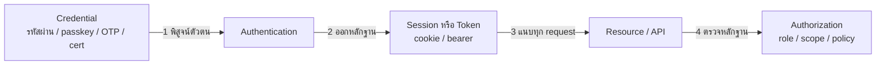
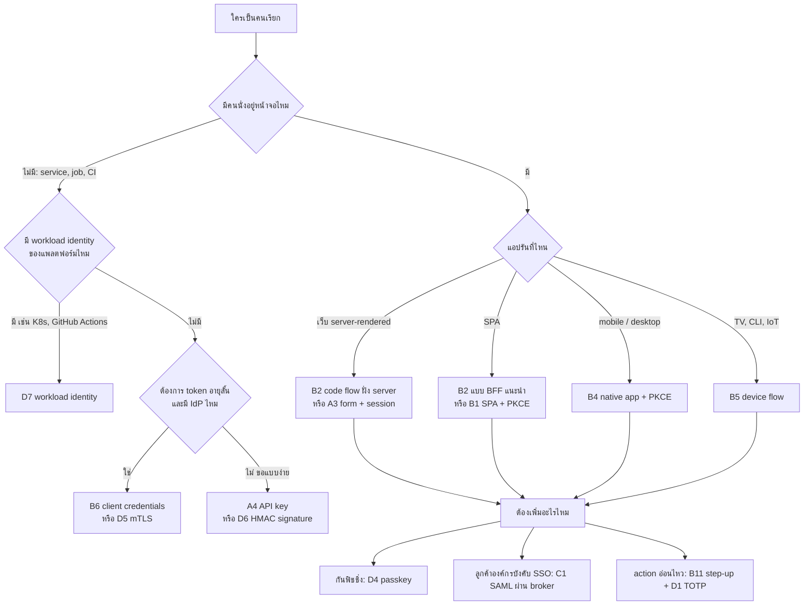
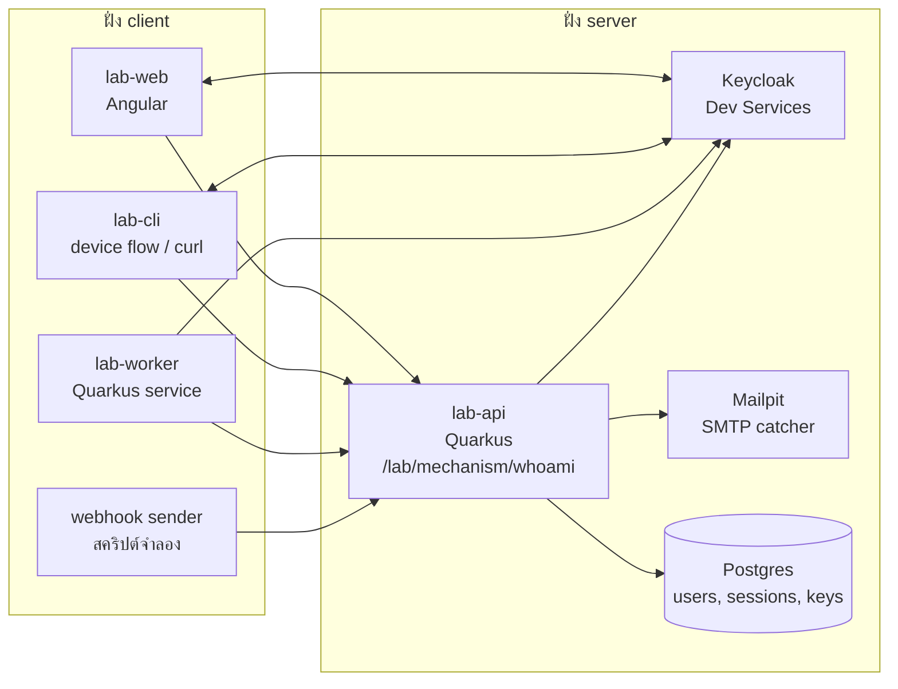

---
tags:
  - spec
  - security
  - auth
  - quarkus
  - angular
type: spec
status: draft
parent: "[[Auth Flows Lab]]"
created: 2026-10-15
updated: 2026-10-15
---

# 🧭 Auth Flow Spec — แผนที่ auth ทุกแบบ

หน้ารวมของสเปคใต้ [[Auth Flows Lab]] ตอบสามข้อ: **auth มีกี่แบบ** (ข้อ 2) · **เลือกแบบไหนตอนไหน** (ข้อ 3) · **ถ้าจะสร้างต้องสร้างอะไร ใช้อะไร** (ข้อ 4–6 และ 4 ส่วนลูกด้านล่าง)

| ส่วน                                         | ตระกูล                                         | รายการ |
| -------------------------------------------- | ---------------------------------------------- | ------ |
| [[Auth Flow Spec 1 — Own Accounts]]          | ทำ auth เอง บัญชีอยู่ในระบบเรา                 | A1–A7  |
| [[Auth Flow Spec 2 — OAuth OIDC]]            | มาตรฐานที่คนใช้กันมากที่สุด (OAuth 2.0 / OIDC) | B1–B15 |
| [[Auth Flow Spec 3 — Federation Enterprise]] | SSO ข้ามระบบ + ของฝั่งองค์กร                   | C1–C8  |
| [[Auth Flow Spec 4 — MFA Passkeys Machine]]  | ปัจจัยเสริม + ระบบคุยกับระบบ                   | D1–D8  |

> **อ่านก่อน**
> 1. ข้อมูลทั้งหมดเป็น ณ **15 ต.ค. 2026** — เวอร์ชัน/สถานะมาตรฐานเปลี่ยนได้ (OAuth 2.1 ยังเป็น draft, Quarkus 4.0 ยังเป็น Beta) ตรวจซ้ำก่อนลงมือทุกครั้ง
> 2. ทุกข้อเท็จจริงเชิงเทคนิคในสเปคแปะ **ป้ายสถานะการตรวจ** ตามตารางด้านล่าง — ข้อที่ไม่มีป้ายคือแนวคิด/ข้อเสนอของผู้บันทึก ไม่ใช่ข้อเท็จจริงที่ต้องตรวจ
> 3. ผล ▶️ ฝั่ง Quarkus รันบน **Quarkus 3.33.4 (LTS) + JDK 21 บน Windows 11** ในโฟลเดอร์ชั่วคราว ส่วนเวกเตอร์ของ RFC (PKCE, TOTP, HS256) และเวลา hash รันด้วย Java 21 ล้วน (Argon2/bcrypt ใช้ BouncyCastle 1.86) — ไม่มี Keycloak/Docker เกี่ยวเลย ส่วน OIDC/Keycloak ทั้งหมดมาจากการอ่านเอกสาร (🔎) ยังไม่เคยรัน

| ป้าย | ความหมาย |
|---|---|
| 🔎 | ตรวจกับต้นทางแล้วในวันที่เขียน (RFC / เอกสาร Quarkus / W3C / NIST / OWASP / เอกสาร provider) — แหล่งอยู่ท้ายแต่ละส่วน |
| ▶️ | รันจริงแล้ว ผลที่เห็นคือผลจริง |
| 🧠 | เขียนจากความรู้มาตรฐานทั่วไป ยังไม่ได้เปิดตรวจรอบนี้ — เช็กกับต้นทางก่อนใช้จริง |

---

## 1. ภาพใหญ่ — auth ตอบ 5 คำถาม

| #   | คำถาม                                | ชื่อเรียก              | ตัวอย่างคำตอบ                        |
| --- | ------------------------------------ | ---------------------- | ------------------------------------ |
| 1   | ใครคือใคร                            | Authentication (AuthN) | รหัสผ่าน, passkey, OTP, certificate  |
| 2   | ทำอะไรได้                            | Authorization (AuthZ)  | role, scope, permission, policy      |
| 3   | request ถัดไปจำได้ยังไงว่าเป็นคนเดิม | Session / การขนหลักฐาน | cookie, bearer token, API key header |
| 4   | ใครยืนยันแทนเรา                      | Federation / SSO       | OIDC, SAML, social login             |
| 5   | บัญชีเกิด เปลี่ยน ตาย ยังไง          | Account lifecycle      | สมัคร, ยืนยัน, รีเซ็ต, ล็อก, ลบ      |

สเปคนี้เน้นข้อ 1, 3, 4, 5 — ข้อ 2 (authorization) แตะเฉพาะที่ผูกกับ flow (scope / role / claim) ส่วนลึกดู [[Quarkus Security]]

คำสี่คำที่คนมักปนกัน: **Credential** (สิ่งที่ใช้พิสูจน์ตัวตนตอนแรก) → **Assertion** (คำยืนยันจากคนที่เราเชื่อว่าใครคือใคร) → **Token** (หลักฐานที่ออกให้หลังพิสูจน์แล้ว) → **Session** (สถานะที่ server จำไว้)



---

## 2. แผนที่ทั้งหมด — มีกี่แบบ

**นับตามที่แยกได้จริงในสเปคนี้: 38 รายการใน 4 ตระกูล** แต่ 38 รายการนี้รวม "ท่าขนหลักฐาน / ท่าต่ออายุ / ท่าเสริมความปลอดภัย" เข้าไปด้วย ถ้านับเฉพาะ **วิธีพิสูจน์ตัวตนจริงๆ มี 10 แบบ** (ตารางล่างสุดของข้อนี้) — ที่เหลือคือโปรโตคอลที่ใช้ออก/ขน/ต่ออายุหลักฐานของ 10 แบบนั้น

สถานะ: ✅ ใช้ได้/แนะนำ · ⚠️ legacy หรือใช้ได้แบบมีข้อควรระวัง · ❌ เลิกใช้

### 2.1 ตระกูล A — ทำ auth เอง ([[Auth Flow Spec 1 — Own Accounts]])

| ID | flow | พิสูจน์ตัวตนด้วย | state อยู่ที่ไหน | เหมาะกับ | |
|---|---|---|---|---|---|
| A1 | HTTP Basic | `user:pass` ทุก request | ไม่มี | เครื่องมือภายใน, bootstrap, ผ่าน HTTPS เท่านั้น | ⚠️ |
| A2 | HTTP Digest | hash แบบ challenge-response | server จำ nonce | อ่านให้รู้จัก ไม่ต้องสร้าง | ⚠️ |
| A3 | Form login + session cookie | รหัสผ่านครั้งเดียวแล้วใช้ cookie | server (session) หรือ cookie ที่เข้ารหัส | เว็บ server-rendered, SPA ที่ same-site | ✅ |
| A4 | API key | secret string ใน header | server เก็บ hash ของ key | developer API, service ง่ายๆ | ✅ |
| A5 | Opaque bearer token + introspection | token สุ่ม | auth server (ถามทุกครั้ง) | ต้อง revoke ทันที | ✅ |
| A6 | JWT bearer (self-contained) | token ที่เซ็นลายเซ็น | ไม่มี (revoke ยาก) | API หลาย service ตรวจ token เอง | ✅ |
| A7 | วงจรชีวิตบัญชี | สมัคร/ยืนยัน/รีเซ็ต/ล็อก | DB ของเรา | ทุกระบบที่เก็บ user เอง | ✅ จำเป็น |

### 2.2 ตระกูล B — OAuth 2.0 / OIDC ([[Auth Flow Spec 2 — OAuth OIDC]])

| ID | flow | ใช้เมื่อ | | 
|---|---|---|---|
| B1 | Authorization Code + PKCE (SPA เป็น public client) | SPA ที่ยอมให้ browser ถือ token | ✅ |
| B2 | Code flow ฝั่ง server / BFF (confidential client) | เว็บ server-rendered และ SPA ที่ต้องการความปลอดภัยสูง | ✅ แนะนำ |
| B3 | OIDC — ชั้น identity (ID token, userinfo) | ต้องรู้ว่าผู้ใช้คือใคร ไม่ใช่แค่ขอสิทธิ์ | ✅ |
| B4 | Native / mobile app (RFC 8252) | แอปมือถือ/เดสก์ท็อป | ✅ |
| B5 | Device Authorization (RFC 8628) | TV, CLI, IoT | ✅ |
| B6 | Client Credentials | service เรียก service ไม่มีผู้ใช้ | ✅ |
| B7 | Refresh token (+ rotation) | ต่ออายุโดยไม่ login ใหม่ | ✅ |
| B8 | Token Exchange (RFC 8693) | service A เรียก B ในนามผู้ใช้ด้วย token ที่แคบลง | ✅ |
| B9 | JWT bearer grant / private_key_jwt (RFC 7523) | client ยืนยันตัวด้วยลายเซ็นแทน secret | ✅ |
| B10 | CIBA (decoupled) | อนุมัติบนอุปกรณ์อื่นโดย client เริ่มเอง | ⚠️ เฉพาะทาง |
| B11 | Step-up (RFC 9470) | action อ่อนไหวต้องยืนยันเพิ่ม | ✅ |
| B12 | ตัวเสริมความปลอดภัย: DPoP, PAR, JAR, RAR, `iss`, resource indicators | งานเข้มงวด (การเงิน) | ✅ ทางเลือก |
| B13 | Logout และ revocation | ทุกระบบที่มี SSO | ✅ |
| B14 | ฝั่ง resource server: ตรวจ token | ทุก API ที่รับ token | ✅ จำเป็น |
| B15 | Implicit และ ROPC | — | ❌ |

### 2.3 ตระกูล C — Federation และองค์กร ([[Auth Flow Spec 3 — Federation Enterprise]])

| ID | flow | พิสูจน์ตัวตนด้วย | เหมาะกับ | |
|---|---|---|---|---|
| C1 | SAML 2.0 SSO | Assertion เซ็นด้วย XML signature | ลูกค้าองค์กรที่บังคับ SAML | ✅ (ผ่าน broker) |
| C2 | Social login (Google, GitHub, Apple, Facebook, LINE) | OIDC/OAuth ของ provider | แอปผู้บริโภค | ✅ |
| C3 | Identity brokering + account linking | IdP กลางรวมหลาย IdP | ต้องรองรับหลายที่มาของผู้ใช้ | ✅ |
| C4 | LDAP / AD bind | รหัสผ่านที่ตรวจกับ directory | ระบบภายในองค์กร | ⚠️ |
| C5 | Kerberos / SPNEGO (และ NTLM) | ticket ของ domain | intranet ที่ต้อง SSO เงียบๆ | ⚠️ |
| C6 | Gateway / forward-auth | proxy ยืนยันให้ แอปเชื่อ header/JWT | ซ่อนแอปไว้หลัง Cloudflare Access / oauth2-proxy | ✅ |
| C7 | MCP / AI agent authorization | OAuth 2.1 profile | MCP server, agent | ✅ ใหม่ |
| C8 | Provisioning (SCIM) และ multi-tenant | — | องค์กร/SaaS | ✅ |

### 2.4 ตระกูล D — ปัจจัยเสริมและเครื่องคุยกับเครื่อง ([[Auth Flow Spec 4 — MFA Passkeys Machine]])

| ID | flow | พิสูจน์ตัวตนด้วย | เหมาะกับ | |
|---|---|---|---|---|
| D1 | TOTP / HOTP | รหัสใช้ครั้งเดียวจากความลับร่วม | MFA ทั่วไป | ✅ |
| D2 | OTP ทาง SMS/email และ magic link | ช่องทางที่ส่งรหัส | passwordless ระดับเสี่ยงต่ำ, fallback | ⚠️ |
| D3 | Push approval / number matching | กดอนุมัติบนมือถือ | MFA ในองค์กร | ⚠️ |
| D4 | WebAuthn / passkey | กุญแจส่วนตัวในอุปกรณ์ ผูกกับโดเมน | ทุกเว็บที่อยากกันฟิชชิ่ง | ✅ แนะนำ |
| D5 | mTLS (client certificate) | cert ที่ TLS | B2B, service mesh, การเงิน | ✅ |
| D6 | HMAC / request signing | ลายเซ็นทับ request | webhook, API ที่ต้องกันแก้ไข/replay | ✅ |
| D7 | Workload identity | token ของแพลตฟอร์ม (K8s, CI, SPIFFE) | ระบบที่ไม่อยากถือ secret ถาวร | ✅ แนะนำ |
| D8 | Recovery codes และ account recovery | รหัสสำรอง | ทุกระบบที่มี MFA | ✅ จำเป็น |

### 2.5 วิธีพิสูจน์ตัวตนจริงๆ มี 10 แบบ

| # | วิธีพิสูจน์ | หลักฐานที่แสดง | อยู่ในรายการ |
|---|---|---|---|
| 1 | รู้บางอย่าง | รหัสผ่าน, PIN | A1, A3, A7 และทุก flow ที่ IdP ถามรหัส |
| 2 | ถือ secret ที่ออกให้ | API key, bearer token | A4, A5, A6, B6 |
| 3 | ถือ session ที่ server จำ | cookie | A3, B2 |
| 4 | ได้ assertion จากคนที่เราเชื่อ | ID token, SAML assertion, JWT ที่เซ็น | B1–B3, B8, B9, C1–C3, C6 |
| 5 | รหัสใช้ครั้งเดียว | OTP, magic link | D1–D3 |
| 6 | ถือกุญแจส่วนตัวในอุปกรณ์ | passkey, client cert | D4, D5 |
| 7 | เซ็นลายเซ็นทับ request | HMAC, DPoP | D6, B12 |
| 8 | ตัวตนของ workload เอง | service account token, SVID, OIDC ของ CI | D7 |
| 9 | ตัวตนในไดเรกทอรีองค์กร | LDAP bind, Kerberos ticket | C4, C5 |
| 10 | อยู่หลัง proxy ที่ยืนยันให้แล้ว | identity header, JWT จาก edge | C6 |

---

## 3. เลือก flow ไหน



| เงื่อนไข | เลือก | เหตุผล |
|---|---|---|
| ไม่อยากเก็บรหัสผ่านและทำ reset เอง | IdP ผ่าน B1/B2 (Keycloak, Auth0 ฯลฯ — ดู [[OAuth 2.0]] ข้อ 3) | งาน A7 ทั้งก้อนย้ายไปอยู่ที่ IdP |
| ต้อง revoke ทันที | session ฝั่ง server (A3) หรือ opaque token (A5) | JWT ที่ stateless เพิกถอนกลางทางไม่ได้จนกว่าจะหมดอายุ |
| หลาย service ต้องตรวจ token เองโดยไม่ถาม auth server | JWT (A6/B14) | ตรวจลายเซ็นด้วย public key จาก JWKS |
| SPA ที่ถือข้อมูลอ่อนไหว | BFF (B2) | RFC 10017 ระบุว่า "strongly recommended" สำหรับงานธุรกิจ/ข้อมูลส่วนบุคคล 🔎 |
| ต้องกันฟิชชิ่งจริงจัง | passkey (D4) | OTP/SMS ที่พิมพ์เองไม่ใช่ phishing-resistant ตาม NIST 🔎 |
| webhook จากผู้ให้บริการภายนอก | HMAC signature (D6) เช่น `x-line-signature` | ผู้ส่งไม่ใช่ผู้ใช้ ไม่มี session |
| CI เรียก cloud | workload identity (D7) — ดู [[CI-CD Secrets]] | ไม่ต้องเก็บ key ถาวร |
| ซ่อนแอปไว้หลัง Cloudflare Access / oauth2-proxy | C6 | แอปรับ identity จาก proxy ต้องล็อก origin ไว้ด้วย |
| ลูกค้าองค์กรขอ SAML | C1 ผ่าน Keycloak broker | Quarkus ไม่มี SAML adapter ในตัว 🔎 |

---

## 4. ส่วนประกอบที่ทุก flow ใช้ร่วมกัน

### 4.1 Credential / Assertion / Token / Session

| คำ | คืออะไร | อายุ | ตัวอย่าง |
|---|---|---|---|
| Credential | สิ่งที่ใช้พิสูจน์ตัวตนตอนแรก | ยาว (จนกว่าเปลี่ยน) | password, passkey, API key, client secret, cert |
| Assertion | คำยืนยันจากคนที่เชื่อว่าใครคือใคร | สั้นมาก (วินาที–นาที) | ID token, SAML assertion |
| Token | หลักฐานที่ออกให้หลังพิสูจน์แล้ว แนบกับ request | สั้น–กลาง (นาที–ชั่วโมง) | access token, refresh token |
| Session | สถานะที่ server จำไว้ว่า login แล้ว | กลาง มี idle + absolute | session id ใน cookie |

### 4.2 Token สองแบบ — opaque กับ JWT

| | Opaque (reference) | JWT (self-contained) |
|---|---|---|
| ตรวจยังไง | ถาม auth server (introspection, RFC 7662) หรือ lookup ใน DB | ตรวจลายเซ็นด้วย public key เอง |
| revoke ทันที | ได้ | ไม่ได้จนกว่าจะหมดอายุ (ต้อง denylist ซึ่งกลับไป stateful) |
| ภาระ auth server | ถูกถามทุก request (cache ได้สั้นๆ) | ไม่ถูกถาม ขยายตัวง่าย |
| ข้อมูลในตัว token | ไม่มี | มี claim อ่านได้ทุกคน (base64 ไม่ใช่การเข้ารหัส) ▶️ |
| ขนาด | เล็ก | ใหญ่ขึ้นตาม claim |
| เหมาะกับ | ต้องคุม/ถอนสิทธิ์ละเอียด | หลาย service ตรวจเอง |

**JWT ไม่ได้ดีกว่า session โดยอัตโนมัติ** — แลกการ revoke ง่ายกับการไม่ต้องมี state กลาง เลือกตามว่ากลัวอะไรมากกว่า

### 4.3 เก็บ token ไว้ที่ไหนใน browser

| ที่เก็บ | โดน XSS ขโมยได้ไหม | โดน CSRF ไหม | หมายเหตุ |
|---|---|---|---|
| cookie `HttpOnly; Secure; SameSite` | JS อ่านไม่ได้ (แต่ XSS ยังสั่งยิง request ในนามผู้ใช้ได้) | โดน ต้องมีตัวกัน CSRF | OWASP แนะนำ cookie หรือ BFF 🔎 |
| ตัวแปรใน memory ของ JS | อ่านได้ระหว่างหน้าเปิดอยู่ หายเมื่อ refresh | ไม่โดน | pattern "browser-based client" ของ RFC 10017 ซึ่งเสี่ยงที่สุดในสามแบบ 🔎 |
| `localStorage` / `sessionStorage` | ขโมยง่ายที่สุด | ไม่โดน | OWASP: อย่าเก็บ token, session id, JWT, refresh token ที่นี่ 🔎 |

### 4.4 ตัวเลขอ้างอิงเรื่องอายุ

| ที่มา | ค่า |
|---|---|
| OWASP session | entropy ≥ 64 bit (แนะนำ 128 ถ้าสร้างเอง), idle 2–5 นาที (มูลค่าสูง) / 15–30 นาที (เสี่ยงต่ำ), absolute ตัวอย่าง 4–8 ชม. 🔎 |
| NIST SP 800-63B-4 (SHOULD ยกเว้นระบุ) | AAL2: รวม ≤ 24 ชม., idle ≤ 1 ชม. · AAL3: รวม ≤ 12 ชม. (SHALL), idle ≤ 15 นาที · AAL1: รวม ≤ 30 วัน 🔎 |
| Quarkus form auth | idle `30M`, ต่ออายุ cookie ทุก `1M` (default) 🔎 |
| SmallRye JWT | ออก token default 300 วินาที (`smallrye.jwt.new-token.lifespan`) 🔎 · ตรวจ clock skew default 60 วินาที ▶️ |
| Quarkus Dev Services (OIDC) | access/ID token default `5M` 🔎 |
| LINE Login v2.1 | authorization code 10 นาที ใช้ครั้งเดียว · access token 30 วัน · refresh token สูงสุด 90 วัน 🔎 |
| Device flow | polling interval default 5 วินาที, `slow_down` บวกเพิ่ม 5 วินาที 🔎 |
| TOTP | step 30 วินาที (RFC 6238) ▶️ |

### 4.5 กุญแจและการหมุนเวียน

- ฝั่งผู้ออก token แจกกุญแจสาธารณะผ่าน **JWKS** (`jwks_uri`) แต่ละกุญแจมี `kid` — ผู้ตรวจดึงมาเก็บแล้วเลือกกุญแจตาม `kid` ห้าม hard-code
- หมุนเวียน: ประกาศกุญแจใหม่ก่อน → เซ็นด้วยกุญแจใหม่ → เก็บกุญแจเก่าไว้จน token เก่าหมดอายุ ตัวอย่างจริง: Cloudflare Access หมุนทุก ~6 สัปดาห์ และกุญแจก่อนหน้ายังใช้ได้อีก 7 วัน 🔎
- กุญแจที่ใช้เซ็นต้องถูกเลือกจาก **config ของผู้ตรวจ ไม่ใช่จาก header ของ token** — ไม่งั้นเปิดทาง alg confusion (ผลรันจริงใน [[Auth Flow Spec 1 — Own Accounts]] ข้อ A6 ▶️)
- secret ที่ดีที่สุดคือ secret ที่ไม่ต้องเก็บ → ดู D7 และ [[CI-CD Secrets]]

### 4.6 401 กับ 403 และ header ที่ต้องส่งกลับ

| สถานการณ์ | status | header |
|---|---|---|
| ไม่มี/ผิด credential | 401 | `WWW-Authenticate: <scheme> ...` บอกว่าต้องใช้วิธีไหน |
| token ไม่ถูกต้อง/หมดอายุ | 401 | `WWW-Authenticate: Bearer error="invalid_token"` |
| รู้ว่าเป็นใคร แต่สิทธิ์ไม่พอ | 403 | `WWW-Authenticate: Bearer error="insufficient_scope", scope="..."` 🔎 (รูปแบบจากสเปค MCP ซึ่งอิง RFC 6750) |
| ต้องยืนยันตัวตนระดับสูงกว่า | 401 | `error="insufficient_user_authentication"` + `acr_values` / `max_age` (RFC 9470) 🔎 |

ผลรันจริง ▶️: Basic รหัสผิดได้ `www-authenticate: basic` · JWT ได้ `www-authenticate: Bearer` · API key (mechanism ที่เขียนเอง) ได้ header ที่เราตั้งเอง — **mechanism แต่ละตัวเป็นคนกำหนดหน้าตาของ 401**

---

## 5. Lab — โครงสร้างโปรเจกต์และเครื่องมือ



```
auth-lab/
├── api/              # Quarkus — /lab/<mechanism>/whoami ต่อ 1 mechanism
├── web/              # Angular — หน้าลองแต่ละ flow + token inspector
├── cli/              # device flow + client credentials
├── worker/           # service ที่เรียก api ด้วย client credentials / token exchange
├── infra/
│   ├── docker-compose.yml   # keycloak, mailpit, postgres
│   └── certs/               # CA + cert ทดลอง (mTLS)
├── bruno/            # collection ยิงทุก flow
└── notes/            # transcript ผลทดลองต่อ milestone = หลักฐานว่าสำเร็จ
```

### 5.1 whoami harness — mechanism ต่อ path

หลักการ: resource เดียว (`whoami` คืน principal + roles) แต่ **แต่ละ path เปิดให้ผ่านได้ด้วย mechanism เดียว** เพื่อเทียบ HTTP จริง Quarkus เลือก mechanism ต่อ path ด้วย `quarkus.http.auth.permission.<ชื่อ>.auth-mechanism` 🔎 ▶️:

```properties
quarkus.http.auth.basic=true            # ต้องตั้งเอง ถ้าไม่ตั้ง Basic เงียบหาย (ดู A1)
quarkus.http.auth.form.enabled=true
quarkus.http.auth.session.encryption-key=<16 ตัวอักษรขึ้นไป>

quarkus.http.auth.permission.basic.paths=/lab/basic/*
quarkus.http.auth.permission.basic.policy=authenticated
quarkus.http.auth.permission.basic.auth-mechanism=basic

quarkus.http.auth.permission.form.paths=/lab/form/*
quarkus.http.auth.permission.form.policy=authenticated
quarkus.http.auth.permission.form.auth-mechanism=form

quarkus.http.auth.permission.jwt.paths=/lab/jwt/whoami
quarkus.http.auth.permission.jwt.policy=authenticated
quarkus.http.auth.permission.jwt.auth-mechanism=bearer

quarkus.http.auth.permission.apikey.paths=/lab/apikey/*
quarkus.http.auth.permission.apikey.policy=authenticated
quarkus.http.auth.permission.apikey.auth-mechanism=x-api-key     # ชื่อที่ใช้ได้ในการรัน (ดู A4)

quarkus.http.auth.permission.open.paths=/lab/public/*,/lab/jwt/login,/lab/hmac/*
quarkus.http.auth.permission.open.policy=permit
```

ผลที่เห็น ▶️: credential ของ mechanism หนึ่งส่งไปที่ path ของอีกอัน → 401 เสมอ (เช่น Basic ที่ถูกต้องส่งไป `/lab/jwt/whoami` → 401 + `www-authenticate: Bearer`) ทางเลือกอีกแบบคือติด annotation ต่อ endpoint (`@BasicAuthentication`, `@FormAuthentication`, `@MTLSAuthentication`, `@AuthorizationCodeFlow`, `@BearerTokenAuthentication`, `@WebAuthn`, `@HttpAuthenticationMechanism("custom")`) แต่ต้องตั้ง `quarkus.http.auth.proactive=false` 🔎

### 5.2 เครื่องมือ

| ใช้ทำอะไร | เครื่องมือ |
|---|---|
| ยิง request / ดู header ดิบ | `curl -si` · [Bruno](https://www.usebruno.com/) (auth mode: Basic, Bearer, Digest, NTLM, OAuth 1/2, AWS Sig v4, Akamai EdgeGrid 🔎) |
| ดู cookie / header ที่ browser ส่งจริง | DevTools → Network, Application → Cookies |
| ถอด JWT | `jq` + base64url หรือ jwt.io (อย่าวาง token จริงของ production ลงเว็บ) |
| Keycloak ใน dev | Quarkus Dev Services (สร้าง Keycloak ให้เองเมื่อมี `quarkus-oidc` และไม่ได้ตั้ง `auth-server-url` — realm `quarkus`, client `quarkus-app`, user `alice`/`bob`, image default `keycloak:26.7.4`) 🔎 · Dev UI ที่ `/q/dev` ลอง login/ขอ token ได้ 🔎 |
| รับอีเมลทดสอบ (verify, reset, magic link) | Mailpit 🧠 |
| ดู XML ของ SAML | extension ดัก SAML ใน browser 🧠 |
| ทำ cert สำหรับ mTLS | `openssl` (Windows ใช้ตัวที่มากับ Git ได้) 🧠 |
| ทดสอบ TOTP กับของจริง | แอป authenticator บนมือถือ 🧠 |
| รับ callback ที่ต้อง HTTPS สาธารณะ (Apple, Facebook, LINE) | tunnel ตาม [[Cloudflare]] |

---

## 6. ลำดับสร้าง (Milestone)

ขนาด S ≈ ครึ่งวัน · M ≈ 1 วัน · L ≈ 2 วัน ของเวลาว่างเสาร์-อาทิตย์ — **ประมาณการกว้างๆ ยังไม่ใช่ข้อตกลง** แกนหลักที่แนะนำให้ทำจริงคือ M0–M6 ที่เหลืออ่านสเปคก่อนก็พอ

| M | ทำอะไร | flow | รู้ว่าสำเร็จเมื่อ | ขนาด |
|---|---|---|---|---|
| M0 | ตั้งฐาน: repo, Quarkus, `whoami`, Bruno collection (+ docker-compose ถ้า Docker พร้อม) | — | `/lab/public/ping` ตอบได้, เปิด Dev UI ได้ | S |
| M1 | credential ตรงๆ: Basic + API key (เขียน mechanism เอง — ไม่เคยเขียน reactive ก็ทำได้ A4 มีคู่มือ `Uni` 1 นาที) | A1, A4 | ตารางเทียบหน้าตา 401 ของแต่ละ mechanism, อธิบายได้ว่าทำไม credential ข้ามทางไม่ได้ | S |
| M2 | session: form login, cookie flags, CSRF, session fixation, logout แบบเพิกถอนฝั่ง server | A3 | เห็น cookie ใน DevTools, ยิง CSRF จากอีกหน้าแล้วโดนบล็อก, logout แล้ว cookie เก่าใช้ไม่ได้ | M |
| M3 | token ที่ออกเอง: JWT + JWKS + refresh rotation + reuse detection | A5, A6 | ชุดโจมตีใน A6 ผ่านครบ, refresh token ที่ถูกใช้ซ้ำทำให้เพิกถอนทั้งสาย | M |
| M4 | OIDC: Angular + Keycloak (code + PKCE) แล้วทำ BFF มาเทียบ | B1, B2, B3 | บอกได้ว่า browser เห็น token อะไรบ้างในสองแบบ, API ปฏิเสธ ID token | M |
| M5 | service-to-service: client credentials + token propagation + token exchange | B6, B8 | worker เรียก API ได้, exchange แล้วได้ token ที่ `aud` แคบลง | M |
| M6 | device flow ผ่าน CLI | B5 | CLI login ได้โดยไม่เปิด browser ในตัวมันเอง | S |
| M7 | วงจรบัญชี: สมัคร + ยืนยัน (Mailpit) + รีเซ็ต + เปลี่ยนรหัส + Argon2id/bcrypt + rate limit + lockout | A7 | ข้อความ uniform ทุก flow, token รีเซ็ตใช้ได้ครั้งเดียว | L |
| M8 | MFA: TOTP + recovery codes + step-up | D1, D8, B11 | โค้ดตรงกับแอป authenticator จริง, โค้ดเดิมใช้ซ้ำถูกปฏิเสธ | M |
| M9 | passkey ด้วย `quarkus-security-webauthn` | D4 | ลงทะเบียน + login ด้วย passkey บน localhost | M |
| M10 | federation: social login + brokering (+ SAML ผ่าน Keycloak) | C1, C2, C3 | login ผ่าน GitHub/Google/LINE ได้, อ่าน XML ของ SAML ได้ | L |
| M11 | machine identity: mTLS + HMAC + workload identity | D5, D6, D7 | cert ผิดถูกปฏิเสธ, webhook แก้ 1 ไบต์ถูกปฏิเสธ | M |
| M12 | ทบทวน: ASVS ชุดย่อย + ลอง DPoP/PAR + audit log | B12 | checklist ข้อ 7 ผ่านตามที่เลือก | M |

---

## 7. ภัยคุกคาม → วิธีกัน → อยู่ในส่วนไหน

คอลัมน์ ASVS ชี้ **บท** ของ [OWASP ASVS 5.0](https://github.com/OWASP/ASVS/tree/master/5.0/en) ที่ใกล้ที่สุด (V6 Authentication, V7 Session Management, V8 Authorization, V9 Self-contained Tokens, V10 OAuth and OIDC, V11 Cryptography, V16 Logging) 🔎 — เลขข้อย่อยยังไม่ได้ไล่ ตรวจเองก่อนใช้เป็น checklist

| ภัย | กันด้วย | flow | ASVS |
|---|---|---|---|
| brute force / credential stuffing | rate limit ต่อบัญชี (ไม่ใช่ต่อ IP), MFA, ตรวจรหัสผ่านกับ blocklist, lockout อย่างระวัง (กลายเป็น DoS ได้) 🔎 | A7, D1 | V6 |
| session fixation | สร้าง session id ใหม่ทุกครั้งหลัง login และเมื่อสิทธิ์เปลี่ยน 🔎 | A3 | V7 |
| ขโมย token ด้วย XSS | cookie HttpOnly / BFF, ไม่เก็บใน localStorage 🔎, CSP | A3, B2 | V7 |
| CSRF | `SameSite` + CSRF token (SameSite เป็นแค่ชั้นเสริม 🔎) | A3, B2 | V7 |
| ดัก authorization code | PKCE `S256` 🔎 | B1–B5 | V10 |
| `redirect_uri` ถูกแก้ / open redirect | AS เทียบ string ตรงตัว (ยกเว้นพอร์ตของ localhost ของ native app) 🔎 | B1 | V10 |
| mix-up attack | พารามิเตอร์ `iss` (RFC 9207), redirect URI แยกต่อ AS 🔎 | B1, C7 | V10 |
| token ถูกขโมยแล้วเล่นซ้ำ | อายุสั้น, จำกัด `aud`, sender-constrain (DPoP / mTLS) 🔎 | B12, D5 | V10 |
| refresh token รั่ว | rotation + reuse detection หรือ sender-constrain (RFC 9700: public client ต้องอย่างใดอย่างหนึ่ง 🔎) | A6, B7 | V10 |
| โจมตี JWT: `alg: none`, alg confusion, `aud`/`iss` ผิด | ล็อก algorithm ที่ผู้ตรวจ, กุญแจต่อ issuer, ตรวจ iss/aud/exp ▶️ ผลรันจริงใน A6 | A6, B14 | V9 |
| confused deputy / ส่งต่อ token ข้าม service | token จำกัด `aud`, ใช้ token exchange แทนการส่งต่อตรงๆ (Quarkus เตือนเรื่องนี้ 🔎) | B8 | V10 |
| user enumeration | ข้อความและเวลาตอบเท่ากันทุกกรณี 🔎 | A7 | V6 |
| ลิงก์รีเซ็ตถูกขโมย/ปลอม | token สุ่มด้วย CSPRNG ใช้ครั้งเดียว มีวันหมดอายุ ไม่ประกอบ URL จาก Host header ไม่ login อัตโนมัติ 🔎 | A7, D2 | V6 |
| ฟิชชิ่ง (รวมแบบ real-time proxy) | passkey (verifier-name-binding) 🔎 — OTP/SMS ไม่กัน | D4 | V6 |
| SIM swap / SMS ถูกดัก | อย่าใช้ SMS เป็นปัจจัยเดียว (NIST: PSTN เป็น restricted) 🔎 | D2 | V6 |
| MFA fatigue / push bombing | number matching, จำกัดจำนวน push 🧠 | D3 | V6 |
| SAML signature wrapping / XXE | ใช้ไลบรารีที่ผ่านการตรวจ, ตรวจว่า element ที่เซ็นคือตัวที่เอาไปใช้, ปิด DTD 🧠 | C1 | V10 (🧠) |
| webhook ปลอม / replay | HMAC ทับ raw body (+ timestamp), เทียบแบบ constant-time, dedupe ด้วย event id | D6 | V11 |
| API key รั่ว | ส่งใน header เท่านั้น, เก็บ hash, prefix ระบุตัว, หมุนเวียน, จำกัด scope | A4 | V6 |
| เชื่อมบัญชีผิดคน (account linking) | ผูกด้วย `(iss, sub)` ไม่ใช่ email, เชื่อ email เฉพาะที่ `email_verified` 🧠 | C2, C3 | V10 |
| เชื่อ identity header โดยตรง | ล็อก origin ให้เข้าได้เฉพาะ proxy, ตรวจ JWT ในแอปด้วย | C6 | V8 |
| ไม่รู้ว่าโดนโจมตี | log ทุก login ล้มเหลว/lockout/เปลี่ยน factor, ไม่ log secret 🔎 | ทุกตัว | V16 |

---

## 8. สภาพแวดล้อมและกับดักตอนลอง

- **Windows + JDK 21: Quarkus start ไม่ขึ้น** ▶️ — อาการ `Failed to start quarkus ... failed to create a child event loop ... Unable to establish loopback connection ... SocketException: Invalid argument: connect` เจอจริงตอนตรวจสเปคในเครื่องนี้ (Windows 11, JDK 21.0.5) อ่านซอร์ส JDK 21 แล้วพบว่า `Selector.open()` บน Windows ใช้ Unix domain socket เป็น wakeup pipe โดยเลือกโฟลเดอร์จาก `%TEMP%` ก่อน — ตั้ง `-Djdk.net.unixdomain.tmpdir=C:\Temp\jtmp` (โฟลเดอร์สั้นที่สร้างไว้) แล้วหาย ส่วน `-Djava.net.preferIPv4Stack=true` และ `-Djava.io.tmpdir=...` ไม่ช่วย สงสัยว่าเกี่ยวกับ `%TEMP%` ของ shell นั้นเป็นชื่อสั้น 8.3 (`C:\Users\BORDIN~1\...`) แต่ยังไม่ได้พิสูจน์ว่า `~` คือต้นเหตุ — ถ้าเทอร์มินัลปกติของคุณไม่เจอก็ไม่ต้องสนใจ
- **Docker Desktop ต้องเปิดก่อน** ถ้าจะใช้ Dev Services (Keycloak, Postgres) — ตอนตรวจสเปค daemon ไม่ได้รัน เลยไม่ได้รัน Keycloak จริง
- **WebAuthn ต้อง HTTPS** แต่ `localhost` ถือเป็น secure context ใช้ HTTP ได้ 🔎
- **Apple และ Facebook login ทดสอบบน `localhost` ไม่ได้** ต้องเป็น HTTPS ที่เข้าถึงจากข้างนอก (เอกสาร Quarkus แนะนำ ngrok) 🔎 — ใช้ tunnel ของ [[Cloudflare]] แทนได้
- **นาฬิกาต้องตรง** — TOTP, `exp`/`nbf`/`iat` ของ JWT, `NotOnOrAfter` ของ SAML, Kerberos ล้วนพึ่งเวลา ถ้าเครื่องเพี้ยนจะเห็นอาการ "token ใช้ไม่ได้ทั้งที่ถูก"
- **พอร์ต/cookie ข้าม origin** — cookie ผูกกับ host ไม่ผูกพอร์ต `localhost:4200` กับ `localhost:8080` แชร์ cookie ของ `localhost` กันได้ แต่ CORS ยังนับเป็นคนละ origin (ดู [[Quarkus Keycloak]] ข้อ 4)

---

## 🎯 แนวทางการเริ่มศึกษา

1. **เริ่มต้น** — ยังไม่แตะโค้ด เข้าใจสามอย่างให้แม่นก่อน: (ก) auth คือ 5 คำถามที่แยกจากกัน — AuthN, AuthZ, session, federation, account lifecycle (ข้อ 1) (ข) credential / token / session ต่างกันยังไง และ opaque กับ JWT แลกอะไรกับอะไร (ข้อ 4.1–4.2) (ค) 401 กับ 403 และ `WWW-Authenticate` บอกอะไร (ข้อ 4.6) แล้วอ่านแผนที่ข้อ 2 ให้เห็นว่า 38 รายการยุบเหลือ 10 วิธีพิสูจน์ตัวตน
2. **ลงมือทำจริง** — M0–M2: endpoint `whoami` ตัวเดียวที่เปิดด้วย Basic, API key, form + cookie ทีละแบบ ดู request/response/cookie ใน DevTools และ curl ลองโจมตีเล็กๆ (เอา credential ของทางหนึ่งไปใช้อีกทาง, CSRF, session fixation) จบด้วยตารางเทียบ 1 หน้า — นี่คือโปรเจกต์ end-to-end แรก ไม่ใช่แค่ "ติดตั้งแล้วรัน"
3. **ใช้งานได้คล่อง** — M3–M6 แล้วต่อด้วย M7–M9: JWT ออกเองพร้อมชุดโจมตี (`alg: none`, alg confusion, `aud` ไม่ตรง) และ refresh rotation · OIDC แบบ SPA ตรงๆ เทียบกับ BFF · client credentials + token exchange · device flow · จากนั้นวงจรบัญชีจริง (รีเซ็ต, rate limit, Argon2id), MFA และ passkey — **ที่มือใหม่มักพลาด:** ไม่ตั้ง `aud` ฝั่ง API, เก็บ token ใน `localStorage`, ลืม CSRF เมื่อใช้ cookie, ทำ passkey โดยไม่มีทางกู้คืน, เชื่อ identity header โดยเข้า origin ได้ตรงๆ

---

## 9. คำถามที่ยังเปิดอยู่ (ต้องให้ผู้ใช้ตัดสินใจ)

1. **ขอบเขต** — สร้างจริงเฉพาะ M0–M6 แล้วอ่านที่เหลือ หรือสร้างทั้งหมด?
2. **IdP หลัก** — ใช้ Keycloak (มีโน้ตและตัวอย่างอยู่แล้ว) หรือเทียบกับเจ้าอื่นด้วย?
3. **SPA เริ่มจากแบบไหน** — BFF ก่อน (RFC 10017 แนะนำสำหรับงานอ่อนไหว) หรือ SPA ตรงๆ ก่อนแล้วค่อยเทียบ?
4. **SAML / mTLS / Kerberos** — ลงมือจริง (ต้องมี infra เพิ่ม) หรืออ่านสเปคอย่างเดียว?
5. **สนามจริง** — เอาไปใช้กับ [[LINE Slip Bot]] (LINE Login ฝั่งแอดมิน) ไปด้วยเลยไหม?
6. **ขยับ status** — `seed` → `sprouting` ตอนไหน (ข้อเสนอ: เมื่อทำ M0–M1 เสร็จ)

---

## 🔗 เกี่ยวข้อง

- [[Auth Flows Lab]] — โน้ตโปรเจกต์
- [[OAuth 2.0]] — grant type และ provider (สเปคนี้ไม่พูดซ้ำ)
- [[Keycloak]], [[Quarkus Keycloak]] — IdP และตัวอย่าง Angular + Quarkus
- [[Quarkus Security]] — custom permission, multi-tenant
- [[Quarkus REST Client]] — แนบ token ตอนเรียก service อื่น
- [[CI-CD Secrets]] — workload identity
- [[Cloudflare]] — Access, Tunnel
- [[Supabase]] — Supabase Auth (provider อีกเจ้า)
- [[Quarkus Config]] — profile และ config ที่ใช้แยก dev/prod

## 📖 อ้างอิงหลัก

- [Quarkus — Security overview](https://quarkus.io/guides/security-overview)
- [Quarkus — Authentication mechanisms](https://quarkus.io/guides/security-authentication-mechanisms)
- [Quarkus — OIDC authorization code flow](https://quarkus.io/guides/security-oidc-code-flow-authentication)
- [Quarkus — Dev Services and Dev UI for OIDC](https://quarkus.io/guides/security-openid-connect-dev-services)
- [RFC 9700 — Best Current Practice for OAuth 2.0 Security](https://www.rfc-editor.org/rfc/rfc9700.html)
- [RFC 10017 — OAuth 2.0 for Browser-Based Applications](https://www.rfc-editor.org/info/rfc10017)
- [OAuth.net — รายการ spec ทั้งหมด](https://oauth.net/specs/)
- [OWASP — Session Management Cheat Sheet](https://cheatsheetseries.owasp.org/cheatsheets/Session_Management_Cheat_Sheet.html)
- [OWASP — Authentication Cheat Sheet](https://cheatsheetseries.owasp.org/cheatsheets/Authentication_Cheat_Sheet.html)
- [NIST SP 800-63B-4](https://pages.nist.gov/800-63-4/sp800-63b.html)
- [OWASP ASVS 5.0](https://github.com/OWASP/ASVS/tree/master/5.0/en)
- [Cloudflare — Validate Access JWT](https://developers.cloudflare.com/cloudflare-one/identity/authorization-cookie/validating-json/)
- [Bruno — Auth overview](https://docs.usebruno.com/auth/overview)
