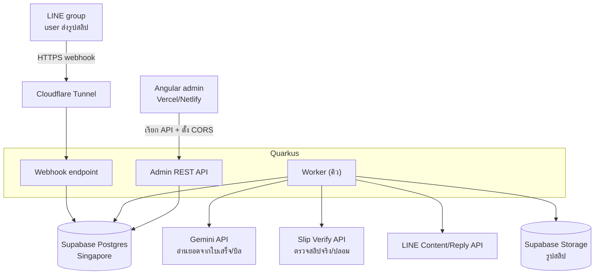
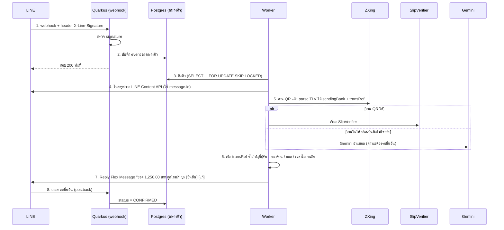

---
tags:
  - spec
  - java
  - quarkus
  - angular
type: spec
status: draft
parent: "[[LINE Slip Bot]]"
created: 2026-10-03
updated: 2026-10-03
---

# 🛠️ Design Spec — LINE Slip Bot

ต่อยอดจาก [[LINE Slip Bot]] — สรุปจากการคุยวางแผน 1–3 ต.ค. 2026 ที่ผู้ใช้แปะเข้ามาเป็น context โปรเจกต์ ใช้เป็นฐานตอนเริ่มเขียนโค้ดจริง

> **อ่านก่อน**
> 1. ราคา/โควตา/ชื่อรุ่นโมเดล/ข้อมูลบริการภายนอกทั้งหมดเป็นข้อมูล **ณ วันที่ค้นของโน้ตต้นทาง (ก.ค.–ก.ย. 2026)** — ผู้บันทึกไม่ได้ตรวจซ้ำ ต้องเช็กซ้ำก่อนใช้งานจริง
> 2. หัวข้อที่ขึ้นต้นด้วย **"ข้อสังเกตที่เพิ่มตอนบันทึก"** คือสิ่งที่เพิ่มเข้ามาตอนบันทึกลง vault ไม่ได้มาจากโน้ตต้นทาง
> 3. โค้ด Java 2 ชิ้น (คำนวณค่าคอม, `SlipVerifier`) คอมไพล์และรันผ่านจริงบน JDK 17 — SQL กับ YAML ยังไม่ได้รันจริง

---

## 1. Tech stack ที่ตัดสินใจแล้ว

| ส่วน               | เลือก                                                                  | เหตุผล                                              |
| ------------------ | ---------------------------------------------------------------------- | --------------------------------------------------- |
| Backend            | **Quarkus (Java)**                                                     | ถนัด, RAM น้อย, logic เงินอยู่ฝั่ง server ที่คุมได้ |
| DB                 | **Supabase (Postgres) region Singapore** — ดู [[Supabase]]             | managed, backup (Pro), ย้ายออกด้วย `pg_dump` ได้    |
| เก็บรูป            | **Supabase Storage**                                                   | อยู่ที่เดียวกับ DB                                  |
| Migration          | **Flyway** — ดู [[Quarkus Flyway]], วิธีต่อ Supabase จริง [[Quarkus + flyway connect supabase]]                                     | `quarkus.flyway.migrate-at-start=true`              |
| LINE               | Messaging API (webhook, reply, content, profile)                       | `line-bot-sdk-java` หรือ REST ตรง                   |
| อ่าน QR สลิป       | **ZXing**                                                              | offline, มาตรฐาน Java                               |
| ตรวจสลิป           | **ผู้ให้บริการกลาง** ผ่าน interface `SlipVerifier`                     | สลับเจ้าได้                                         |
| AI อ่านใบเสร็จ/ยอด | **Gemini 3.1 Flash-Lite** ผ่าน [[Quarkus REST Client]]                 | ถูกสุดที่อ่านรูปได้                                 |
| Admin web          | **Angular + PrimeNG**                                                  | ถนัด                                                |
| Frontend hosting   | Vercel หรือ Netlify                                                    | static เท่านั้น                                     |
| Backend hosting    | VPS Singapore + Docker Compose + Cloudflare Tunnel — ดู [[Cloudflare]] | ต้องมี worker รันค้าง                               |
| CI/CD              | GitHub Actions → ghcr.io → ssh deploy — ดู [[CI-CD]]                   | ยังไม่ต้อง K8s/ArgoCD                               |

### การใช้ Supabase — กฎสำคัญ

- ใช้ Supabase เป็น **แค่ Postgres + Storage** เท่านั้น
- **ไม่ใช้** Supabase Auth, Edge Functions และ **ไม่เอา `anon key` ไปไว้ใน Angular**
- Angular คุยกับ Quarkus อย่างเดียว; Quarkus เป็นตัวเดียวที่แตะ DB
- เปิด RLS ทุกตารางไว้เป็นด่านสำรอง (ดู [[Supabase]] ข้อ 4)
- Free tier: ไม่มี backup + pause หลังเงียบ 1 สัปดาห์ → ใช้กับข้อมูลทดสอบเท่านั้น มีลูกค้าจริงต้องขึ้น Pro ($25/เดือน, backup รายวัน 7 วัน)

### ที่ "ยังไม่ใช้" ช่วง MVP

Kubernetes, ArgoCD, microservices, Redis, Kafka/RabbitMQ, Keycloak — **หน้าแอดมินใช้ LINE Login แทน** (LINE Login เป็น OAuth 2.0 / OpenID Connect provider ตัวหนึ่ง หลักการ flow ดู [[OAuth 2.0]])

---

## 2. Architecture



---

## 3. Flow การรับสลิป



หลักการ claim คิวด้วย `SELECT ... FOR UPDATE SKIP LOCKED` (ขั้น 3) ใช้แพทเทิร์นเดียวกับที่โปรเจกต์ [[Background Job Processor (Quarkus)]] กำลังฝึกอยู่ — ถ้าทำโปรเจกต์นั้นก่อน จะเอามาใช้ตรงๆ ได้

### 3.1 ข้อสังเกตที่เพิ่มตอนบันทึก — flow นี้กับข้อจำกัดของ LINE API

ข้อ 1–2 มาจากเอกสาร LINE (Messaging API reference / Receive messages) ที่อ่านตอนบันทึก — **ยังไม่ได้ทดสอบจริงกับบัญชี/อุปกรณ์จริง**

**① replyToken ใช้ได้ครั้งเดียว และต้องใช้ภายใน 1 นาทีหลังรับ webhook** (เอกสารบอกด้วยว่าตัวเลขนี้เปลี่ยนได้โดยไม่แจ้ง และอาจแกว่งตาม network) — ลอง trace ดู: ถ้าขั้น "reply ได้รับแล้ว" (MVP ข้อ 2) ใช้ token ไปแล้ว ขั้น 7 จะ reply ด้วยอะไร? และแม้ไม่ได้ตอบก่อน ถ้าคิวช้าหรือ `SlipVerifier` ตอบช้าเกิน token ก็หมดอายุก่อนถึงขั้น 7 → ต้อง **push** ซึ่งนับโควตา ขัดกับกฎข้อ 9 ("ใช้ reply ไม่ใช้ push ให้มากที่สุด") ตัวเลือกที่เห็น (ยังไม่ตัดสินใจ):

- reply ครั้งเดียวพร้อมผลลัพธ์ภายในช่วงอายุ token (ไม่ตอบ "ได้รับแล้ว" ก่อน) — ต้องวัดเวลา end-to-end จริงว่าอยู่ในกรอบไหม
- ยอมใช้ push สำหรับข้อความยืนยัน — **ต้นทุนในข้อ 8 สมมติว่าไม่มี push เลย ต้องคำนวณใหม่ทั้งก้อน** (วิธีนับโควตาตอน push เข้ากลุ่มต้องเช็กกับ LINE)

**② `userId` ของคนส่งอาจหายไปจาก webhook ในกลุ่ม** — เอกสารระบุว่าใน group/multi-person chat source `userId` "มีเฉพาะ message event" และ "มีเฉพาะผู้ใช้ LINE for iOS และ LINE for Android" พร้อมอ้างถึงเรื่อง consent การเข้าถึงข้อมูลโปรไฟล์ → **คนส่งสลิปจาก LINE Desktop อาจไม่มี `userId`** = จับคู่ "สลิป → คน" ไม่ได้ ซึ่งชนแก่นของโปรดักต์ (ยอดรายคน) ตรงๆ ฟีเจอร์ "แอดมินแก้เจ้าของรายการ" (คำถามข้อ 11) น่าจะเป็นทางออกของกรณีนี้ด้วย — คิดรวมกัน

**③ webhook อาจถูกส่งซ้ำ (redelivery)** — LINE ส่งซ้ำถ้าเซิร์ฟเวอร์ไม่ตอบ `2xx` (เมื่อเปิดฟีเจอร์ redelivery) payload เหมือนเดิมยกเว้น `deliveryContext.isRedelivery` และเอกสารบอกให้ **dedupe ด้วย `webhookEventId`** (ULID) — `UNIQUE` ที่ `trans_ref`/`image_hash` (กฎข้อ 3) กันซ้ำระดับ transaction ได้ แต่**ตารางคิวควรมี `webhook_event_id UNIQUE` ด้วย** และถ้า insert ชน unique ให้ยังตอบ `200` (หลักการเดียวกับ [[Idempotency]]) เอกสารเตือนอีกว่าลำดับ event ที่ได้รับอาจไม่ตรงลำดับที่เกิดจริงตอน redelivery

---

## 4. Design Rules (สำคัญ — ห้ามละเลย)

1. **เงินไม่ใช้ `double`** — เก็บเป็นสตางค์ (`BIGINT`) หรือ `NUMERIC`, คำนวณด้วย `BigDecimal`, ปัดเศษ `RoundingMode.HALF_UP` (เหตุผลดู [[Java Data Type]])
2. **ไม่เก็บ "ผลรวม" เป็น column ที่ `+=`** — เก็บทุก transaction แล้ว `SUM ... GROUP BY` ตอนต้องการ
3. **กันซ้ำที่ DB ด้วย `UNIQUE`** (`trans_ref`, `image_hash`) ไม่ใช่เช็กใน code อย่างเดียว (race condition)
4. **Snapshot อัตราค่าคอมตอนปิดเดือน** — เปลี่ยน % ทีหลังต้องไม่กระทบเดือนเก่า
5. **ปิดยอดแล้วห้ามแก้รายการเดือนนั้น** + มี audit log ว่าใครแก้อะไรเมื่อไหร่
6. **AI อ่านยอด ต้องให้คนกดยืนยันเสมอ** — AI ไม่ใช่หลักฐานว่าเงินเข้าจริง
7. **การพิสูจน์ว่าสลิปจริง = คำตอบจาก Slip Verify API เท่านั้น** (ถอด QR ได้ ≠ สลิปจริง — หลักการเดียวกับ [[Thai QR Payment]] ข้อ 6)
8. **Webhook ตอบเร็วแล้วประมวลผล async** — replyToken มีอายุสั้น
9. **ใช้ reply ไม่ใช้ push ให้มากที่สุด** — push นับโควตา LINE OA เสียเงิน
10. **Secret ทั้งหมดอยู่ใน `.env`/env var** ห้ามอยู่ใน git (บน production ของที่ทำหน้าที่แทน `.env` จริงคือ environment variable — ดู [[Quarkus Config]], [[CI-CD Secrets]])
11. **External API ทุกตัวอยู่หลัง interface** (`SlipVerifier`, `ReceiptReader`) เพื่อสลับเจ้าได้ — ไม่ต้อง over-engineer เกินนี้ (แพทเทิร์น interface + polymorphism เดียวกับ [[Java OOP]])

### 4.1 ข้อสังเกตที่เพิ่มตอนบันทึก — กฎ vs schema

- **กฎ 8 + 9 ชนกับ replyToken** — ดูข้อ 3.1 ①
- **`UNIQUE (trans_ref)` และ `UNIQUE (image_hash)` เป็นระดับ global (ข้ามทุกร้าน/กลุ่ม)** — ตอนมีหลายร้านในฐานเดียวกัน สลิปที่ร้าน A ลงไว้แล้วจะทำให้ร้าน B ได้ error "ซ้ำ" และเท่ากับบอกร้าน B ว่าสลิปนี้เคยถูกลงที่อื่น ถามนำ: สลิปใบเดียวกันควรถูกยอมรับได้กี่ร้าน? ถ้าตอบว่า "ร้านเดียว" global ถูกแล้วแต่ต้องยอมรับผล side effect นี้ ถ้าตอบว่า "แต่ละร้านแยกกัน" ต้องเปลี่ยนเป็น `UNIQUE (group_id, trans_ref)` — และอีกจุดที่ต้องเช็กกับสเปคแต่ละธนาคาร: `trans_ref` อาจต้องคู่กับ `sending_bank` ถึงจะ unique จริง
- **หน่วยเงินปนกันในสคีมา** — `amount_satang`/`total_satang` เป็นสตางค์ (`BIGINT`) แต่ `commission` เป็น `NUMERIC(14,2)` หน่วยบาท และยอดที่ได้จาก Slip API มักเป็นบาททศนิยม ต้องแปลงเป็นสตางค์ด้วย `BigDecimal` เสมอ (ไม่ผ่าน `double`) — ควรตั้งชื่อ column ให้บอกหน่วยทุกตัว (เช่น `commission_baht`) กันสับสน
- **คิดค่าคอมจากยอดรวมรายคนครั้งเดียว แล้วปัดครั้งเดียว** (ตามโค้ดข้อ 5) อย่าปัดทีละใบแล้วรวม — ตัวอย่างที่รันจริง: สลิป 123.45 บาท × 100 ใบ ที่ 7.50% → ปัดทีละใบแล้วรวมได้ **926.00** แต่รวมก่อนแล้วปัดครั้งเดียวได้ **925.88**

---

## 5. Data Model (เริ่มต้น)

```sql
CREATE TABLE transaction_record (
    id              BIGSERIAL PRIMARY KEY,
    group_id        VARCHAR(64)    NOT NULL,   -- LINE groupId (= 1 ร้าน/ทีม)
    line_user_id    VARCHAR(64)    NOT NULL,
    amount_satang   BIGINT         NOT NULL,
    source_type     VARCHAR(20)    NOT NULL,   -- SLIP / RECEIPT / MANUAL
    trans_ref       VARCHAR(64),
    image_hash      VARCHAR(64)    NOT NULL,
    status          VARCHAR(20)    NOT NULL,   -- PENDING / CONFIRMED / REJECTED
    created_at      TIMESTAMPTZ    NOT NULL DEFAULT now(),
    CONSTRAINT uq_trans_ref  UNIQUE (trans_ref),
    CONSTRAINT uq_image_hash UNIQUE (image_hash)
);
CREATE INDEX idx_tx_group_user_month ON transaction_record (group_id, line_user_id, created_at);

CREATE TABLE commission_summary (
    id              BIGSERIAL PRIMARY KEY,
    group_id        VARCHAR(64)   NOT NULL,
    line_user_id    VARCHAR(64)   NOT NULL,
    period          CHAR(7)       NOT NULL,   -- '2026-10'
    total_satang    BIGINT        NOT NULL,
    rate_percent    NUMERIC(5,2)  NOT NULL,   -- snapshot
    commission      NUMERIC(14,2) NOT NULL,
    closed_at       TIMESTAMPTZ   NOT NULL DEFAULT now(),
    CONSTRAINT uq_group_user_period UNIQUE (group_id, line_user_id, period)
);
```

`trans_ref` เป็น nullable ได้ทั้งที่มี `UNIQUE` เพราะ Postgres ถือว่า `NULL` แต่ละตัว "ไม่เท่ากัน" — เหมาะกับบิล/ใบเสร็จที่ไม่มี `transRef` (ลงหลายใบได้โดยไม่ชน)

**ยังต้องเพิ่ม:** ตาราง tenant/ร้าน (บัญชีรับเงินของร้าน, rate ค่าคอม), webhook event queue (+ `webhook_event_id UNIQUE` ตามข้อ 3.1 ③), audit log

### คำนวณค่าคอม

```java
public BigDecimal calculateCommission(long totalSatang, BigDecimal ratePercent) {
    BigDecimal totalBaht = BigDecimal.valueOf(totalSatang, 2);
    return totalBaht.multiply(ratePercent)
                    .divide(BigDecimal.valueOf(100), 2, RoundingMode.HALF_UP);
}
```

ผลที่รันจริง (JDK 17):

| `totalSatang` | rate | ผลลัพธ์ (บาท) |
|---|---|---|
| 125000 (= 1,250.00 บาท) | 5.00% | 62.50 |
| 12345 (= 123.45 บาท) | 7.50% | 9.26 |
| 1 (= 0.01 บาท) | 3.33% | 0.00 |

(ทำไมกฎข้อ 1 ห้ามใช้ `double`: `0.1 + 0.2` ได้ `0.30000000000000004`)

---

## 6. ตรวจสลิป

**Mini-QR บนสลิป** เป็นโค้ดตรวจสอบ (ไม่ใช่ QR จ่ายเงิน) ถอดได้ offline รูปแบบ TLV:

- tag `00` (ซ้อน TLV): `00` = version, `01` = sending bank code, `02` = transRef
- tag `51` = `TH`, tag `91` = CRC (ต้องตรวจ CRC)
- อ้างอิง: library promptparse (maythiwat), thai_promptpay

หลักการ TLV/CRC เบื้องต้นอธิบายไว้ที่ [[Thai QR Payment]] ข้อ 2 (เป็นของ QR จ่ายเงิน — รายละเอียด CRC ของ tag 91 บนสลิปต้องเช็กกับ library/เอกสารผู้ให้บริการที่ต้นทางอ้างถึง ยังไม่ได้ยืนยันว่าใช้อัลกอริทึมเดียวกัน)

**ผู้ให้บริการ (ราคา ณ ก.ค.–ก.ย. 2026 — เช็กซ้ำ):**

| เจ้า | แพ็กเกจ | ราคา/เดือน (฿) | โควตา |
|---|---|---|---|
| Thunder | Free / Start / Basic / Starter | 0 / 99 / 199 / 349 | 150 / 400 / 1,000 / 2,500 |
| EasySlip | Start / Basic / Starter | 99 / 350 / 700 | 250 / 1,000 / 2,500 |
| SlipOK | OK Start / OK SME | 210 / 360 | 500 / 1,000 |

- API ธนาคารตรง: KBank, SCB, Krungsri — ผูกกับบัญชีรับเงินของแต่ละร้าน ไม่เหมาะกับ SaaS หลายร้านช่วงแรก
- แผน: dev ด้วย Thunder Free → ทดสอบสลิปหลายธนาคาร (โดยเฉพาะกรุงศรี) กับหลายเจ้า → เลือกเจ้าที่แม่นสุด
- SDK อ้างอิง: github.com/maythiwat/slipverify (รวม provider: scb, kbank, rdcw, slipok, thunder, easyslip, truemoney)

```java
public interface SlipVerifier {
    SlipVerifyResult verify(String qrPayload);
}
public record SlipVerifyResult(boolean valid, String transRef, long amountSatang,
                               String receiverAccount, String receiverName,
                               OffsetDateTime transferredAt) {}
```

`record` ดู [[Java Record]] · แพทเทิร์น interface หลายเจ้าสลับได้ ดู [[Java OOP]] ข้อ 2–4

---

## 7. AI (Gemini)

- ใช้ **API แบบ pay-per-use** (ไม่ใช่ subscription แบบ ChatGPT Plus/Claude Pro)
- Paypers ยืนยันใน privacy policy ว่าใช้ Gemini อ่านเอกสาร
- **Gemini 3.1 Flash-Lite:** input $0.25 / output $1.50 ต่อ 1M token (Batch/Flex ครึ่งราคา)
- ⚠️ Gemini Flash 3.6–3.8 ราคาขึ้น 2 เท่าตั้งแต่ 1 ม.ค. 2027
- **Free tier: ข้อมูลถูกใช้ปรับปรุงผลิตภัณฑ์ของ Google → ห้ามส่งสลิปลูกค้าจริงผ่าน free tier** (PDPA) — มีลูกค้าจริงต้องผูก billing
- ใช้ structured output (JSON schema) + validate ฝั่ง Java, ลด/ปิด thinking, ให้ตอบสั้น
- วัด token จริงจาก `usageMetadata` ทุก response เก็บลง DB เพื่อหา unit cost

---

## 8. ต้นทุนโดยประมาณ (ต่อเดือน, ยังไม่รวม server)

สมมติฐาน (ตามต้นทาง): 60 รูป/คน/เดือน (reply ฟรี), ~$0.0008/ใบ (Gemini Flash-Lite, สมมติ 1,500 in / 300 out token)

**LINE OA:**

| แพ็กเกจ | ราคา/เดือน | ข้อความรวม            | ส่วนเกิน |
| ------- | ---------- | --------------------- | -------- |
| Free    | 0          | 300 (ซื้อเพิ่มไม่ได้) | —        |
| Basic   | 1,280฿     | 15,000                | +0.10฿   |
| Pro     | 1,780฿     | 35,000                | +0.06฿   |

- push นับโควตา, reply (ตามที่ทราบ — ต้นทางยังไม่ได้ยืนยัน) ไม่นับ
- ถ้าไม่ใช้ push: LINE OA Free ได้ช่วงแรก → ต้นทุนหลักร้อยบาท
- **Push (เช่น เตือนรายวัน) คือต้นทุนที่โตเร็วที่สุด** → ทำเป็นฟีเจอร์เสียเงิน
- ตรวจสลิป: ~0.14–0.42฿/ใบ ตามแพ็กเกจ

**ตัวอย่างคำนวณจากสมมติฐานต้นทาง (ผู้บันทึกคำนวณเพิ่ม):** ทีม 10 คน × 60 รูป = 600 สลิป/เดือน → ตรวจสลิป ≈ **84–252฿**/เดือน (จาก 0.1396–0.42฿/ใบ ตามตารางผู้ให้บริการแบบเสียเงิน) · Gemini ≈ **$0.50** เป็นเพดานบน (ใช้เป็น fallback เท่านั้น ไม่ได้ใช้ทุกใบ) — **ตัวเลขนี้ไม่รวม push** ถ้าข้อความยืนยันต้อง push (ข้อ 3.1 ①) ต้องคำนวณใหม่

---

## 9. Deployment

- **Frontend (Angular):** Vercel / Netlify (static)
- **Backend (Quarkus):** VPS Singapore + Docker Compose + Cloudflare Tunnel (ไม่เปิด port) — ดู [[Docker Compose and Deploy]], [[Cloudflare]] ข้อ 5
- **ห้ามใช้ Vercel/Netlify/Cloud Run แบบ request-based กับ backend นี้** — serverless ไม่ให้ CPU หลังตอบ request → worker async ไม่ทำงาน; Vercel ไม่มี Java runtime ทางการ, default region อยู่ US
- Cloud Run ใช้ได้ภายหลังถ้าใช้ instance-based billing (มี region Bangkok `asia-southeast3`)
- Homelab ใช้แค่ dev/demo เท่านั้น
- ต้องมี: `/q/health` + uptime monitor ([[Quarkus Health Check]]), log เก็บนอก container, CORS เฉพาะโดเมน admin, secret ใน `.env`

```yaml
services:
  app:
    image: ghcr.io/<you>/slip-bot:${TAG}
    restart: unless-stopped
    env_file: .env
    ports: ["127.0.0.1:8080:8080"]
  tunnel:
    image: cloudflare/cloudflared:latest
    restart: unless-stopped
    command: tunnel run
    environment:
      - TUNNEL_TOKEN=${CLOUDFLARE_TUNNEL_TOKEN}
```

---

## 10. ลำดับการพัฒนา MVP

1. Quarkus project + Flyway + เชื่อม Supabase
2. Webhook endpoint + ตรวจ `X-Line-Signature` + reply "ได้รับแล้ว"
3. ตารางคิว + worker
4. โหลดรูป → ZXing อ่าน QR → parse TLV
5. `SlipVerifier` (Thunder) + เช็กซ้ำ/บัญชีผู้รับ/ยอด
6. Flex Message ยืนยัน + postback
7. คำสั่งในแชท "สรุปเดือนนี้" → SQL รวมยอดรายคน
8. Gemini fallback สำหรับบิลที่ไม่ใช่สลิป
9. Angular admin: ดูยอด, ตั้ง %, ปิดเดือน + snapshot ค่าคอม
10. Deploy VPS + CI/CD

ลำดับนี้คือ "สร้างเต็ม" — การทดลองที่เล็กกว่ามาก (ตัดเหลือแค่ข้อ 2 + 4 + 5 แบบไม่มีคิว/UI/DB) อยู่ใน [[LINE Slip Bot]] หัวข้อ 🧪 การทดลองที่เล็กที่สุด

---

## 11. คำถามที่ยังเปิดอยู่

- รูปส่วนใหญ่เป็น **สลิปโอน** หรือ **บิล/ใบเสร็จ**? (สลิปแม่นกว่ามาก) ← ต้องถามผู้ใช้จริง
- ค่าคอม **% เดียว** หรือ **ขั้นบันได / แยกตามสินค้า / คอมซ้อนชั้นทีม**? ← กระทบสคีมา: ตอนนี้ `rate_percent` เป็นค่าเดียวต่อคนต่อเดือน ถ้าเป็นขั้นบันไดหรือซ้อนชั้นต้องมีตารางกติกาค่าคอมเพิ่ม
- ~~ในกลุ่ม LINE ได้ `userId` และดึงโปรไฟล์ได้ทุกกรณีไหม~~ → **ตอบจากเอกสารแล้ว (ยังไม่ได้ทดสอบจริง): ไม่ทุกกรณี** — ดูข้อ 3.1 ② (ต้องทดสอบจริงกับ iOS/Android/Desktop และสมาชิกที่ไม่เคยแอดบอท)
- ~~อายุ replyToken จริงเท่าไหร่~~ → **ตอบจากเอกสารแล้ว: ใช้ได้ครั้งเดียว ต้องใช้ภายใน 1 นาทีหลังรับ webhook (เปลี่ยนได้โดยไม่แจ้ง)** — ผลต่อ design ดูข้อ 3.1 ①
- คนส่ง ≠ เจ้าของยอด (หัวหน้าส่งแทน) → สิทธิ์แอดมินแก้เจ้าของรายการ
- โมเดลราคาขาย: รายเดือนต่อกลุ่ม? ต่อจำนวนสลิป?

---

## 🔗 เกี่ยวข้อง

- [[LINE Slip Bot]] — ปัญหา/สมมติฐาน/prior art/การทดลองเล็กที่สุด/ความเสี่ยง
- [[Thai QR Payment]] — TLV/CRC, QR ไม่ใช่หลักฐานว่าจ่ายแล้ว, ไม่เชื่อสลิปที่ลูกค้าอัปโหลด
- [[Idempotency]] — webhook redelivery, `UNIQUE` กันซ้ำ
- [[Background Job Processor (Quarkus)]] — worker/claim pattern เดียวกับ flow ข้อ 3

## 📖 แหล่งอ้างอิง

จากโน้ตต้นทาง (ยังไม่ได้เปิดตรวจ):

- ป้านวล: https://parnuan.com/ , https://parnuan.com/terms-and-privacy
- Paypers: https://paypers.ai/ , https://paypers.ai/privacy-policy
- Paypers story: https://blog.skooldio.com/ai-solopreneur-paypers-ai-product/
- Gemini pricing: https://ai.google.dev/gemini-api/docs/pricing
- Supabase pricing: https://supabase.com/pricing
- Cloud Run pricing: https://cloud.google.com/run/pricing
- Vercel runtimes: https://vercel.com/docs/functions/runtimes
- Slip API comparison: https://thunder.in.th/blog/cheapest-slip-verification-api/
- EasySlip: https://easyslip.com/api-products/
- SlipOK API: https://slipok.com/api-documentation/check-slip/
- slipverify SDK: https://github.com/maythiwat/slipverify
- LINE OA pricing: https://www.sellsuki.co.th/blogs/detail/489/lineoa-price-rate

ที่ค้นเพิ่มตอนบันทึก:

- [LINE Developers — Messaging API reference](https://developers.line.biz/en/reference/messaging-api/nojs/) — replyToken (ใช้ครั้งเดียว, 1 นาที), `userId` ใน group source
- [LINE Developers — Receive messages (webhook)](https://developers.line.biz/en/docs/messaging-api/receiving-messages/) — redelivery, `webhookEventId`, `deliveryContext.isRedelivery`
