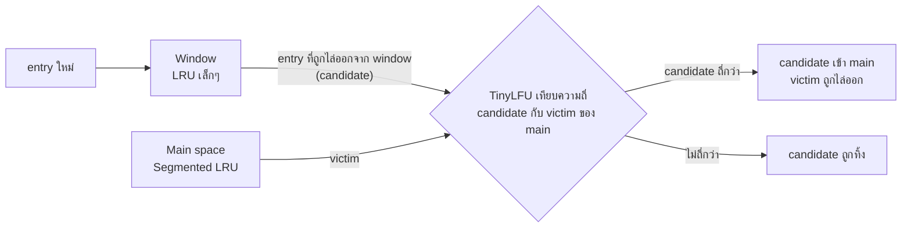

---
tags:
  - java
  - cache
  - caffeine
  - performance
type: reference
created: 2026-10-03
---

# ⚡ Java Caffeine — cache ในหน่วยความจำของแอป

> **Caffeine คือไลบรารี cache ในหน่วยความจำของ Java (open source)** เก็บข้อมูลแบบ key → value ไว้ใน RAM (heap) ของแอปเอง เร็วระดับไม่กี่ไมโครวินาทีหรือน้อยกว่า (ไม่มี network hop ไม่ต้อง serialize) และ**ไม่ต้องตั้ง server แยก** — เป็น cache ตัว default ของ `quarkus-cache` ([[Quarkus Redis]] ข้อ 2) และเป็น "L1" ในการวาง cache สองชั้น ([[Cache]] ข้อ 7)
>
> ตัวอย่างที่มีบล็อกผลลัพธ์กำกับใต้โค้ด **รันจริงกับ Caffeine 3.3.0 บน JDK 21** (คอมไพล์ด้วย `--release 17`) ส่วนที่เหลือเป็นรูปแบบการใช้ตามเอกสาร — ข้อเท็จจริงของไลบรารีอ้างจาก wiki/Javadoc/ซอร์สของโปรเจกต์เอง

---

## 1. ทำไมไม่ใช้ `ConcurrentHashMap` เป็น cache ตรงๆ

`ConcurrentMap` เก็บทุกอย่างที่ใส่ไว้**จนกว่าจะสั่งลบเอง** ส่วน `Cache` ถูกออกแบบมาให้ **evict อัตโนมัติเพื่อจำกัด memory** — นี่คือความต่างหลัก Caffeine เพิ่มของที่ cache จริงจังต้องมีให้ครบ:

| ความสามารถ | ตัวอย่าง |
|---|---|
| ไล่ของออกเมื่อเต็ม (ตามจำนวนหรือ weight) | `maximumSize(10_000)` |
| หมดอายุตามเวลา | `expireAfterWrite` / `expireAfterAccess` / `expireAfter(Expiry)` |
| โหลดค่าให้เองตอน miss (sync หรือ async) | `get(key, loader)`, `LoadingCache`, `AsyncLoadingCache` |
| reload เบื้องหลังโดยคืนค่าเก่าไปก่อน | `refreshAfterWrite` |
| ผูกกับ GC | `weakKeys` / `weakValues` / `softValues` |
| แจ้งเมื่อของถูกลบ | `removalListener` / `evictionListener` |
| สถิติ (hit rate ฯลฯ) | `recordStats()` |

### เร็วแค่ไหน

ตัวเลขจาก [benchmark ของโปรเจกต์เอง](https://github.com/ben-manes/caffeine/wiki/Benchmarks) (JMH, อ่าน 100%, cache แบบมี maximum size, เครื่อง Xeon E5-2698B v3 16 core — เครื่องเก่า และผู้พัฒนาวัดเอง ใช้ดูลำดับความต่างเท่านั้น):

| cache | ops/s (8 thread) | ops/s (16 thread) |
|---|---|---|
| Caffeine | 181,703,298 | 382,355,194 |
| Guava (default) | 12,434,655 | 10,647,238 |
| `LinkedHashMap` แบบ LRU | 9,209,065 | 13,598,576 |

คำนวณคร่าวๆ จาก 382 ล้าน ops/s บน 16 thread ≈ **หลักสิบนาโนวินาทีต่อการอ่านหนึ่งครั้ง** — ของจริงจะช้ากว่านี้เพราะมี GC, cache miss, loader เข้ามาเกี่ยว แต่ก็ยังอยู่ในระดับไมโครวินาทีที่ไม่ต้องข้ามเครือข่ายเหมือน Redis

---

## 2. เริ่มใช้

```xml
<dependency>
    <groupId>com.github.ben-manes.caffeine</groupId>
    <artifactId>caffeine</artifactId>
    <version>3.3.0</version>   <!-- ออก 2026-09-21 — เช็กเวอร์ชันล่าสุดก่อนใช้ -->
</dependency>
```

**Java 11 ขึ้นไปใช้ `3.x` ต่ำกว่านั้นใช้ `2.x`** (ตาม README — เช็กจาก class file ของ 3.3.0 แล้วเป็น Java 11 baseline จริง) ถ้าใช้ผ่าน Quarkus ไม่ต้องใส่เอง `quarkus-cache` พาไลบรารีนี้มาให้ (ข้อ 8)

มี 4 รูปแบบ เลือกตามว่า "ใครเป็นคนโหลดค่า" และ "ช้าแค่ไหน":

| แบบ | สร้างด้วย | เหมาะกับ |
|---|---|---|
| `Cache` (manual) | `.build()` | คุมเอง: `getIfPresent` / `put` / `get(key, fn)` / `invalidate` |
| `LoadingCache` | `.build(loader)` | มีวิธีโหลดมาตรฐานอันเดียวต่อ cache |
| `AsyncCache` | `.buildAsync()` | คืน `CompletableFuture` เหมาะกับงานช้า/reactive |
| `AsyncLoadingCache` | `.buildAsync(loader)` | async + loader ประจำ cache |

```java
Cache<String, User> users = Caffeine.newBuilder()
        .maximumSize(10_000)
        .expireAfterWrite(Duration.ofMinutes(5))
        .recordStats()
        .build();

users.getIfPresent("u1");                                   // null (ยังไม่มี)
for (int i = 0; i < 3; i++) {
    users.get("u1", id -> { dbCalls.incrementAndGet(); return new User(id, "สมชาย"); });
}
users.invalidate("u1");
```

```
getIfPresent(u1) ก่อน put = null
เรียก get 3 ครั้ง แต่ยิง 'DB' กี่ครั้ง = 1
หลัง invalidate = null
stats = CacheStats{hitCount=2, missCount=3, loadSuccessCount=1, loadFailureCount=0, totalLoadTime=69100, evictionCount=0, evictionWeight=0}
```

**ใช้ `cache.get(key, k -> value)` เป็นหลัก** (wiki แนะนำ) ไม่ใช่ `getIfPresent` แล้วค่อย `put` เอง เพราะมัน atomic — ข้อ 3

---

## 3. `get(key, loader)` — กัน stampede ภายในเครื่อง (single-flight)

8 thread ขอ key เดียวกันพร้อมกัน ขณะที่ loader ช้า (200 ms):

```java
Cache<String, String> sf = Caffeine.newBuilder().build();
// 8 thread เรียกพร้อมกัน
sf.get("hot", k -> { loads.incrementAndGet(); sleep(200); return "value"; });
```

```
8 thread ขอพร้อมกัน loader ถูกเรียกกี่ครั้ง = 1
```

ตาม Javadoc: การเรียกทั้งหมดเป็น atomic → **function ถูกเรียกอย่างมากหนึ่งครั้งต่อ key** และการ update บางอย่างของ thread อื่นอาจถูกบล็อกระหว่างคำนวณ จึง **"ควรสั้นและเบา"** และ **ห้ามแก้ cache ตัวเองระหว่างคำนวณ** (ดูกับดักข้อ 5–6)

**แก้ stampede ได้แค่ภายใน JVM เดียว** — ถ้ามี 5 instance แต่ละ instance ยังโหลดจาก DB หนึ่งครั้งต่อ key (รวม 5) วิธีแก้ระดับข้ามเครื่องดู [[Cache]] ข้อ 5

`AsyncCache` ก็ทำแบบเดียวกัน — ผู้เรียกที่ขอ key เดิมระหว่างกำลังโหลดจะได้ `CompletableFuture` ตัวเดียวกัน (รันจริง: `f1 == f2` เป็น `true`)

---

## 4. Eviction — ไล่อะไรออก

### 4.1 ตามขนาด

```java
.maximumSize(10_000)                                            // นับจำนวน entry
.maximumWeight(10_000).weigher((Key k, Graph g) -> g.vertices().size())   // นับตาม weight
```

- **weight ถูกคำนวณตอนเขียน/อัปเดตแล้วคงที่** และใช้แค่ตัดสินว่า "เกินความจุหรือยัง" — **ไม่ได้ใช้เลือกว่าจะไล่ตัวไหน**
- Javadoc เตือนว่า cache **อาจไล่ก่อนถึงเพดาน หรือเกินเพดานชั่วคราวระหว่างไล่** — อย่าใช้ `maximumSize` เป็นตัวเลข memory ที่เป๊ะ
- `maximumSize(0)` = ไล่ทันทีหลังโหลด ใช้ปิด cache ชั่วคราวตอนเทสต์ได้โดยไม่แก้โค้ด

### 4.2 ไม่ใช่ LRU — Window TinyLFU

LRU ง่ายและใช้ได้ดีในหลายเคส แต่ **hit rate แย่เมื่อเจอ scan** (อ่านของใหม่ไหลผ่านเป็นจำนวนมากแล้วไม่กลับมาใช้อีก) — ของที่ใช้บ่อยจริงถูกดันออกหมด Caffeine ใช้ **Window TinyLFU**: ของใหม่ต้อง "พิสูจน์ตัว" ก่อนได้ที่ใน main space



ความถี่เก็บใน **4-bit CountMinSketch** (ใช้ประมาณ 8 byte ต่อ entry และไม่เก็บ key ที่ถูกไล่ไปแล้ว) ขนาด window กับ main **ปรับเองตาม workload** (hill climbing) — แถมสุ่มรับ ~1% ของ candidate ที่ถูกปฏิเสธและมีความถี่ปานกลาง กันถูกโจมตีด้วย hash collision (ตาม [Design wiki](https://github.com/ben-manes/caffeine/wiki/Design))

**ทดลองให้เห็นภาพ** — cache ขนาด 100, hot key 50 ตัว, scan key 10,000 ตัวที่ใช้ครั้งเดียว, ทุก 100 key ที่ scan มีรอบใช้ hot key ทั้ง 50 ตัว เทียบกับ LRU (`LinkedHashMap` แบบ access-order):

| workload | Caffeine | LRU |
|---|---|---|
| hot key กลับมาทุก 100 key ที่ scan | **100%** hit | **0%** |
| (control) hot key กลับมาทุก 40 key ที่ scan | 100% | 100% |
| ขนาด 1,000, hot 500 ตัว (สุ่มเลือก), scan 200,000 ตัว, รอบ hot ทุก 1,000 key | 100% | 36.7% |

LRU ได้ 0% เพราะระหว่างรอบ hot มี key ใหม่ไหลผ่าน 100 ตัว > ที่ว่างของ cache จึงดัน hot key ออกหมด ส่วน control (40 key) ที่ว่างพอ LRU ก็รอดเช่นกัน — **เป็น workload สังเคราะห์ที่เลือกมาให้เห็นกลไก** ไม่ใช่ตัวเลขที่จะเจอในงานจริง (ผล simulation บน trace จริงดู [Efficiency wiki](https://github.com/ben-manes/caffeine/wiki/Efficiency)) และ Design wiki ระบุว่า **cache ที่ยังเต็มไม่ถึง 50% policy ยังไม่เปิดเต็มที่** (frequency sketch ยังไม่ถูกสร้าง)

### 4.3 ตามเวลา

| ตัวตั้งค่า | นับจาก | เหมาะกับ |
|---|---|---|
| `expireAfterWrite(d)` | ตอนสร้าง/แทนค่าล่าสุด | ข้อมูลที่เก่าแล้วไม่ควรใช้ — **เลือกอันนี้เป็นค่าเริ่มต้น** |
| `expireAfterAccess(d)` | ตอนอ่านหรือเขียนล่าสุด | ข้อมูลผูกกับ session ที่หมดอายุเมื่อไม่มีใครใช้ |
| `expireAfter(Expiry)` | คำนวณต่อ entry | เวลาหมดอายุกำหนดโดยของภายนอก (เช่น token) |

**กับดัก `expireAfterAccess`:** key ที่ถูกอ่านถี่ตัวจับเวลาถูกรีเซ็ตทุกครั้ง → **ไม่มีวันหมดอายุ ข้อมูลเก่าค้างตลอด** ถ้าต้องการความสด ใช้ `expireAfterWrite` หรือ `refreshAfterWrite` (ข้อ 6)

### 4.4 ตาม reference (ผูกกับ GC)

`weakKeys()` / `weakValues()` / `softValues()` — ปล่อยให้ GC เก็บ entry ได้ ข้อควรรู้: **เปรียบเทียบด้วย identity (`==`) แทน `equals()`** และ **ใช้กับ `AsyncCache` ไม่ได้** wiki แนะนำให้ใช้ maximum size แทน soft reference เพราะคาดเดาพฤติกรรมง่ายกว่า

---

## 5. หมดอายุ "จริงๆ" เกิดตอนไหน — lazy maintenance

**Caffeine ไม่ลบของหมดอายุทันที** — มันทำงานเก็บกวาดเล็กๆ ตอนมีการเขียน หรือตอนอ่านเป็นบางครั้งถ้าไม่ค่อยมีการเขียน (ตาม [Cleanup wiki](https://github.com/ben-manes/caffeine/wiki/Cleanup)) cache ที่ traffic สูงไม่ต้องห่วง แต่ **cache ที่เงียบ** จะเก็บของหมดอายุไว้ในหน่วยความจำ และ removal listener ก็แจ้งช้า

เทสต์ด้วยเวลาปลอม ไม่ต้องรอจริง:

```java
// Ticker มีเมธอดเดียว long read() คืนนาโนวินาที
static final class FakeTicker implements Ticker {
    private final AtomicLong nanos = new AtomicLong();
    @Override public long read() { return nanos.get(); }
    void advance(Duration d) { nanos.addAndGet(d.toNanos()); }
}

Cache<String, String> ttl = Caffeine.newBuilder()
        .expireAfterWrite(Duration.ofMinutes(10))
        .executor(Runnable::run)      // maintenance รันบน thread เดียวกัน → deterministic
        .ticker(ticker)
        .build();
ttl.put("a", "1"); ttl.put("b", "2"); ttl.put("c", "3");

ticker.advance(Duration.ofMinutes(9));
ttl.getIfPresent("a");        // ยังอยู่
ticker.advance(Duration.ofMinutes(2));          // รวม 11 นาที
ttl.estimatedSize();          // ยังไม่มีใครแตะ
ttl.getIfPresent("a");        // อ่านดู
ttl.cleanUp();                // สั่งเก็บกวาด
ttl.estimatedSize();
```

```
ผ่านไป 9 นาที   getIfPresent(a) = 1
ผ่านไป 11 นาที  estimatedSize ก่อนมีใครแตะ = 3     ← ยังนับของที่หมดอายุแล้ว
ผ่านไป 11 นาที  getIfPresent(a) = null            ← แต่อ่านแล้วได้ null เสมอ (ความถูกต้องไม่เพี้ยน)
หลัง cleanUp()  estimatedSize = 0
```

`estimatedSize()` เป็นค่าประมาณและอาจนับของที่รอลบ (Javadoc แนะนำ `cleanUp()` ก่อนถ้าต้องการให้แม่นขึ้น) — ที่เพี้ยนได้คือ **ขนาด/เวลาแจ้ง listener ไม่ใช่ค่าที่อ่านออกมา**

### ถ้าอยากให้ลบทันเวลา — `Scheduler`

```java
.scheduler(Scheduler.systemScheduler())     // Java 9+ ใช้ thread จัดเวลาของระบบ
.expireAfterWrite(Duration.ofMillis(200))
```

รันจริงกับ cache ที่ไม่มีใครแตะเลย (TTL 200 ms):

| เวลา | ไม่มี scheduler | มี `Scheduler.systemScheduler()` |
|---|---|---|
| +0.6 s | size = 1 | size = 1 |
| +1.2 s | size = 1 | size = 1 → ที่ ~1.23 s listener แจ้ง `EXPIRED` |
| +1.7 s | size = 1 | size = 0 |
| +3.2 s | size = 1 (จนกว่าเรียก `cleanUp()`) | size = 0 |

**TTL 200 ms แต่ลบที่ ~1.2 s** — สอดคล้องกับ pacing ของ scheduler ที่กันไม่ให้รันถี่เกินไป (ในซอร์ส 3.3.0 `Pacer.TOLERANCE` ≈ 1.07 วินาที) และเอกสารบอกว่าเป็น best-effort ไม่รับประกันเวลา สรุป: **ใช้ `Scheduler` เมื่อต้องการให้ของหมดอายุถูกเก็บ "ภายในราวหนึ่งวินาที" ไม่ใช่ตรงเป๊ะ**

**Executor:** งาน maintenance, removal listener และการโหลดแบบ async รันบน `ForkJoinPool.commonPool()` เป็นค่าเริ่มต้น (เปลี่ยนด้วย `.executor(...)`) — **ไม่ใช่ thread ของผู้เรียก** ถ้า listener แตะของที่ผูกกับ request context จะไม่เจอ (ดู [[Quarkus Thread Pool]] ข้อ 4)

---

## 6. Refresh — คืนค่าเก่าไปก่อน แล้ว reload เบื้องหลัง

```java
LoadingCache<String, String> rc = Caffeine.newBuilder()
        .refreshAfterWrite(Duration.ofMinutes(1))   // มีสิทธิ์ reload หลัง 1 นาที
        .expireAfterWrite(Duration.ofMinutes(5))    // กันของเก่าค้างถ้าไม่มีใครมาขอเลย
        .executor(refreshPool)
        .ticker(ticker)
        .build(k -> loadFromSource(k));
```

```
get ครั้งแรก                      = v1
เลย 1 นาที get ทันที              = v1   ← ค่าเก่า (reload กำลังรันเบื้องหลัง)
รอ reload เสร็จแล้ว get อีกครั้ง   = v2
```

ต่างจาก expire ตรงที่ **expire บังคับให้ผู้เรียกรอโหลดใหม่ ส่วน refresh คืนค่าเก่าให้ก่อนโดยไม่ต้องรอ** — คือ stale-while-revalidate ในเครื่อง (เทียบ [[Cache]] ข้อ 5):

- refresh **เริ่มก็ต่อเมื่อมีคนมาอ่าน** key นั้น — ถ้าไม่มีใครอ่านหลังถึงเวลา ของจะค่อยๆ หมดอายุไปเอง (จึงควรใส่ `expireAfterWrite` คู่กันเสมอ)
- ถ้า reload โยน exception → **เก็บค่าเก่าไว้ และแค่ log + กลืน exception**
- ต้องการใช้ค่าเก่าช่วยคำนวณค่าใหม่ → override `CacheLoader.reload(K, V)`; สั่ง `cache.refresh(key)` เองได้และจะ dedupe ถ้ามีงานค้างอยู่
- **สังเกตจากการรันจริง:** ถ้าตั้ง `executor(Runnable::run)` ตอนเทสต์ reload จะรันบน thread ของผู้เรียกที่เป็นคนกระตุ้น ผู้เรียกจึงเห็น `v2` ทันที ไม่ใช่ค่าเก่า — จะทดสอบ "คืนค่าเก่า" ต้องใช้ executor จริง

---

## 7. Removal listener และสถิติ

เรียกให้ชัดตามศัพท์ของ Caffeine: **eviction** = ถูกไล่ตาม policy · **invalidation** = ผู้เรียกสั่งลบ · **removal** = ทั้งสองอย่างรวมกัน

| `RemovalCause` | เกิดเมื่อ | `wasEvicted()` |
|---|---|---|
| `SIZE` | เกินความจุ | true |
| `EXPIRED` | หมดอายุ | true |
| `COLLECTED` | GC เก็บ (weak/soft) | true |
| `EXPLICIT` | เรียก `invalidate*` | false |
| `REPLACED` | `put` ค่าใหม่ทับ key เดิม | false |

(`SIZE`/`REPLACED`/`EXPLICIT`/`EXPIRED` รันจริงครบทั้งสี่ตัว)

- `removalListener(...)` ทำงาน **แบบ async** บน executor ส่วน `evictionListener(...)` ทำงาน **sync พร้อมการไล่** และแจ้งเฉพาะกรณี `wasEvicted() == true`
- exception ใน listener ถูก log แล้วกลืน

```java
Cache<Key, Graph> graphs = Caffeine.newBuilder()
        .maximumSize(10_000)
        .recordStats()
        .build();
graphs.stats().hitRate();           // สัดส่วน hit
graphs.stats().evictionCount();     // จำนวนที่ถูกไล่
graphs.stats().averageLoadPenalty() // เวลาโหลดเฉลี่ย
```

wiki แนะนำให้**จับตาสถิติเหล่านี้ใน cache ที่ performance สำคัญ** (ไว้จูน `maximumSize`) — ต่อกับ Micrometer/Prometheus/Dropwizard ได้ ([Statistics wiki](https://github.com/ben-manes/caffeine/wiki/Statistics))

---

## 8. ใช้กับ Quarkus (`quarkus-cache`)

backend default ของ `quarkus-cache` คือ Caffeine (`quarkus.cache.type=caffeine`) — annotation `@CacheResult`/`@CacheInvalidate` ที่ใช้ใน [[Quarkus Redis]] ข้อ 2 วิ่งบน Caffeine เบื้องหลัง (และตัว annotation เองคือ [[Quarkus Interceptor]]) ตั้งค่าต่อ cache ได้:

```properties
quarkus.cache.caffeine."product".maximum-size=10000
quarkus.cache.caffeine."product".expire-after-write=5M
quarkus.cache.caffeine."product".metrics-enabled=true
```

| property (`quarkus.cache.caffeine."ชื่อ cache".*`) | ความหมาย |
|---|---|
| `initial-capacity` | ขนาดเริ่มต้นของโครงสร้างภายใน |
| `maximum-size` | จำนวน entry สูงสุด |
| `expire-after-write` | หมดอายุหลังสร้าง/แทนค่า |
| `expire-after-access` | หมดอายุหลังไม่ถูกอ่าน/เขียน |
| `metrics-enabled` | เปิดเก็บสถิติ |

ตั้งแบบ global (ไม่ใส่ชื่อ cache) ได้เป็นค่าเริ่มต้น และ override ต่อ cache

**⚠️ เอกสาร Quarkus ระบุว่า "By default, caches do not perform any type of eviction if not configured"** — ไม่ตั้ง `maximum-size`/`expire-after-write` = ไม่มีการไล่ข้อมูลออกเลย memory โตไปเรื่อยๆ (เหมือนข้อ "ค่า default ไม่มี TTL" ใน [[Quarkus Redis]])

เข้าถึงตัว Caffeine ตรงๆ เมื่อ annotation ไม่พอ:

```java
@Inject @CacheName("my-cache") Cache cache;                 // io.quarkus.cache.Cache

cache.as(CaffeineCache.class).setMaximumSize(10_000);       // API เฉพาะ Caffeine
// CaffeineCache มี: keySet(), getIfPresent(key), put(key, CompletableFuture),
//                   setExpireAfterWrite/Access(Duration), setMaximumSize(long)
```

Quarkus 3.33 LTS ขึ้นไปเลือก backend ต่างกันต่อ cache ในแอปเดียวได้ (Caffeine สำหรับข้อมูล hot + Redis สำหรับข้อมูลแชร์ข้าม instance — ตามโน้ต [[Quarkus Updates]])

---

## 9. Caffeine vs Redis — เลือกยังไง

| | Caffeine (ในโปรเซส) | Redis (ภายนอก) |
|---|---|---|
| อยู่ที่ไหน | heap ของ JVM แต่ละ instance | server แยก ทุก instance เห็นชุดเดียวกัน |
| ความเร็ว | ไม่มี network ไม่ serialize | ข้ามเครือข่าย + serialize ทุกครั้ง |
| เก็บอะไร | object reference ตรงๆ | bytes/JSON |
| ตอน restart | หายหมด (cold start) | อยู่ต่อได้ถ้าเปิด persistence |
| กิน memory ของ | heap แอป (กระทบ GC) | RAM ของ Redis |
| หลาย instance | ต่างคนต่างมี → ข้อมูลอาจไม่ตรงกัน | ชุดเดียว |
| invalidate | ต้องประกาศข้าม instance เอง | ลบที่เดียว ทุกเครื่องเห็น |

**เริ่มด้วย Caffeine เสมอ** (ตรงกับ [[Quarkus Redis]] ข้อ 2) ย้าย/เพิ่ม Redis เมื่อมีเหตุผลชัด: ต้องแชร์ข้ามเครื่อง, cache ใหญ่เกิน heap, หรือต้องอยู่รอดข้าม restart — และใช้สองชั้นพร้อมกันได้ ([[Cache]] ข้อ 7) ตัวอย่างในวอลต์: [[URL Shortener (Quarkus)]] เดิมวางแผนใช้ Caffeine (traffic แบบ Zipf ทำให้ local cache เล็กๆ ก็ hit rate สูง) แล้วเลือก Redis แทนเพื่อ**ฝึก Redis** ไม่ใช่เพราะจำเป็นด้าน scale

---

## 🎯 แนวทางการเริ่มศึกษา

1. **เริ่มต้น** — เข้าใจ 3 อย่างก่อนแตะโค้ด: (1) `Cache` ไม่ใช่ `Map` — มันไล่ของออกเองเพื่อจำกัด memory (2) pattern `get(key, loader)` — miss แล้วโหลดครั้งเดียว (3) expire (บังคับโหลดใหม่) ต่างจาก refresh (คืนค่าเก่าไปก่อน) แล้วจำกฎเดียว: **ตั้ง `maximumSize` และ `expireAfterWrite` ทุกครั้ง**
2. **ลงมือทำจริง** — เอา `Cache` ครอบการเรียกที่ช้า (query DB/เรียก API) ในโปรเจกต์เล็ก เปิด `recordStats()` แล้วพิมพ์ `hitRate()` หลังยิงโหลดจริง จากนั้นลองตัวอย่างในโน้ตนี้ทีละข้อ (โดยเฉพาะข้อ 3, 5, 6 ที่เห็นผลชัด)
3. **ใช้งานได้คล่อง** — เขียนเทสต์ด้วย `Ticker` + `executor(Runnable::run)` + `cleanUp()` (ข้อ 5), ดู `hitRate`/`evictionCount` เพื่อจูนขนาด, รู้ว่าเมื่อไหร่ต้องใช้ `Scheduler`, ระวัง cache ต่อ instance ไม่ตรงกัน (ข้อ 9) และอย่าเก็บ object ที่แก้ได้ (กับดักข้อ 7)

---

## กับดัก

1. **ไม่ตั้ง `maximumSize`/TTL = ไม่มีการไล่เลย** (Quarkus ก็เช่นกัน ข้อ 8) — memory โตจน OOM
2. **คิดว่าหมดอายุแล้วถูกลบทันที** — เป็น lazy maintenance (ข้อ 5) cache ที่เงียบเก็บของหมดอายุค้างและ listener แจ้งช้า ใช้ `Scheduler` (คาดว่าราว 1 วินาที) หรือ `cleanUp()`
3. **`expireAfterAccess` กับ key ที่ถูกอ่านถี่** ไม่มีวันหมดอายุ ข้อมูลเก่าค้าง (ข้อ 4.3)
4. **loader คืน `null` = ไม่ถูก cache** → key ที่ไม่มีใน DB ยิง DB ซ้ำทุกครั้ง ต้องทำ negative caching เอง ([[Cache]] ข้อ 6):

   ```
   loader คืน null            → ขอ 3 ครั้ง loader ถูกเรียก = 3 ครั้ง
   เก็บเป็น Optional.empty()   → loader ถูกเรียก = 1 ครั้ง
   ```
5. **เขียน cache ตัวเองใน loader (recursive update)** — `IllegalStateException: Recursive update` (รันจริงด้วย key เดียวกัน) ส่วนกรณีต่าง key อาจ livelock บน Java 8 หรือ exception บน Java 9+ ตาม [FAQ](https://github.com/ben-manes/caffeine/wiki/Faq) ทางแก้คือเก็บ `CompletableFuture` ใน `AsyncCache` แล้วคำนวณนอก atomic scope
6. **loader ช้า/บล็อกนาน** — thread อื่นที่แตะ key เดียวกันถูกบล็อกตาม (Javadoc: "ควรสั้นและเบา") งาน IO ช้าให้ใช้ `AsyncLoadingCache`
7. **cache เก็บ reference ไม่ใช่สำเนา** — แก้ object ที่ได้ออกมา = แก้ของใน cache (รันจริง: เพิ่ม `"oops"` เข้า list แล้วใน cache เห็นด้วย) ใช้ `record` + collection แบบ immutable ([[Java Record]], [[Java Value vs Reference]], [[Cache]] ข้อ 8)
8. **listener/maintenance ไม่ได้รันบน thread ของผู้เรียก** — เป็น `ForkJoinPool.commonPool()` โดย default และ exception ถูกกลืน (ข้อ 5, 7)
9. **`weakKeys`/`weakValues`/`softValues` เปลี่ยนเป็น identity (`==`)** และใช้กับ `AsyncCache` ไม่ได้ (ข้อ 4.4)
10. **ต่อ instance ไม่ใช่ต่อระบบ** — หลายเครื่องข้อมูลไม่ตรงกัน และ `invalidate` ไม่ข้ามเครื่อง → TTL สั้น / ประกาศ invalidate / ใช้ Redis (ข้อ 9)
11. **ทดสอบ refresh ด้วย direct executor** แล้วเห็นค่าใหม่ทันที (ข้อ 6) — ต้องใช้ executor จริงถึงจะเห็นพฤติกรรม "คืนค่าเก่า"

---

## Cheat sheet

```java
Cache<K, V> cache = Caffeine.newBuilder()
        .maximumSize(10_000)                       // ตั้งเสมอ — ไม่ตั้ง = ไม่ไล่
        .expireAfterWrite(Duration.ofMinutes(5))   // ตั้งเสมอ — กันของเก่าค้าง
        .recordStats()                             // เปิดไว้ดู hitRate
        .build();

V v = cache.get(key, k -> load(k));                // miss → โหลดครั้งเดียวต่อ key (ในเครื่อง)
cache.invalidate(key);
cache.stats().hitRate();

// เทสต์: เวลาปลอม + maintenance บน thread เดียวกัน
Caffeine.newBuilder().ticker(fakeTicker).executor(Runnable::run)/* ... */.build();
cache.cleanUp();                                   // สั่งเก็บกวาดทันที
```

| อาการ | สาเหตุ |
|---|---|
| memory โตไม่หยุด | ไม่ได้ตั้ง `maximumSize`/expire (Quarkus default ก็ไม่ไล่) |
| ตั้ง TTL แล้วแต่ size/listener ไม่ขยับตามเวลา | expiry เป็น lazy — cache เงียบ → `Scheduler` หรือ `cleanUp()` |
| key ที่ไม่มีใน DB ยิง DB ซ้ำทุกครั้ง | loader คืน `null` ไม่ถูก cache → `Optional`/sentinel |
| `IllegalStateException: Recursive update` | loader เขียน cache ตัวเอง |
| ข้อมูลเก่าค้างทั้งที่ตั้ง `expireAfterAccess` | key ถูกอ่านถี่ → ตัวจับเวลารีเซ็ต → ใช้ `expireAfterWrite`/`refreshAfterWrite` |
| แก้ object แล้วคนอื่นเห็นด้วย | cache เก็บ reference → immutable |
| เครื่อง A กับ B เห็นข้อมูลไม่ตรงกัน | cache ต่อ instance → TTL สั้น/broadcast/Redis |
| เทสต์ refresh ได้ค่าใหม่ทันที | `executor(Runnable::run)` ทำให้ reload รันบน thread เดียวกัน |

---

## 🔗 เกี่ยวข้อง

- [[Cache]] — pattern ทั่วไป: stampede (ข้อ 5), negative caching (ข้อ 6), L1/L2 (ข้อ 7), cache key + mutable (ข้อ 8)
- [[Quarkus Redis]] — `quarkus-cache`/`@CacheResult` (ข้อ 2) ที่ใช้ Caffeine เป็น default
- [[Quarkus Interceptor]] — `@CacheResult` ทำงานเป็น CDI interceptor
- [[Quarkus Updates]] — Quarkus 3.33 เลือก cache backend ต่อ cache ได้
- [[Redis]] — cache ภายนอก ใช้แชร์ข้าม instance
- [[Java Lambda]] — loader เป็น lambda / method reference
- [[Java Record]] — key/value แบบ immutable พร้อม `equals`/`hashCode`
- [[Java Value vs Reference]] — ทำไม cache ถึงเก็บ reference
- [[Java Date Time]] — `Duration` ที่ใช้ตั้งเวลา
- [[Quarkus Thread Pool]] — ทำไม listener บน thread อื่นแตะ request context ไม่ได้
- [[URL Shortener (Quarkus)]] — โปรเจกต์ที่ตัดสินใจเรื่อง Caffeine vs Redis
- [[Java]] — หน้ารวม

## 📖 อ่านต่อ

- [Caffeine — GitHub](https://github.com/ben-manes/caffeine) (README + wiki)
- wiki: [Population](https://github.com/ben-manes/caffeine/wiki/Population) · [Eviction](https://github.com/ben-manes/caffeine/wiki/Eviction) · [Refresh](https://github.com/ben-manes/caffeine/wiki/Refresh) · [Removal](https://github.com/ben-manes/caffeine/wiki/Removal) · [Cleanup](https://github.com/ben-manes/caffeine/wiki/Cleanup) · [Testing](https://github.com/ben-manes/caffeine/wiki/Testing) · [FAQ](https://github.com/ben-manes/caffeine/wiki/Faq) · [Efficiency](https://github.com/ben-manes/caffeine/wiki/Efficiency) · [Design](https://github.com/ben-manes/caffeine/wiki/Design) · [Benchmarks](https://github.com/ben-manes/caffeine/wiki/Benchmarks)
- [Quarkus — Application data caching](https://quarkus.io/guides/cache)
- [TinyLFU: A Highly Efficient Cache Admission Policy (arXiv:1512.00727)](http://arxiv.org/pdf/1512.00727.pdf)
- [Caffeine บน Maven Central (รายการเวอร์ชัน)](https://repo1.maven.org/maven2/com/github/ben-manes/caffeine/caffeine/)
