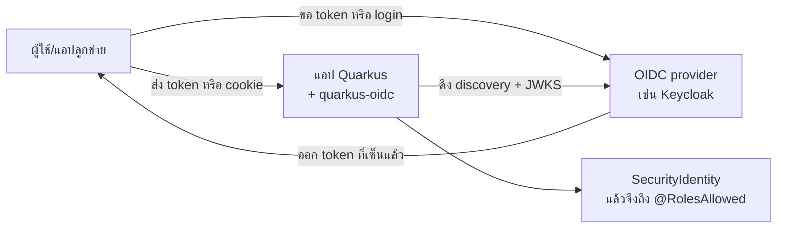

---
tags:
  - quarkus
  - security
  - auth
  - oidc
type: reference
created: 2026-10-20
---

# 🪪 Quarkus OIDC — `quarkus-oidc` คืออะไร และเกี่ยวกับ auth ตรงไหน

**สถานะการตรวจ** 🔎 อ่านจากคู่มือ Quarkus ([Bearer token](https://quarkus.io/guides/security-oidc-bearer-token-authentication), [Authorization code flow](https://quarkus.io/guides/security-oidc-code-flow-authentication)) เมื่อ 2026-10-20 · ▶️ ผลทดลองที่อ้างมาจาก [[Auth Flow Spec 1 — Own Accounts]] (Quarkus 3.33.4) · 🧠 คำอธิบายเชิงภาพรวมที่ผมเรียบเรียงเอง · คู่มือสองฉบับยาวมาก ผมอ่านถึงประมาณ 100,000 ตัวอักษรแรก หัวข้อท้ายคู่มือ (SPA, logout แบบต่าง ๆ, session management) ไม่ได้อ่าน

---

## 1. คืออะไร (ย่อ)

`quarkus-oidc` คือ extension ที่ทำให้แอป Quarkus **ไม่ต้องเก็บรหัสผ่านและไม่ต้องตรวจ login เอง** แต่ไปเชื่อ OIDC provider (Keycloak, Auth0, Entra ID, Google ฯลฯ) แทน แอปทำหน้าที่เป็น "ผู้ตรวจ" ว่า token หรือการ login ที่มาถึงนั้นออกโดย provider จริงและยังไม่หมดอายุ

- **ไม่ใช่ตัว provider** — ไม่ออก token ไม่มีหน้า login ไม่จัดการ user (นั่นคืองานของ [[Keycloak]])
- **ไม่ใช่ตัวเรียก API ข้างนอก** — ถ้าแอปต้องไปขอ token มาเรียกบริการอื่น เป็นอีก extension คือ `quarkus-oidc-client` (ดู [[Quarkus REST Client]])

---

## 2. เกี่ยวอะไรกับ auth

คำศัพท์สามตัวที่มักปนกัน (รายละเอียดเต็มอยู่ที่ [[OAuth 2.0]] และ [[Auth Flow Spec 2 — OAuth OIDC]]):

| ตัว | เป็นอะไร | ตอบคำถามอะไร |
|---|---|---|
| OAuth 2.0 | กรอบการ **มอบสิทธิ์** | "แอปนี้ได้รับอนุญาตให้ทำอะไรแทนผู้ใช้" |
| OpenID Connect (OIDC) | ชั้น **ยืนยันตัวตน** ที่สร้างบน OAuth 2.0 (มี ID token, userinfo, discovery) | "ผู้ใช้คนนี้คือใคร" |
| `quarkus-oidc` | ตัวทำงานฝั่ง Quarkus ที่พูดโปรโตคอลสองตัวบน | "request นี้มาจากใคร มีสิทธิ์อะไร" |

ภายในแอป `quarkus-oidc` เสียบเข้ากับระบบ security ของ Quarkus (ดู [[Quarkus Security]]) โดยเป็น mechanism ที่อ่าน credential (bearer token หรือ cookie ของ session) ตรวจแล้วสร้าง `SecurityIdentity` ให้ จากนั้น `@RolesAllowed`, `SecurityIdentity`, `permission` ใน config ใช้ได้เหมือน auth แบบอื่น 🧠 — ชั้น `Uni`/`IdentityProvider` ที่เจอใน [[Auth Flow Spec 1 — Own Accounts]] ข้อ A4 เป็นของที่ extension เขียนไว้ให้แล้ว คุณแค่ตั้ง config ไม่ต้องเขียนโค้ด reactive



---

## 3. สามโหมด (`quarkus.oidc.application-type`) 🔎

| โหมด | ใครเรียกแอป | credential ที่รับ | ใช้กับ |
|---|---|---|---|
| `service` | แอปอื่น / SPA ที่ถือ token มาเอง | `Authorization: Bearer <token>` | REST API ล้วน |
| `web-app` | เบราว์เซอร์ของคน | redirect ไป provider (authorization code flow) แล้วถือ session cookie | เว็บที่ server ส่ง HTML |
| `hybrid` | ทั้งสองแบบ | มี bearer → ใช้ bearer, ไม่มี → เริ่ม code flow | แอปที่มีทั้งหน้าเว็บและ API |

Config ขั้นต่ำ (ค่าตัวอย่าง `localhost` ตามคู่มือ):

```properties
# service (ตรวจ bearer token)
quarkus.oidc.auth-server-url=http://localhost:8180/realms/quarkus
quarkus.oidc.client-id=quarkus-app
quarkus.oidc.application-type=service

# web-app (login ผ่านเบราว์เซอร์) — เพิ่ม secret ของ client
quarkus.oidc.application-type=web-app
quarkus.oidc.credentials.secret=<secret>
```

`auth-server-url` ชี้ไปที่ base URL ของ provider แล้ว Quarkus ต่อ `/.well-known/openid-configuration` เพื่อค้นหา endpoint ทั้งหมดเอง (ปิดได้ด้วย `discovery-enabled=false` แล้วตั้ง `jwks-path`, `introspection-path` เอง)

---

## 4. โหมด service: Quarkus ตรวจอะไรใน bearer token 🔎

1. ลายเซ็น — ดึง JWK set จาก provider แล้วเลือกกุญแจตาม `kid` ใน header ของ token (รีเฟรชชุดกุญแจได้อย่างมากทุก `quarkus.oidc.token.forced-jwk-refresh-interval` ค่าเริ่มต้น 10 นาที)
2. `exp` — หมดอายุหรือยัง (ตรวจหลังลายเซ็น)
3. `iss` — ตรงกับ issuer ที่ค้นเจอ หรือค่า `quarkus.oidc.token.issuer` ที่ตั้งไว้ (คู่มือเตือนให้ข้ามการตรวจนี้ด้วย `issuer=any` เมื่อไม่มีทางอื่นจริง ๆ เท่านั้น)
4. `aud` — ตรวจเมื่อตั้ง `quarkus.oidc.token.audience` (คู่มือแนะนำให้ตั้ง `client-id` เพราะช่วยให้ตรวจ audience ได้)

**token แบบ opaque** (ไม่ใช่ JWT) ตรวจเองไม่ได้ ต้องส่งไปถาม introspection endpoint ของ provider ทุกครั้ง (ช้ากว่าแต่เพิกถอนได้ทันที เทียบกับ JWT ที่ [[Auth Flow Spec 1 — Own Accounts]] ข้อ A5/A6)

**role ใน token → `@RolesAllowed`**: ค่าเริ่มต้นอ่านจาก claim `groups`, `realm_access/roles` หรือ `resource_access/<client-id>/roles` ปรับด้วย `quarkus.oidc.roles.role-claim-path` หรือ `quarkus.oidc.roles.source` (ตัวอย่างและกับดัก realm/client role อยู่ที่ [[Quarkus Keycloak]])

โค้ดฝั่งใช้งาน:

```java
@Inject JsonWebToken jwt;          // อ่าน claim เช่น jwt.getSubject()

@GET @RolesAllowed("user")
public String me() { return jwt.getSubject(); }
```

---

## 5. โหมด web-app: authorization code flow 🔎

1. ผู้ใช้เข้าหน้าที่ป้องกันไว้ → Quarkus redirect ไปหน้า login ของ provider
2. ผู้ใช้ login ที่ provider (รหัสผ่านไม่ผ่านแอปเรา) → provider ส่ง **code** กลับมา
3. Quarkus เอา code ไปแลก ID token / access token / refresh token (หลังบ้าน แบบ confidential client)
4. เก็บ token ไว้ใน **session cookie ที่เข้ารหัส** (ตัวจัดการค่าเริ่มต้น `TokenStateManager`) เบราว์เซอร์ไม่เห็น token ตัวจริง
5. request ถัด ๆ ไปใช้ cookie นี้ และ Quarkus ใช้ refresh token ต่ออายุให้เมื่อจำเป็น

ค่าที่ควรรู้: `quarkus.oidc.authentication.pkce-required=true` (เปิด PKCE) คู่กับ `quarkus.oidc.authentication.state-secret` (ความยาว 32 ตัวอักษร ใช้เข้ารหัส code verifier ใน state cookie) · state cookie อายุเริ่มต้น 5 นาที · ถ้า token ใหญ่จน cookie เกิน 4KB ใช้ `quarkus.oidc.token-state-manager.split-tokens=true` · `token-state-manager.encryption-secret` ควรยาวอย่างน้อย 32 ตัวอักษร · logout แบบ RP-initiated ใช้ `quarkus.oidc.end-session-path`

ข้อนี้คือสิ่งที่ [[Auth Flow Spec 2 — OAuth OIDC]] ข้อ B2 เรียกว่า BFF: ให้ Quarkus เป็นฝั่งที่ถือ token แทน SPA ซึ่งเป็นแนวทางที่ RFC 10017 แนะนำอย่างหนักสำหรับเว็บที่รันบนเบราว์เซอร์ (ตามสเปคที่ผมตรวจไว้)

---

## 6. เลือกโหมดไหน

| สถานการณ์ | โหมด |
|---|---|
| มีแค่ REST API ให้แอปอื่นหรือ SPA เรียก | `service` |
| เว็บที่ server เรนเดอร์ HTML หรือ Quarkus เป็น BFF ให้ SPA | `web-app` |
| หน้าเว็บ + API ในแอปเดียวกัน | `hybrid` |
| SPA ที่ถือ token เอง (ไม่ใช้ BFF) | ฝั่ง API ใช้ `service` และ SPA ใช้ไลบรารีฝั่ง Angular (ดู [[Quarkus Keycloak]]) — แต่ลองเทียบ BFF ก่อน |

---

## 7. ลองและทดสอบ

- **Dev Services for Keycloak**: ตอน dev/test Quarkus สตาร์ต Keycloak ใน container ให้เอง สร้าง realm `quarkus` กับ client `quarkus-app` และผู้ใช้ทดลอง (alice, bob) โดยไม่ต้องตั้งอะไร (ต้องมี Docker) 🔎
- ทางเลือกทดสอบ: WireMock (`quarkus-test-oidc-server`), `@TestSecurity` กับ `@OidcSecurity` 🔎
- ปิด auth ตอนทดสอบ: ดู [[Quarkus Keycloak]] ข้อ 8

---

## 8. ต่างกับ `quarkus-smallrye-jwt` ยังไง 🧠

| | `quarkus-oidc` | `quarkus-smallrye-jwt` |
|---|---|---|
| รู้จัก provider ผ่าน | discovery + JWKS ที่รีเฟรชเองได้ | ตั้ง public key / issuer ใน config เอง |
| login ผ่านเบราว์เซอร์ (code flow) | มี | ไม่มี ตรวจ token อย่างเดียว |
| opaque token / introspection | มี | ไม่มี |
| เหมาะกับ | มี IdP จริง (Keycloak ฯลฯ) | ออก/ตรวจ JWT เอง ดู ▶️ ใน [[Auth Flow Spec 1 — Own Accounts]] ข้อ A6 |

---

## 🎯 แนวทางการเริ่มศึกษา

1. **เริ่มต้น** — เข้าใจก่อนแตะโค้ด: (ก) OAuth 2.0 มอบสิทธิ์ vs OIDC ยืนยันตัวตน (ข) JWT คืออะไรและตรวจด้วยกุญแจสาธารณะยังไง (ค) ความต่างของ `service` กับ `web-app` ว่าใครถือ token
2. **ลงมือทำจริง** — ทำตาม [[Quarkus Keycloak]]: Keycloak ใน Docker + API `service` ที่ป้องกันด้วย `@RolesAllowed` ยิงด้วย `curl` ขอ token จริงแล้วลองส่ง token ผิด/หมดอายุดูว่าได้ 401 หรือ 403 จากนั้นลองเปลี่ยนเป็น `web-app` เห็น redirect และ cookie ใน DevTools
3. **ใช้งานได้คล่อง** — ตั้ง `aud`/`issuer` ให้ถูก, เข้าใจ opaque vs JWT, ต่ออายุ token, logout ให้ครบ, multi-tenancy, ต่อ `quarkus-oidc-client` เรียกบริการอื่น, และอ่านชุดทดลองโจมตีใน [[Auth Flow Spec 2 — OAuth OIDC]]

---

## กับดัก

- **ตั้ง `application-type` ผิดโหมด** — API ที่ตั้งเป็น `web-app` จะ redirect ไปหน้า login แทนตอบ 401
- **role ไม่เจอ** — role ถูกเก็บคนละที่ (realm กับ client) กับที่ Quarkus อ่าน ดู `roles.source` / `role-claim-path`
- **ข้ามการตรวจ issuer** (`issuer=any`) เพราะ URL ไม่ตรงกันระหว่าง container กับเครื่องตัวเอง — แก้ที่ต้นเหตุ ไม่ใช่ปิดการตรวจ
- **ไม่ตั้ง `client-id` / audience** — token ที่ออกให้แอปอื่นอาจใช้กับเราได้ (ประเด็นเดียวกับ `aud` ใน A6 ▶️ ของ SmallRye JWT ส่วนค่าเริ่มต้นของ `quarkus-oidc` ผมยังไม่ได้ทดสอบ)
- **ใช้ opaque token โดยไม่คิดเรื่องโหลด** — ทุก request ไปถาม provider
- **cookie ของ session โต** — เกิน 4KB ทำให้ login วนหรือพัง ใช้ `split-tokens`
- **ลืม `state-secret` / `encryption-secret` ยาวพอ** (32 ตัวอักษร)
- **ลองกับ Keycloak ใน container แล้ว issuer ไม่ตรง** — URL ที่แอปมองเห็นกับที่ browser เห็นต้องสอดคล้องกัน

## Cheat sheet

```properties
quarkus.oidc.auth-server-url=<base URL ของ realm/tenant>
quarkus.oidc.client-id=<client>
quarkus.oidc.application-type=service|web-app|hybrid
quarkus.oidc.credentials.secret=<secret>           # web-app / confidential client
quarkus.oidc.token.audience=<aud ของเรา>
quarkus.oidc.token.issuer=<ถ้า issuer ไม่ตรงกับ discovery>
quarkus.oidc.roles.role-claim-path=<path ของ claim role>
quarkus.oidc.authentication.pkce-required=true
quarkus.oidc.authentication.state-secret=<32 ตัวอักษร>
quarkus.oidc.token-state-manager.split-tokens=true
quarkus.oidc.end-session-path=<logout endpoint>
```

## 🔗 เกี่ยวข้อง

- [[Quarkus Keycloak]] — ลงมือจริง: Keycloak + Angular + Quarkus
- [[Quarkus Security]] — `SecurityIdentity`, `@RolesAllowed`, permission
- [[OAuth 2.0]] — grant type และ provider
- [[Keycloak]] — ตัว provider
- [[Quarkus REST Client]] — `quarkus-oidc-client` สำหรับเรียกบริการอื่น
- [[Auth Flow Spec 2 — OAuth OIDC]] — OIDC เชิงลึก, BFF, ตัวตรวจ ID token, logout
- [[Quarkus]]

## 📖 แหล่งอ้างอิง

- [Quarkus — OIDC bearer token authentication](https://quarkus.io/guides/security-oidc-bearer-token-authentication)
- [Quarkus — OIDC authorization code flow](https://quarkus.io/guides/security-oidc-code-flow-authentication)
- [Quarkus — OIDC configuration properties](https://quarkus.io/guides/security-oidc-configuration-properties-reference)
