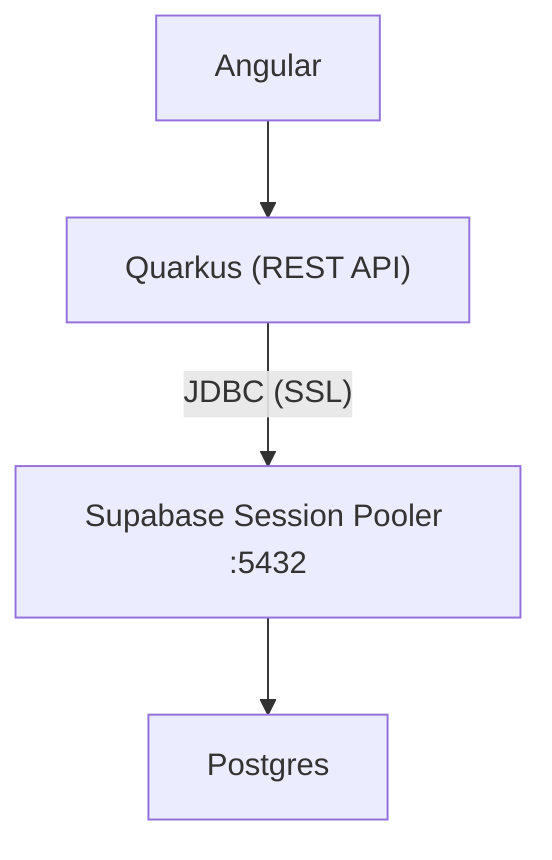
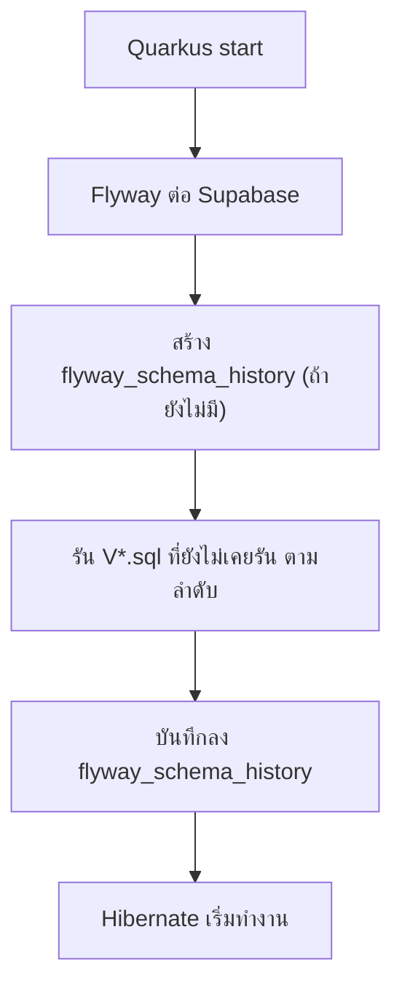

---
tags:
  - quarkus
  - flyway
  - supabase
  - postgres
  - database
type: reference
created: 2026-10-04
---

# 🔌 Quarkus + Flyway เชื่อมต่อ Supabase

> แนวคิดหลัก: **Flyway เป็นเจ้าของ schema** ส่วน Supabase เป็นแค่ Postgres ที่มีคนดูแล server ให้
> Schema อยู่ใน Git → Supabase แค่รันตามไฟล์ migration

ที่มา: โน้ตที่ผู้ใช้แปะเข้ามา (2026-10-04) — กล่อง **💬 เพิ่มตอนบันทึก** คือสิ่งที่เพิ่มจากการเช็กเอกสารตอนบันทึกลง vault ไม่ได้มาจากต้นฉบับ (แหล่งอ้างอิงอยู่ท้ายโน้ต)



---

## 1. ตั้งค่า Supabase Project (Security)

| Setting | ค่า | เหตุผล |
|---|---|---|
| Enable Data API | ❌ ปิด | Quarkus คือ API อยู่แล้ว ไม่ต้องมี REST อัตโนมัติ (ตัดประตูหลังเข้า DB) |
| Automatically expose new tables | ❌ ปิด | ป้องกันตารางใหม่ถูก grant ให้ `anon` อัตโนมัติ |
| Enable automatic RLS | ✅ เปิด | ชั้นป้องกันสำรอง ไม่กระทบ Quarkus เพราะ owner ของตารางข้าม RLS |

> Warning "Client libraries need Data API" ไม่กระทบเรา เพราะ Quarkus ต่อ Postgres ตรงผ่าน JDBC
> ถ้าวันหน้าจะใช้ `supabase-js` / Supabase Auth / Realtime ค่อยกลับมาเปิด Data API และเขียน RLS policy

> 💬 **เพิ่มตอนบันทึก:** ตัวเลือกกลุ่มนี้เป็นของใหม่ — ตาม [changelog ของ Supabase](https://supabase.com/changelog/45329-breaking-change-tables-not-exposed-to-data-and-graphql-api-automatically) เริ่มให้เลือกไม่ expose ตารางใหม่ให้ Data API ตั้งแต่ 28 เม.ย. 2026, กลายเป็นค่า default ของโปรเจกต์ใหม่ตั้งแต่ 30 พ.ค. 2026 และจะบังคับกับ**โปรเจกต์เดิม**ตั้งแต่ 30 ต.ค. 2026 (ชื่อตัวเลือกใน changelog คือ "Automatically expose new tables and functions" — ปิด = ตารางไม่ถูก expose จนกว่าจะ `GRANT` เอง) ไม่กระทบ Quarkus ที่ต่อ JDBC ตรง ชื่อ/หน้าตาใน dashboard อาจเปลี่ยนอีก ให้เทียบกับของจริงก่อนทำตาม

---

## 2. เลือก Connection Method

Supabase Dashboard → **Connect** → แท็บ **Direct** → Connection Method → **Session pooler** → Type: **JDBC**

| แบบ | Host / Port | ใช้ได้ไหม |
|---|---|---|
| Direct connection | `db.<ref>.supabase.co:5432` | ❌ IPv6 only → `UnknownHostException` บนเครือข่าย IPv4 |
| Transaction pooler | `*.pooler.supabase.com:6543` | ❌ Flyway มีปัญหาเรื่อง lock / prepared statement |
| **Session pooler** | `*.pooler.supabase.com:5432` | ✅ ใช้ตัวนี้ |

เช็กว่าเลือกถูก:
- host เป็น `...pooler.supabase.com`
- port `5432`
- user เป็น `postgres.<project-ref>`

> 💬 **เพิ่มตอนบันทึก:** [เอกสาร Supabase](https://supabase.com/docs/guides/database/connecting-to-postgres) ระบุว่างานอย่าง migration / `pg_dump` ควรใช้ **Direct connection** ถ้าเครือข่ายของคุณรองรับ IPv6 (หรือซื้อ IPv4 add-on) — Session pooler คือทางเลือกสำหรับเครือข่าย IPv4-only ซึ่งเป็นกรณีของโน้ตนี้ ส่วน Transaction mode เอกสารระบุตรงๆ ว่า "does not support prepared statements" ตรงกับเหตุผลในตาราง

---

## 3. Dependency (`pom.xml`)

```xml
<dependency>
    <groupId>io.quarkus</groupId>
    <artifactId>quarkus-jdbc-postgresql</artifactId>
</dependency>
<dependency>
    <groupId>io.quarkus</groupId>
    <artifactId>quarkus-flyway</artifactId>
</dependency>
<!-- Flyway 10+ แยก module ตาม DB -->
<dependency>
    <groupId>org.flywaydb</groupId>
    <artifactId>flyway-database-postgresql</artifactId>
</dependency>
```

---

## 4. `.env` (root project ระดับเดียวกับ `pom.xml`)

```properties
SUPABASE_DB_URL=jdbc:postgresql://<pooler-host>:5432/postgres?sslmode=require
SUPABASE_DB_USER=postgres.<project-ref>
SUPABASE_DB_PASSWORD=<db-password>
```

- host ต้อง copy จาก Supabase (`aws-0` / `aws-1` และ region อาจต่างกัน)
- password แยกจาก URL แล้ว → ไม่ต้อง percent-encode อักขระพิเศษ
- **`.env` ต้องอยู่ใน `.gitignore`** — ทำ `.env.example` (ไม่มีค่าจริง) ไว้ commit แทน

> 💬 **เพิ่มตอนบันทึก:** ไฟล์ `.env` ที่ Quarkus อ่านได้มีผลเฉพาะตอน dev บนเครื่องนั้น ไม่ถูก build เข้า artifact — ตอน deploy ให้ตั้งชื่อตัวแปรเดียวกัน (`SUPABASE_DB_URL` ฯลฯ) เป็น **environment variable จริง** บน server/container (ดู [[Quarkus Config]])
---

## 5. `application.properties`

```properties
# ---------- Datasource ----------
quarkus.datasource.db-kind=postgresql
quarkus.datasource.jdbc.url=${SUPABASE_DB_URL:jdbc:postgresql://localhost:5432/postgres}
quarkus.datasource.username=${SUPABASE_DB_USER:postgres}
quarkus.datasource.password=${SUPABASE_DB_PASSWORD:}
# Free plan connection น้อย
quarkus.datasource.jdbc.max-size=5

# ---------- Hibernate ----------
# ให้ Flyway คุม schema คนเดียว
quarkus.hibernate-orm.schema-management.strategy=none
%dev.quarkus.hibernate-orm.log.sql=true

# ---------- Flyway ----------
quarkus.flyway.migrate-at-start=true
quarkus.flyway.baseline-on-migrate=true
quarkus.flyway.baseline-version=0
```

### ทำไมต้อง baseline?
Schema `public` ของ Supabase ไม่ว่างตั้งแต่แรก (มี function ของ automatic RLS) → Flyway ปฏิเสธถ้าไม่ baseline

### ทำไม `baseline-version=0`?
Default คือ `1` → Flyway จะถือว่า `V1` รันไปแล้วและ**ข้ามไปเงียบ ๆ** (ตารางไม่ถูกสร้าง แต่ไม่มี error)

```text
baseline-version=1 (default) → V1 ถูกข้าม ❌
baseline-version=0           → รัน V1, V2, V3 ... ตามปกติ ✅
```

> 💬 **เพิ่มตอนบันทึก:**
> (ก) `quarkus.hibernate-orm.schema-management.strategy` คือ**ชื่อใหม่**ของ `quarkus.hibernate-orm.database.generation` (เปลี่ยนใน Quarkus 3.23 — ชื่อเก่ายังใช้ได้แต่ deprecated และจะถูกถอดหลังผ่านไปอีกไม่กี่เวอร์ชัน ตาม [Migration Guide 3.23](https://github.com/quarkusio/quarkus/wiki/Migration-Guide-3.23)) ถ้าเจอตัวอย่างเก่าบนเว็บให้เปลี่ยนเป็นชื่อใหม่
> (ข) เอกสาร Flyway ระบุว่า migration ที่ version เท่ากับหรือต่ำกว่า baseline จะถูกข้าม ([baseline-on-migrate](https://documentation.red-gate.com/fd/flyway-baseline-on-migrate-setting-277578974.html)) — จึงต้อง `baseline-version=0` ถึงจะรัน `V1`
> (ค) คำอธิบายของ property นี้ใน Quarkus ระบุว่ามันจะถูกเมินถ้ามีตาราง `flyway_schema_history` อยู่แล้ว หรือ schema ปัจจุบันว่างเปล่า — ถ้า `public` ไม่มีอะไรอยู่ก่อน Flyway จะ migrate ตามปกติโดยไม่ baseline (เปิดทิ้งไว้ไม่เสียหาย แต่ควรปิดหลังเริ่มใช้ ตาม [[Quarkus Flyway]] ข้อ 7)

---

## 6. Migration Files

```text
src/main/resources/db/migration/
├── V1__create_customer.sql
├── V2__create_order.sql
└── V3__add_phone_to_customer.sql
```

```sql
-- V1__create_customer.sql
CREATE TABLE customer (
    id          BIGSERIAL PRIMARY KEY,
    name        VARCHAR(255) NOT NULL,
    created_at  TIMESTAMPTZ  NOT NULL DEFAULT now()
);
```

**ไม่ต้องสร้างตารางใน Supabase เอง** — Flyway สร้างให้ตอน Quarkus start



Log ที่ควรเห็น:
```text
Creating Schema History table "public"."flyway_schema_history" with baseline ...
Migrating schema "public" to version "1 - create customer"
```

---

## 7. Error ที่เจอและวิธีแก้

| Error | สาเหตุ | แก้ |
|---|---|---|
| `UnknownHostException: db.xxx.supabase.co` | ใช้ Direct connection (IPv6 only) | เปลี่ยนเป็น Session pooler |
| `password authentication failed` | username ไม่มี `.<project-ref>` | ใช้ `postgres.<project-ref>` |
| `Found non-empty schema(s) "public" but no schema history table` | Supabase มีของใน `public` อยู่ก่อน | `baseline-on-migrate=true` + `baseline-version=0` |
| `Max client connections reached` | pool ใหญ่เกิน / หลาย instance | ลด `jdbc.max-size` |
| `Migration checksum mismatch` | แก้ไฟล์ migration ที่รันไปแล้ว | สร้างไฟล์ `V` ใหม่แทนการแก้ไฟล์เก่า |

ถ้าแก้ URL แล้ว error ยังเห็น host เดิม → เช็กค่าที่ override:
- prefix `%dev.` / `%prod.` ใน `application.properties`
- ไฟล์ `.env`
- env var `QUARKUS_DATASOURCE_JDBC_URL`
- jar เก่าที่ยังไม่ build ใหม่

### อ่าน Stack Trace จาก exception ล่างสุด

| Exception ล่างสุด | ความหมาย | ไปเช็กที่ |
|---|---|---|
| `UnknownHostException` | DNS หา host ไม่เจอ | ชื่อ host / IPv4-IPv6 / DNS |
| `ConnectException: Connection refused` | เจอ host แต่ port ปิด | port / firewall / service |
| `SocketTimeoutException` | ไม่มีใครตอบ | firewall drop / network |
| `password authentication failed` | ต่อถึงแต่ login ไม่ผ่าน | username / password |

---

## 8. ข้อควรระวัง

- **ห้ามสร้าง/แก้ตารางผ่าน Supabase Table Editor** — ใช้ Dashboard แค่ดูข้อมูล
- **ห้ามแก้ไฟล์ migration ที่รันไปแล้ว** — สร้าง `V` ใหม่เสมอ
- **ห้ามใช้ `flyway clean` / `clean-at-start`** — อาจลบ schema ระบบของ Supabase (`auth`, `storage`)
- **ห้าม commit password / `.env` / `service_role` key ลง Git** — ถ้าหลุดให้ reset password ทันที
- `log.sql` ใส่เฉพาะ `%dev`
- `validate-in-dev-mode` ปล่อยเป็น default (`true`) ไว้ จะเตือนเมื่อ Entity ไม่ตรงกับตารางจริง
- ถ้าไป K8s หลาย pod → พิจารณาแยก migration เป็น Job / init container แทน `migrate-at-start` (ดู [[Quarkus Flyway]] ข้อ 9)

> 💬 **เพิ่มตอนบันทึก:** `quarkus.flyway.clean-disabled` **default เป็น `false`** ([ดูในซอร์สของ Quarkus](https://github.com/quarkusio/quarkus/blob/main/extensions/flyway/runtime/src/main/java/io/quarkus/flyway/runtime/FlywayDataSourceRuntimeConfig.java) และ [Quarkus guide](https://quarkus.io/guides/flyway)) — ไม่ตั้ง = `clean` ทำงานได้เลย จึงควรใส่ `%prod.quarkus.flyway.clean-disabled=true` เองเสมอ (ดู [[Quarkus Flyway]] ข้อ 5) ส่วนขอบเขตของ `clean` คือ schema ที่ Flyway จัดการ ([`schemas`](https://documentation.red-gate.com/fd/environment-schemas-setting-277578932.html); จาก log ในข้อ 6 คือ `public`) — ไม่แตะ `auth`/`storage` ถ้าไม่ได้ตั้งให้ครอบ แต่ `public` เองก็มี object ของ Supabase ปนอยู่ (เช่น function ของ automatic RLS) ซึ่ง `clean` จะลบไปด้วย เหตุผลนี้พอแล้วที่จะห้ามใช้

---

## หลักที่ใช้ได้กับทุก Managed DB

1. **Schema อยู่ใน Git** ไม่ใช่ใน Dashboard
2. **Migration tool ต้องการ session mode** (ไม่ใช่ transaction pooler)
3. **Baseline ให้ถูก version** — ของเดิมไม่เกี่ยวกับ migration เรา → `0`
4. **เปิดเฉพาะช่องทางที่ใช้จริง** — อะไรที่ "auto expose" ถือว่าเป็น attack surface

---

## 🔗 เกี่ยวข้อง

- [[Supabase]] — Supabase คืออะไร, RLS, `anon` vs `service_role` key (โน้ตนี้ใช้ Supabase เป็นแค่ Postgres ไม่ใช้ส่วนอื่น)
- [[Quarkus Flyway]] — schema history, ชื่อไฟล์ `V`/`R`, baseline (ข้อ 7), ความเสี่ยง `migrate-at-start` (ข้อ 9), `clean-disabled` (ข้อ 5)
- [[Quarkus Hibernate]] — ทำไมต้องให้ Flyway คุม schema คนเดียว (`schema-management.strategy=none`)
- [[Quarkus Config]] — `.env`, profile `%dev`/`%prod`, ลำดับความสำคัญของ config source
- [[CI-CD Secrets]] — เก็บ password/secret นอก Git
- [[LINE Slip Bot]] — โปรเจกต์ Greenhouse ที่ใช้ stack นี้ (Quarkus + Flyway + Supabase เป็นแค่ Postgres) ดู [[Design Spec]]

## 📖 แหล่งอ้างอิง

ที่ใช้เช็กกล่อง 💬:

- [Supabase — Connect to your database](https://supabase.com/docs/guides/database/connecting-to-postgres)
- [Supabase changelog — Tables not exposed to Data and GraphQL API automatically](https://supabase.com/changelog/45329-breaking-change-tables-not-exposed-to-data-and-graphql-api-automatically)
- [Quarkus — Using Flyway](https://quarkus.io/guides/flyway)
- [Quarkus — Using Hibernate ORM and Jakarta Persistence](https://quarkus.io/guides/hibernate-orm)
- [Quarkus Migration Guide 3.23](https://github.com/quarkusio/quarkus/wiki/Migration-Guide-3.23) — เปลี่ยนชื่อ `database.generation` → `schema-management.strategy`
- [Flyway — Baseline On Migrate setting](https://documentation.red-gate.com/fd/flyway-baseline-on-migrate-setting-277578974.html)
- [Flyway — Environment Schemas setting](https://documentation.red-gate.com/fd/environment-schemas-setting-277578932.html)
